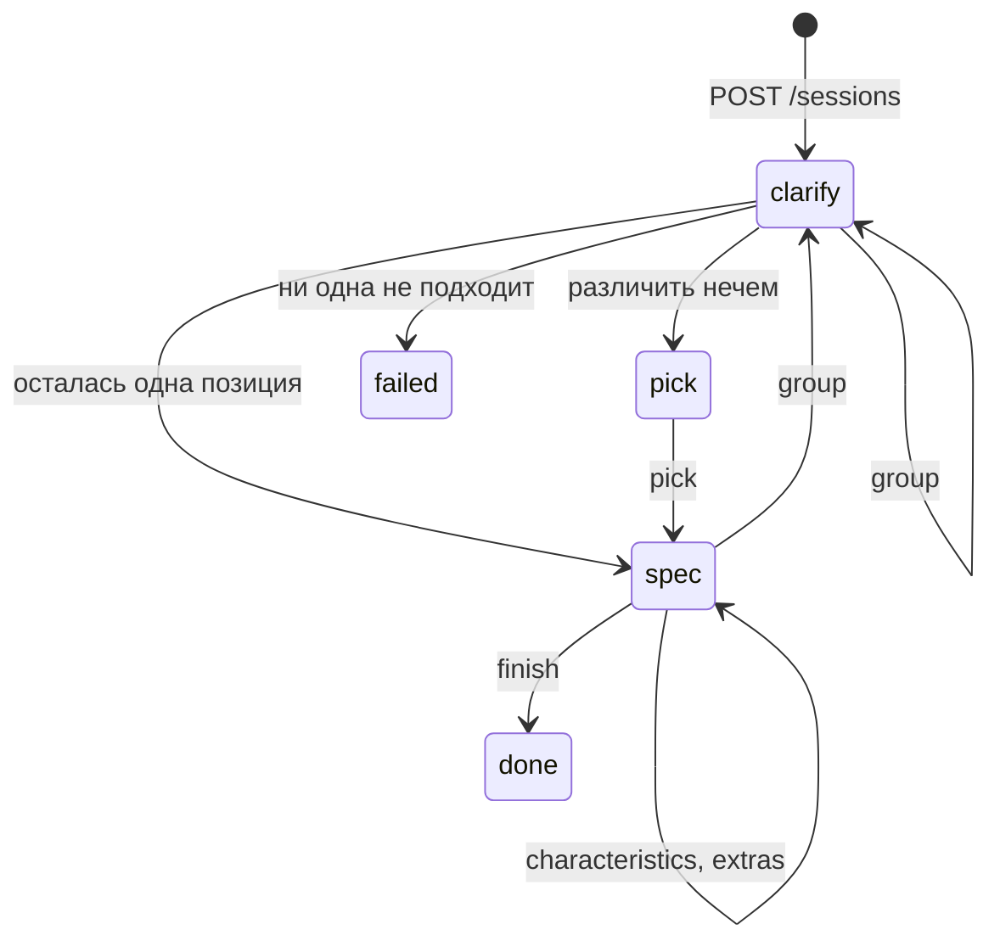

# RAG по справочнику КТРУ

Прототип подбора позиции КТРУ по описанию товара от поставщика. Поставщик пишет описание
коротко или подробно, сервис находит подходящие позиции каталога и ранжирует их, затем спрашивает поставщика о
характеристиках, пока не останется один код КТРУ. Затем заказчик выбирает значения изменяемых
характеристик и добавляет свои, а LLM проверяет добавленные на корректность.

Прототип: тестов нет. Прежний проект (бэкенд, фронтенд, сервисы, docs) лежит в `legacy/` и с этим кодом не связан.

## Как устроен поиск

```mermaid
flowchart LR
    A[Описание поставщика] --> B[Haiku: опечатки и ошибки]
    B --> C[Эмбеддинг запроса<br/>Qwen3-Embedding-8B]
    C --> D[Косинус по 60 087 позициям]
    D --> E[200 кандидатов →<br/>группы по названию → top-20]
    E --> F[Sonnet: ранжирование]
    F --> G[Позиции с relevance и причиной]
    G --> H[Вопросы поставщику<br/>по неизменяемым характеристикам]
    H --> I[Один код КТРУ]
    I --> J[Выбор значений kind=2/3<br/>и свои характеристики]
    J --> K[Sonnet: проверка своих]
```



1. **Исправление** (`preprocess.py`). Haiku правит опечатки, единицы и явные логические ошибки.
   Противоречия, которые нельзя исправить однозначно, не трогает, а возвращает в `issues` —
   их надо уточнить у поставщика.
2. **Эмбеддинг запроса** (`search.py`). К запросу добавляется инструкция
   `Instruct: … Query: …`, как требует Qwen3-Embedding. Тексты позиций кодируются без неё.
3. **Поиск** (`Index.search`). Векторы нормированы, поэтому косинус — это `vectors @ q`.
   Берётся 200 лучших кандидатов, позиции с одинаковым `name` склеиваются в группу, на выходе
   20 групп.
4. **Ранжирование** (`rerank.py`). Sonnet получает описание и карточки 20 групп (название,
   ОКПД2, характеристики) и возвращает JSON: `id`, `relevance` 0..100, `reason`.
5. **Уточнение** (`clarify.py`, `rag-ask`). Лучшая группа раскрывается в группу КТРУ: шаблон
   (`isTemplate`) и его конечные позиции по `parentPositionInfo`. Конечные позиции различаются
   неизменяемыми характеристиками (`kind=1`, у конечной позиции — одно значение), поэтому
   вопросы задаются только по ним: сначала обязательные, затем те, у которых больше вариантов.
   Haiku сначала сопоставляет с вариантами само описание (`extract`). Ответ номером варианта идёт
   без модели, ответ текстом — в Haiku отдельным вызовом (`answer`): характеристики с вариантами
   и ответ. В схеме на каждую характеристику — массив из `enum` её значений (а не номеров),
   пустой, если ответ о ней молчит, и `comment` — пояснение, что выбрано или почему выбрать
   нельзя. Если по заданной характеристике ничего не выбрано, вопрос повторяется. Позиции без
   заданной характеристики не отсеиваются.
   Цикл идёт, пока не останется одна позиция или различающих характеристик. Характеристики
   `kind=2/3` выбирает заказчик, у поставщика они не спрашиваются.
   Если различающих характеристик не осталось, а позиций несколько, позицию выбирают по номеру.
6. **Характеристики закупки** (`spec.py`, `rag-ask`). У найденной позиции:
   - **Изменяемые характеристики КТРУ.** `kind=2` — одно значение из списка КТРУ, `kind=3` —
     несколько. Haiku заполняет их из описания и ответов поставщика. Дальше заказчик выбирает
     номер характеристики или пишет текстом сразу про несколько («угловой, для руководителя,
     эргономичный»): текст уходит в `answer` со всеми изменяемыми характеристиками. Без
     обязательных характеристик команда не завершается.
   - **Свои характеристики** (п. 5 Правил использования КТРУ, ПП РФ № 145): название, значение и
     необязательное обоснование. Sonnet получает карточку позиции с выбранными значениями и
     отклоняет характеристику, только если она дублирует КТРУ, противоречит ему, указывает
     товарный знак, производителя или страну (ст. 33 44-ФЗ), не относится к товару, субъективна
     или имеет неправдоподобное значение. Характеристика описывает конкретный товар поставщика,
     поэтому одно значение и пустое обоснование — не повод отклонять. Советы по уточнению
     (до двух) приходят в `warnings` и добавлению не мешают. Если характеристику можно
     исправить без нового значения (название, единица, запись), Sonnet предлагает исправление;
     оно тоже проходит проверку. Позиции с `noNewFeatures=true` (561
     позиция; по названию поля — запрет дополнительных характеристик) свои не принимают, LLM не
     вызывается.
   - **Подсказки своих характеристик** (`suggest.py`). У многих позиций КТРУ характеристик
     мало: у 7 832 из 60 087 их нет совсем, у 35 382 нет изменяемых. Поэтому на этапе
     характеристик сервис предлагает до 6 своих. Источник частот — выгрузки СТЕ организаторов
     («Примеры выгрузок»: инструменты, мебель, одежда, ~300 тыс. товаров). По TF-IDF названий
     берутся до 300 похожих СТЕ, считается доля товаров с каждой характеристикой; бренд,
     страна, модель, упаковка отбрасываются. Sonnet получает карточку позиции, описание и эти
     частоты, сначала решает, тот же ли это товар (строительный шпатель — не аналог
     медицинскому), и если нет — предлагает характеристики по своим знаниям. Значение берётся
     только из описания поставщика с дословной цитатой; цитату без совпадения с описанием код
     снимает, дубли КТРУ отбрасывает. Метка «СТЕ» с долей ставится, только если характеристика
     нашлась среди частот аналогов, иначе «ИИ». Принятая подсказка уходит в свои
     характеристики и проходит ту же проверку Sonnet. Без `data/ste.pkl` работает только ветка
     «ИИ».
   На выходе — JSON: код, ОКПД2, неизменяемые значения, выбранные значения, свои характеристики.

Шаги 5–6 — состояние диалога `Session` в `session.py`, без ввода-вывода. Поверх него — CLI
(`cli.py`, `rag-ask`) и HTTP API (`api.py`, `rag-api`).



## Что лежит в индексе

Источник — полная выгрузка КТРУ из ЕИС на 2026-10-03: `КТРУ xml.zip` с
[Яндекс.Диска организаторов](https://disk.yandex.ru/d/5Olg3IoYYf4loA), папка `КТРУ`.
Берутся только файлы `nsiKTRUNew_all_actual_*.xml` и в них только позиции со статусом
`ACTIVE` — 60 087 штук.

Текст позиции для эмбеддинга (`position_text` в `ktru.py`):

```
Струбцина
ОКПД2: 25.73.30.223 Струбцины
Рубрики: Хозяйственные товары
Тип: Винтовая; Магнитная; Корпусная; …
Максимальная глубина зажима: < 50 Миллиметр; ≥ 50 < 100 Миллиметр; …
```

Файлы в `data/` (в git не попадают):

| Файл | Размер | Что внутри |
|---|---|---|
| `ktru.zip` | 107 МБ | исходная выгрузка, кладётся вручную |
| `codes.json` | 1.5 МБ | номер строки → код КТРУ |
| `texts.json` | 46 МБ | тексты для эмбеддинга в том же порядке |
| `positions.pkl` | 77 МБ | код → `Position`: название, ОКПД2, единицы, характеристики |
| `raw.pkl` | 292 МБ | код → весь `<oos:position>` из XML как dict |
| `vectors.npy` | 492 МБ | эмбеддинги `(60087, 4096)`, float16, нормированы |
| `vectors.f32.npy` | 939 МБ | float32-копия для поиска, собирается сама |
| `vectors.done.npy` | 60 КБ | какие строки посчитаны, для докачки |
| `ste/*.xlsx` | 57 МБ | выгрузки СТЕ организаторов, кладутся вручную |
| `ste.pkl` | 635 МБ | СТЕ: название → характеристики, TF-IDF названий |

## Запуск

Нужны `uv` и залогиненный Claude Code: Agent SDK берёт его авторизацию.

```bash
cp .env.example .env
uv sync
```

В `.env` — ключ OpenAI-совместимого API эмбеддингов. По умолчанию это
`qwen/qwen3-embedding-8b` на polza.ai.

| Переменная | По умолчанию | Что задаёт |
|---|---|---|
| `EMBEDDINGS_URL` | `https://api.polza.ai/api/v1` | адрес `/embeddings` |
| `EMBEDDINGS_MODEL` | `qwen/qwen3-embedding-8b` | модель |
| `EMBEDDINGS_API_KEY` | — | ключ |
| `RAG_DATA` | `data` | папка с индексом |
| `EMBED_BATCH` | `32` | текстов в одном запросе `rag-embed` |
| `EMBED_CONCURRENCY` | `8` | параллельных запросов `rag-embed` |

### Собрать индекс

```bash
mkdir -p data && cp "<путь>/КТРУ xml.zip" data/ktru.zip
uv run rag-parse
uv run rag-embed
mkdir -p data/ste && cp "<путь>/Примеры выгрузок/"*.xlsx data/ste/
uv run rag-ste
```

- `rag-parse` — разбор zip в `positions.pkl`, `raw.pkl`, `codes.json`, `texts.json`, ~110 с.
  Если `codes.json` и `texts.json` уже есть, сверяет их с новыми: при расхождении
  векторы надо пересчитать.
- `rag-embed` — эмбеддинги всех текстов в `vectors.npy`. Прогресс сохраняется каждые 20
  батчей, после обрыва команда продолжает с того же места. Через polza — ~28 текстов/с.
- `rag-ste [папка]` — xlsx из `data/ste` (Лист1 — СТЕ, Лист2 — названия характеристик) в
  `ste.pkl`, ~140 с. Название и значение в СТЕ склеены («Материал рукояти Пластик»), граница
  ищется по самому длинному префиксу из названий Лист2 — так делится 99,9% записей.
  Категорийные характеристики Лист2 («Вид продукции») выкидываются. Необязательна: без неё
  подсказки идут только от модели.

### Команды

| Команда | Что делает |
|---|---|
| `uv run rag-rerank "описание"` | вся цепочка: исправление → поиск → ранжирование |
| `uv run rag-search "описание"` | только векторный поиск, top-20 групп с обязательными характеристиками |
| `uv run rag-ste` | индекс СТЕ для подсказок своих характеристик |
| `uv run rag-api` | HTTP API на `RAG_HOST:RAG_PORT`, по умолчанию `127.0.0.1:8100` |
| `uv run rag-ask "описание"` | вся цепочка в терминале: вопросы до одного кода КТРУ, выбор значений, свои характеристики с проверкой |
| `uv run rag-fix "описание"` | только исправление описания через Haiku |
| `uv run rag-hello` | проверка Agent SDK: Sonnet отвечает по JSON-схеме |
| `uv run rag` | проверка API эмбеддингов |

Пример:

```
$ uv run rag-rerank "струбцына винтовая, глубина зажима 100 кг, длинна 300мм"
исправлено: струбцина винтовая, глубина зажима 100 кг, длина 300 мм
  [typo] струбцына → струбцина
  [typo] длинна → длина
  ! «Глубина зажима» указана в килограммах … Требуется уточнение поставщика.

 1.  98 (было  1, cos 0.679) 25.73.30.223-00000013 Струбцина
 2.  30 (было  2, cos 0.543) 25.73.30.221-00000001 Тиски слесарные
```

## HTTP API

`uv run rag-api` загружает индекс при старте (~15 с), документация — `/docs`. Схема лежит в
[`openapi.json`](openapi.json); после правки `api.py` её пересобирают, индекс для этого не нужен:

```bash
uv run python -c "import json; from rag.api import app; print(json.dumps(app.openapi(), ensure_ascii=False, indent=2))" > openapi.json
```

Сессии живут в памяти процесса; изменения одной сессии идут по очереди под `asyncio.Lock`.

| Метод | Путь | Этап | Что делает |
|---|---|---|---|
| `POST` | `/sessions` | — | `{description}`: исправление, поиск, ранжирование, ответы из описания |
| `GET` | `/sessions/{id}` | любой | состояние сессии |
| `DELETE` | `/sessions/{id}` | любой | удалить сессию |
| `POST` | `/sessions/{id}/answer` | `clarify` | ответ на `question`: `{option}` с 1 (0 — не знаю) или `{text}` |
| `POST` | `/sessions/{id}/pick` | `clarify`, `pick` | `{code}` из `candidates` |
| `POST` | `/sessions/{id}/group` | до `done` | `{code}` из `groups`: уточнение заново в другой группе |
| `PATCH` | `/sessions/{id}/characteristics` | `spec` | `{values: {имя: [варианты]}}`, `[]` — сбросить |
| `PUT` | `/sessions/{id}/characteristics/number` | `spec` | `{name, value}`: число в единице КТРУ, сервер сам выбирает диапазон; `null` — сбросить |
| `POST` | `/sessions/{id}/characteristics/text` | `spec` | `{text, name?}`: разбор текста Haiku по всем характеристикам или одной |
| `POST` | `/sessions/{id}/extras` | `spec` | `{name, value, reason}`: проверка Sonnet; `accepted`, `problems`, `fixed` |
| `DELETE` | `/sessions/{id}/extras/{n}` | `spec` | удалить свою характеристику по номеру с 0 |
| `POST` | `/sessions/{id}/suggestions` | `spec`, `done` | подсказки своих характеристик, ~8 с; кешируются по сессии и коду, параллельные запросы ждут один вызов |
| `POST` | `/sessions/{id}/finish` | `spec` | итоговый JSON; 422, если не выбраны обязательные |

Ответ на все запросы, кроме `finish` и `extras`, — состояние сессии: `stage`, `groups` и `group`,
`question` с вариантами, `candidates`, `answers`, `position`, `characteristics` с `options`,
выбранными `values` и `origin` — откуда значение: `description` (разбор описания при входе в
`spec`), `assistant` (`describe` или сообщение помощнику), `manual` (`PATCH`), `extras`, `missing` — невыбранные обязательные, `message` — пояснение Haiku к
последнему ответу текстом. `fixed` у отклонённой характеристики не добавляется сам: его
отправляют в `extras` ещё раз.

Числовая характеристика, у которой все значения — диапазоны в одной единице, приходит с
`unit` и `bands` (границы и включённость краёв, по возрастанию); `options` идут в том же
порядке. `PUT …/number` ищет диапазон с числом внутри: край `≥` входит, `>` нет, так что
1500 при «≥ 1400 < 1500» и «≥ 1500 < 1600» попадает во второй. Пороги вида «≥ 30», «≥ 60»,
«≥ 90» пересекаются, и из подходящих берётся самый узкий: 75 → «≥ 60». Число вне всех
диапазонов даёт 422. Введённое число возвращается в `number` и уходит в `entered` итога
`finish`, пока выбранный диапазон не сменили другим способом. Фронт повторяет то же правило
в `field-kind.ts`, чтобы подсвечивать ошибку до запроса. Помощник (`describe`) кроме
диапазона просит у Haiku точное число в единице КТРУ («3 кВт» → 3000 при «Ватт»); если число
названо и попадает в диапазон, оно сохраняется как введённое, и диапазон берётся по нему.

КТРУ не ограничивает открытые диапазоны: 300 000 000 Вт формально попадает в «≥ 3000 Вт», и в
карточку уходит верный диапазон. Чтобы поймать лишние нули и перепутанные единицы, число
проверяется на правдоподобие, но не отклоняется. `warning` у характеристики (и `doubts` в
итоге `finish`): `large` — больше самой большой конечной границы в 10 раз, `small` —
положительное и меньше самой малой в 10 раз, `negative` — отрицательное при неотрицательных
границах. Интерфейс показывает предупреждение под полем и сохраняет значение. Поле ввода показывается для
одиночного выбора от пяти диапазонов, меньше — плитки.

Ошибки: 404 — нет сессии, 409 — действие не для текущего этапа, 422 — неверный ввод, 502 —
ошибка вызова модели.

```bash
curl -s localhost:8100/sessions -H 'content-type: application/json' -d '{"description": "стол"}'
curl -s localhost:8100/sessions/$ID/answer -H 'content-type: application/json' -d '{"text": "деревянный"}'
curl -s localhost:8100/sessions/$ID/characteristics/text -H 'content-type: application/json' \
  -d '{"text": "угловой, для руководителя, ЛДСП"}'
curl -s -X POST localhost:8100/sessions/$ID/finish
```

## Использование из кода

```python
import asyncio
from rag.preprocess import preprocess
from rag.rerank import rerank
from rag.search import Index, expand, query_vector

index = Index()
pre = asyncio.run(preprocess("струбцына винтовая"))
hits = index.search(asyncio.run(query_vector(pre.corrected)))
ranked = asyncio.run(rerank(pre.corrected, hits)).ranked

best = ranked[0].hit
best.position.code
best.raw["data"]["characteristics"]
best.raw["printForm"]["url"]
for member, diff in expand(best):
    member.position.code, diff
```

| Что | Где | Что возвращает |
|---|---|---|
| `Index()` | `search.py` | загружает векторы, `positions` и `raw` в память |
| `Index.search(vec, k=20)` | `search.py` | `list[Hit]`: группы по убыванию косинуса |
| `Index.leaves(position)` | `search.py` | конечные позиции группы КТРУ, в которую входит позиция |
| `questions(leaves, answers)` | `clarify.py` | `list[Question]`: неизменяемые характеристики, которые различают позиции |
| `narrow(leaves, answers)` | `clarify.py` | позиции, совместимые с ответами |
| `extract(text, questions)` | `clarify.py` | ответы из текста: имя характеристики → варианты |
| `answer(reply, questions)` | `clarify.py` | имя характеристики → выбранные варианты и пояснение |
| `changeable(position)` | `spec.py` | `list[Question]`: характеристики `kind=2/3` |
| `session.start(index, text)` | `session.py` | `Session`; остальные шаги — `reply`, `choose`, `pick`, `switch_group`, `set_values`, `describe`, `add_extra`, `remove_extra`, `finish` |
| `validate(position, chosen, extras, new)` | `spec.py` | `Verdict`: `ok`, `problems`, `fixed` — предложенное исправление |
| `Index.row(i)` | `search.py` | `(Position, raw)` по номеру строки индекса |
| `Hit` | `search.py` | `row`, `score`, `position`, `raw`, `members`; `siblings` — число вариантов |
| `expand(hit)` | `search.py` | варианты группы и характеристики, которыми они различаются |
| `preprocess(text)` | `preprocess.py` | `Preprocessed`: `corrected`, `fixes`, `issues` |
| `rerank(text, hits)` | `rerank.py` | `RerankResult`: `ranked` (`hit`, `relevance`, `reason`) и `ResultMessage` |

`siblings` и `expand` считают варианты только среди 200 кандидатов поиска, а не по всему КТРУ.

## Время и стоимость

Замеры отдельных прогонов на одной машине, без статистики.

| Этап | Время | Стоимость |
|---|---|---|
| Загрузка индекса | ~15 с | — |
| Haiku, исправление | 5–11 с | ~$0.0008 |
| Эмбеддинг запроса | 0.3–5 с | ~0.001 ₽ |
| Косинус по 60 087 векторам | 40–70 мс | — |
| Sonnet, ранжирование 20 групп | ~10 с | ~$0.03–0.04 |

Вызовы через Agent SDK со structured output делают два хода модели (`turns=2`): первый
вызывает служебный инструмент `StructuredOutput`, второй завершает ответ.

## Ограничения

- **Шум от медизделий.** Класс ОКПД2 32 — больше половины каталога, поэтому медицинские позиции
  попадают в кандидаты к бытовым запросам. Например, «струбцина» → фиксатор трахеостомической
  трубки на 3-м месте по косинусу. Ранжирование Sonnet их опускает.
- **Группы — по точному `name`.** «Струбцина» и «Струбцина винтовая» — разные группы.
- **Группа по умолчанию — лучшая по Sonnet.** Ранжирование недетерминировано: на «стол» первой
  бывает то «Стол письменный», то «Стол приставной». В API группу меняет `POST …/group`, в
  `rag-ask` такой команды нет.
- **Сессии в памяти.** Без срока жизни и без сохранения: перезапуск `rag-api` их теряет, несколько
  воркеров uvicorn не поддерживаются. `POST /sessions` занимает ~25 с — три вызова модели подряд.
- **Неразличимые позиции.** В 149 из 5710 групп с потомками конечные позиции не различаются
  неизменяемыми характеристиками, тогда этап `pick` — код выбирают из списка.
- **Контекст агента.** Claude Code добавляет к каждому вызову блок окружения: рабочую папку, ОС,
  дату и email аккаунта. Вызовы идут из временной пустой папки с `setting_sources=[]`, поэтому
  проект и CLAUDE.md модель не видит, но email и дата в контекст попадают.
- **Память.** `raw.pkl` в памяти занимает ~1.5 ГБ, векторы — ~1 ГБ через mmap.

## Веб-интерфейс

`frontend/` подключён к настоящему `rag-api`, без мокового сервера. Запуск и устройство:
[frontend/README.md](frontend/README.md). Браузер открывается на `localhost:5175`, API —
на `localhost:8100`; запросы проходят через Vite-прокси `/api`.

Для поэтапного интерфейса добавлены отдельные операции:

| Метод | Путь | Действие |
|---|---|---|
| POST | `/searches` | Проверить описание через Claude и показать исправления |
| POST | `/searches/{id}/candidates` | Получить top-20 из векторного индекса |
| POST | `/searches/{id}/rerank` | Переранжировать через Claude и вернуть top-5 |
| POST | `/searches/{id}/select` | Выбрать группу по `code` и создать обычную сессию уточнения |

Далее интерфейс использует существующие `/sessions/{id}/answer`, `/pick`,
`/characteristics`, `/characteristics/text`, `/extras` и `/finish`. Результаты поиска
сохраняются в памяти, повторы получения кандидатов и ранжирования возвращают уже
рассчитанный результат. Искусственных задержек нет.

При отсутствии файлов индекса `/health` и начало поиска возвращают 503; `/docs` остаётся
доступным. После установки векторов перезапустите API. Индекс должен содержать согласованные
`vectors.npy`, `codes.json`, `positions.pkl`, `raw.pkl`; порядок строк должен соответствовать
инварианту выше. Полный индекс автоматически за счёт платного API не пересчитывается.

OAuth-токен Claude при необходимости задаётся через `CLAUDE_CODE_OAUTH_TOKEN` в локальном
`.env`; этот файл исключён из git. Запуск с загрузкой переменных: `uv run --env-file .env rag-api`.
HTTPS-запросы эмбеддингов используют системное хранилище доверенных сертификатов через
`truststore`; проверка сертификатов не отключается.

Индекс загружается через mmap. Готовый актуальный `vectors.f32.npy` используется, если он
есть и соответствует форме исходных векторов. Иначе поиск читает исходный `vectors.npy`
блоками по 4096 строк и переводит в float32 только текущий блок; дополнительная
гигабайтная копия на диске не создаётся.

Варианты КТРУ сравниваются на сервере по единицам поставки и характеристикам, включая
допустимые значения, обязательность и способ выбора. Различия передаются в `differences`
для каждой строки выдачи и каждой оставшейся позиции, а интерфейс показывает их сразу.
Единица поставки участвует в уточнении: упаковка и штука не считаются одинаковыми кодами.
Совпадающие по характеристикам, единицам и запрету дополнительных полей варианты выбираются
автоматически; технический порядок кодов используется только для таких эквивалентных вариантов.
Свободный ответ может заполнить несколько оставшихся вопросов за один запрос.

Переранжирование возвращает `exact_match_id`: модель заполняет его только при полном
однозначном совпадении группы. Сервер разрешает автовыбор лишь для первого результата
с relevance=100, без второго результата с relevance=100 и без нерешённых замечаний к
описанию. `auto_select_code` и `auto_select_reason` входят в ответ поиска. Интерфейс
запускает выбор после завершения анимации; возврат к группам отключает повторный автовыбор.
Это решение модели, а не гарантия правильности кода: различия внутри группы уточняются
отдельно. Живой браузерный прогон: `cd frontend && RAG_LIVE_TEST=1 npm run test:e2e -- e2e/selection-live.spec.ts`.

### Правки карточки сообщением

`POST /sessions/{session_id}/messages` принимает `{ "text": "…" }` на этапах
уточнения, выбора позиции, заполнения и готовой карточки. Модель получает актуальные
значения (включая ручные изменения), варианты КТРУ, текущий вопрос и последние сообщения.
Она возвращает изменения с цитатой из запроса; сервер проверяет допустимые значения и
кратность выбора. Очистка поля и замена отличаются от добавления варианта.
Дополнительные характеристики проходят ту же проверку, что и ручное добавление;
обоснование не выдумывается. Советы валидатора идут в ответ, предложенное исправление
показывается текстом и само не применяется. Отклонённые сведения остаются в переписке для
уточнения.
На этапах уточнения и выбора позиции модель видит оставшиеся позиции с различиями и может
выбрать одну из них по сообщению («у меня ленточная»); сервер принимает только код из
`candidates` и переводит сессию к заполнению.
Фиксированные параметры и код выбранного КТРУ этим методом не меняются.

Ответ содержит обновлённую сессию и `messages` с историей диалога. Изменение готовой
карточки возвращает её на этап заполнения и требует повторного сохранения. Ошибка
вызова модели не применяет частично подготовленные изменения. История, как и сессии,
хранится в памяти процесса и теряется после перезапуска API. В интерфейсе поле ввода
остаётся доступным до конца пути; история раскрывается над ним.
