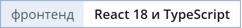
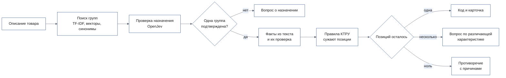

<h1 align="center">Карточка товара по КТРУ из описания своими словами</h1>

<p align="center">
  Поставщик пишет, что продаёт, как умеет: с опечатками и без половины свойств. Система находит
  позицию КТРУ, сужает группу до одного кода и заполняет характеристики значениями из справочника.
</p>

<p align="center">
  <!-- readme:buttons -->
  <a href="#запуск"><picture><source media="(prefers-color-scheme: dark)" srcset="docs/readme/cta-run.dark.png"></picture></a>
  <a href="docs/for-jury.md"><picture><source media="(prefers-color-scheme: dark)" srcset="docs/readme/cta-jury.dark.png"></picture></a>
  <a href="docs/README.md"><picture><source media="(prefers-color-scheme: dark)" srcset="docs/readme/cta-docs.dark.png"></picture></a>
  <!-- /readme:buttons -->
</p>

<p align="center">
  <!-- readme:status -->
  <a href="#результаты"><picture><source media="(prefers-color-scheme: dark)" srcset="docs/readme/badge-status-1.dark.png"></picture></a>
  <a href="#запуск"><picture><source media="(prefers-color-scheme: dark)" srcset="docs/readme/badge-status-2.dark.png"></picture></a>
  <a href="docs/evidence.md#хватает-ли-40-гб-видеопамяти"><picture><source media="(prefers-color-scheme: dark)" srcset="docs/readme/badge-status-3.dark.png"></picture></a>
  <br>
  <a href="docs/running.md"><picture><source media="(prefers-color-scheme: dark)" srcset="docs/readme/badge-status-4.dark.png"></picture></a>
  <picture><source media="(prefers-color-scheme: dark)" srcset="docs/readme/badge-status-5.dark.png"></picture>
  <!-- /readme:status -->
</p>

<p align="center">
  <!-- readme:stack -->
  <picture><source media="(prefers-color-scheme: dark)" srcset="docs/readme/badge-stack-1.dark.png"></picture>
  <picture><source media="(prefers-color-scheme: dark)" srcset="docs/readme/badge-stack-2.dark.png"></picture>
  <picture><source media="(prefers-color-scheme: dark)" srcset="docs/readme/badge-stack-3.dark.png"></picture>
  <br>
  <picture><source media="(prefers-color-scheme: dark)" srcset="docs/readme/badge-stack-4.dark.png"></picture>
  <picture><source media="(prefers-color-scheme: dark)" srcset="docs/readme/badge-stack-5.dark.png"></picture>
  <picture><source media="(prefers-color-scheme: dark)" srcset="docs/readme/badge-stack-6.dark.png"></picture>
  <!-- /readme:stack -->
</p>

<p align="center">
  <!-- readme:nav -->
  <a href="#зачем-это"><picture><source media="(prefers-color-scheme: dark)" srcset="docs/readme/badge-nav-1.dark.png"></picture></a>
  <a href="#как-это-работает"><picture><source media="(prefers-color-scheme: dark)" srcset="docs/readme/badge-nav-2.dark.png"></picture></a>
  <a href="#попробовать-за-пять-минут"><picture><source media="(prefers-color-scheme: dark)" srcset="docs/readme/badge-nav-3.dark.png"></picture></a>
  <br>
  <a href="#результаты"><picture><source media="(prefers-color-scheme: dark)" srcset="docs/readme/badge-nav-4.dark.png"></picture></a>
  <a href="#запуск"><picture><source media="(prefers-color-scheme: dark)" srcset="docs/readme/badge-nav-5.dark.png"></picture></a>
  <a href="#устройство"><picture><source media="(prefers-color-scheme: dark)" srcset="docs/readme/badge-nav-6.dark.png"></picture></a>
  <a href="#ограничения"><picture><source media="(prefers-color-scheme: dark)" srcset="docs/readme/badge-nav-7.dark.png"></picture></a>
  <!-- /readme:nav -->
</p>

> **Код КТРУ выдаётся, только когда по правилам справочника осталась ровно одна позиция.** Модели
> находят кандидатов и проверяют формулировки, но код выбирают не они: статус «позиция определена»
> вычисляется из оставшихся позиций, а тест `test_indistinct_positions_are_ambiguous_in_catalog`
> падает, если неразличимые позиции получат код.

## Зачем это

Чтобы завести карточку на Портале поставщиков, нужно найти позицию КТРУ среди 1 967 позиций трёх
категорий и для каждой характеристики выбрать допустимое значение и единицу. В выгрузках СТЕ
299 926 строк, и один товар назван десятками способов: по названию из случайной строки выгрузки
поиск ставит правильную группу первой лишь в 23 случаях из 42
([доказательства](docs/evidence.md#как-часто-поиск-находит-правильную-группу)).

Поставщик пишет «Шкаф для одежды металлический, глубина 0,55 м». Система находит группу «Шкаф для
одежды металлический» из двух позиций, **исключает одну с причиной «вид товара: секция шкафа;
указано шкаф»**, раскладывает глубину по характеристике с единицей и задаёт один вопрос про тип
шкафа. После ответа карточка готова, с кодом `31.01.11.121-00000003`.

## Как это работает



<table>
<tr>
<td valign="top" width="33%">

**1. Три метода поиска сливаются в один список**

Символьные n-граммы ловят опечатки, векторы Qwen3-Embedding — смысл, словарь синонимов — бытовые
названия вроде «болгарки». Ранги сливаются RRF, на проверку уходят десять групп.

<sub>R@5 = 42 из 46, [поиск групп](docs/search.md)</sub>

</td>
<td valign="top" width="33%">

**2. Модель проверяет назначение, но не выбирает наугад**

OpenJev оценивает каждую группу: соответствует, противоречит или нет сведений. Группа выбирается
сама, только если подтверждена одна, с оценками не ниже 0,90; иначе поставщику задаётся вопрос.

<sub>0 ошибочных автовыборов из 10, [доказательства](docs/evidence.md#выбирает-ли-модель-группу-без-оснований)</sub>

</td>
<td valign="top" width="33%">

**3. Правила справочника сужают позиции и объясняют каждое исключение**

Факт исключает позицию, если противоречит её значению или диапазону с учётом единиц. Неизвестное не
исключает. У каждой исключённой позиции — причина словами справочника.

<sub>`tests/test_rules.py`, [архитектура](docs/architecture.md#как-проходит-одно-сообщение-поставщика)</sub>

</td>
</tr>
</table>

## Попробовать за пять минут

После [запуска](#запуск), адрес <http://localhost:5173/sell>.

| | Что сделать | Что увидите |
|---|---|---|
| 1 | Ввести «Шкаф для одежды металлический, глубина 0,55 м» и нажать «Подобрать позицию» | Путь «Мебель › Шкаф для одежды металлический», «Подходит позиций: 1 из 2», вторая позиция исключена с причиной |
| 2 | «Продолжить», в строке «Тип шкафа» выбрать «Секционный» | Таблица характеристик, «Заполнено обязательных: 2 из 2» |
| 3 | «Новая карточка», ввести «Перчатки» | Вопрос «Для какого назначения нужен товар?» вместо угаданной группы |

Полный маршрут и где ответ на каждый критерий оценки — в [маршруте для жюри](docs/for-jury.md).
Каждое требование ТЗ по пунктам — в [карте требований](docs/requirements-map.md).

## Результаты

Через HTTP API продукта на временной базе, с настоящими моделями на A100 40 ГБ; наборы
зафиксированы по хешу, пороги и их источники — в [плане валидации](docs/validation-plan.md).

| Метрика | Решение | База | Порог |
|---|---|---|---|
| Правильная группа в топ-5, `smoke_v0` | **42 из 46** | 42 из 46, TF-IDF и bge-m3 | ≥ 42 из 46 |
| Правильная группа в топ-5, реальные СТЕ | **27 из 42** | 26 из 42 без словаря синонимов | не задан |
| Верный выданный код, `dev_v1` | **21 из 24** | — | ≥ 95 % |
| Верные автоматически принятые значения | **20 из 20** | — | ≥ 99 % |
| Ошибочные автовыборы группы | **0 из 10** | — | не задан |
| Видеопамять всех моделей | **37,1 ГБ** | — | ≤ 40 ГБ |

**Где проигрываем.** На реальных названиях из выгрузок правильная группа в топ-5 только у 27 из 42:
бренды и артикулы не похожи на наименования групп. Выданный код верен в 88 % случаев при цели 95 %;
прогон сделан до подключения проверки назначения.

<details>
<summary><b>Пересчитать все числа раздела</b></summary>
<br>

```bash
backend/.venv/bin/python evals/smoke/bench_search.py --embeddings-url http://127.0.0.1:8081/v1 \
  --database artifacts/ktru-search.sqlite3 --reuse-database
cd backend && uv run python ../evals/e2e/run.py --embeddings-url http://127.0.0.1:8081/v1 && cd ..
backend/.venv/bin/python evals/enum/run.py --url http://127.0.0.1:18080 --threshold 0.90 \
  --holdout evals/datasets/enum_holdout_v2.json --out var/enum-mapping.json
backend/.venv/bin/python evals/groups/run.py --output var/group-validation.json
```

Нужны сервисы моделей на GPU из [запуска](docs/running.md#как-запустить-модели). Отчёты пишутся в
`evals/reports/` и `var/`; сохранённые отчёты — в [`evals/reports/`](evals/reports/).

</details>

## Запуск

```bash
mkdir -p var && cp artifacts/ktru-search.sqlite3 var/tender.db
cd backend && uv sync && uv run alembic upgrade head && uv run uvicorn --factory main:create_app
```

```bash
cd frontend && npm ci --silent && npm run mock-api &
cd frontend && STOREFRONT_URL=http://localhost:8001 API_URL=http://localhost:8000 npm run dev
```

Интерфейс — <http://localhost:5173>, Swagger — <http://localhost:8000/api/docs>. Справочник,
витрина и проверки работают без GPU и сети. Анализ описаний требует трёх локальных моделей:
`EMBEDDINGS_URL`, `DECISION_URL` и `EXTRACTOR_URL`; без них сессия получает статус технического
сбоя. Платные API не нужны.

<details>
<summary><b>Модели, проверки, переменные</b></summary>
<br>

```bash
OPENJEV_PORT=18080 docker compose --profile gpu up --build -d openjev
docker compose -f compose.yaml -f compose.qwen.yaml --profile gpu up -d
```

Проверки: бэкенд — `cd backend && uv run ruff check . && uv run mypy . && uv run pytest`,
фронтенд — `cd frontend && npm run lint && npm run typecheck && npm test && npm run e2e`.
Переменные окружения, профили GPU и тесты — в [запуске и проверках](docs/running.md).

</details>

## Устройство

Интерфейс на React, API на FastAPI с SQLite и три модели в отдельных GPU-сервисах. Ключевое
решение — выдать код или задать вопрос — принимают правила справочника в сценарии анализа, а не
модели.

| Документ | Что внутри |
|---|---|
| [Архитектура](docs/architecture.md) | Части стенда, путь одного сообщения, слои, что заменяется без правки кода |
| [API](docs/api.md) | Методы, ответ анализа, формат ошибок; OpenAPI — `/api/docs` |
| [Зависимости](docs/dependencies.md) | Модели, библиотеки и сервисы с версиями и лицензиями |
| [Глоссарий](docs/glossary.md) | Термины КТРУ, работы поставщика и статусы анализа |
| [Оглавление](docs/README.md) | Все страницы документации |

## Ограничения

- **На реальных названиях поиск слабее.** Правильная группа в топ-5 у 27 из 42 строк выгрузки СТЕ;
  вместо угадывания система спрашивает о назначении.
- **Анализ требует GPU.** Три модели занимают 37,1 ГБ на A100 40 ГБ; без них работают справочник,
  витрина и все тесты, а анализ описаний — нет.
- **Витрина работает на моке.** Позиции и характеристики настоящие, цены и поставщики выдуманы.

Все ограничения, со статусом и тем, что закрыло бы каждое, — в [ограничениях](docs/limitations.md).

<p align="center">
  <sub>Команда GoatWhistle, Tender Hack, Казань, 2026.</sub>
</p>
