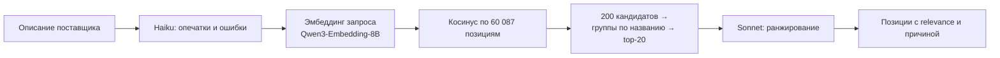

# RAG по справочнику КТРУ

Прототип подбора позиции КТРУ по описанию товара от поставщика. Поставщик пишет описание
коротко или подробно, сервис находит подходящие позиции каталога и ранжирует их. Следующий шаг —
спросить обязательные характеристики выбранной позиции.

Прототип: тестов нет. Прежний проект (бэкенд, фронтенд, сервисы, docs) лежит в `legacy/` и с этим кодом не связан.

## Как устроен поиск



1. **Исправление** (`preprocess.py`). Haiku правит опечатки, единицы и явные логические ошибки.
   Противоречия, которые нельзя исправить однозначно, не трогает, а возвращает в `issues` —
   их надо уточнить у поставщика.
2. **Эмбеддинг запроса** (`search.py`). К запросу добавляется инструкция
   `Instruct: … Query: …`, как требует Qwen3-Embedding. Тексты позиций кодируются без неё.
3. **Поиск** (`Index.search`). Векторы нормированы, поэтому косинус — это `vectors @ q`.
   Берётся 200 лучших кандидатов, позиции с одинаковым `name` склеиваются в группу, на выходе
   20 групп.
4. **Ранжирование** (`rerank.py`). Sonnet получает описание и карточки 20 групп (название,
   ОКПД2, характеристики) и возвращает JSON: `id`, `relevance` 0..100, `reason`.

## Что лежит в индексе

Источник — полная выгрузка КТРУ из ЕИС на 2026-10-03: `КТРУ xml.zip` с
[Яндекс.Диска организаторов](https://disk.yandex.ru/d/5Olg3IoYYf4loA), папка `КТРУ`.
Берутся только файлы `nsiKTRUNew_all_actual_*.xml` и в них только позиции со статусом
`ACTIVE` — 60 087 штук.

Текст позиции для эмбеддинга (`position_text` в `ktru.py`):

```
Струбцина
ОКПД2: 25.73.30.223 Струбцины
Рубрики: Хозяйственные товары
Тип: Винтовая; Магнитная; Корпусная; …
Максимальная глубина зажима: < 50 Миллиметр; ≥ 50 < 100 Миллиметр; …
```

Файлы в `data/` (в git не попадают):

| Файл | Размер | Что внутри |
|---|---|---|
| `ktru.zip` | 107 МБ | исходная выгрузка, кладётся вручную |
| `codes.json` | 1.5 МБ | номер строки → код КТРУ |
| `texts.json` | 46 МБ | тексты для эмбеддинга в том же порядке |
| `positions.pkl` | 77 МБ | код → `Position`: название, ОКПД2, единицы, характеристики |
| `raw.pkl` | 292 МБ | код → весь `<oos:position>` из XML как dict |
| `vectors.npy` | 492 МБ | эмбеддинги `(60087, 4096)`, float16, нормированы |
| `vectors.f32.npy` | 939 МБ | float32-копия для поиска, собирается сама |
| `vectors.done.npy` | 60 КБ | какие строки посчитаны, для докачки |

## Запуск

Нужны `uv` и залогиненный Claude Code: Agent SDK берёт его авторизацию.

```bash
cp .env.example .env
uv sync
```

В `.env` — ключ OpenAI-совместимого API эмбеддингов. По умолчанию это
`qwen/qwen3-embedding-8b` на polza.ai.

| Переменная | По умолчанию | Что задаёт |
|---|---|---|
| `EMBEDDINGS_URL` | `https://api.polza.ai/api/v1` | адрес `/embeddings` |
| `EMBEDDINGS_MODEL` | `qwen/qwen3-embedding-8b` | модель |
| `EMBEDDINGS_API_KEY` | — | ключ |
| `RAG_DATA` | `data` | папка с индексом |
| `EMBED_BATCH` | `32` | текстов в одном запросе `rag-embed` |
| `EMBED_CONCURRENCY` | `8` | параллельных запросов `rag-embed` |

### Собрать индекс

```bash
mkdir -p data && cp "<путь>/КТРУ xml.zip" data/ktru.zip
uv run rag-parse
uv run rag-embed
```

- `rag-parse` — разбор zip в `positions.pkl`, `raw.pkl`, `codes.json`, `texts.json`, ~110 с.
  Если `codes.json` и `texts.json` уже есть, сверяет их с новыми: при расхождении
  векторы надо пересчитать.
- `rag-embed` — эмбеддинги всех текстов в `vectors.npy`. Прогресс сохраняется каждые 20
  батчей, после обрыва команда продолжает с того же места. Через polza — ~28 текстов/с.

### Команды

| Команда | Что делает |
|---|---|
| `uv run rag-rerank "описание"` | вся цепочка: исправление → поиск → ранжирование |
| `uv run rag-search "описание"` | только векторный поиск, top-20 групп с обязательными характеристиками |
| `uv run rag-fix "описание"` | только исправление описания через Haiku |
| `uv run rag-hello` | проверка Agent SDK: Sonnet отвечает по JSON-схеме |
| `uv run rag` | проверка API эмбеддингов |

Пример:

```
$ uv run rag-rerank "струбцына винтовая, глубина зажима 100 кг, длинна 300мм"
исправлено: струбцина винтовая, глубина зажима 100 кг, длина 300 мм
  [typo] струбцына → струбцина
  [typo] длинна → длина
  ! «Глубина зажима» указана в килограммах … Требуется уточнение поставщика.

 1.  98 (было  1, cos 0.679) 25.73.30.223-00000013 Струбцина
 2.  30 (было  2, cos 0.543) 25.73.30.221-00000001 Тиски слесарные
```

## Использование из кода

```python
import asyncio
from rag.preprocess import preprocess
from rag.rerank import rerank
from rag.search import Index, expand, query_vector

index = Index()
pre = asyncio.run(preprocess("струбцына винтовая"))
hits = index.search(asyncio.run(query_vector(pre.corrected)))
ranked = asyncio.run(rerank(pre.corrected, hits)).ranked

best = ranked[0].hit
best.position.code
best.raw["data"]["characteristics"]
best.raw["printForm"]["url"]
for member, diff in expand(best):
    member.position.code, diff
```

| Что | Где | Что возвращает |
|---|---|---|
| `Index()` | `search.py` | загружает векторы, `positions` и `raw` в память |
| `Index.search(vec, k=20)` | `search.py` | `list[Hit]`: группы по убыванию косинуса |
| `Index.row(i)` | `search.py` | `(Position, raw)` по номеру строки индекса |
| `Hit` | `search.py` | `row`, `score`, `position`, `raw`, `members`; `siblings` — число вариантов |
| `expand(hit)` | `search.py` | варианты группы и характеристики, которыми они различаются |
| `preprocess(text)` | `preprocess.py` | `Preprocessed`: `corrected`, `fixes`, `issues` |
| `rerank(text, hits)` | `rerank.py` | `RerankResult`: `ranked` (`hit`, `relevance`, `reason`) и `ResultMessage` |

`siblings` и `expand` считают варианты только среди 200 кандидатов поиска, а не по всему КТРУ.

## Время и стоимость

Замеры отдельных прогонов на одной машине, без статистики.

| Этап | Время | Стоимость |
|---|---|---|
| Загрузка индекса | ~15 с | — |
| Haiku, исправление | 5–11 с | ~$0.0008 |
| Эмбеддинг запроса | 0.3–5 с | ~0.001 ₽ |
| Косинус по 60 087 векторам | 40–70 мс | — |
| Sonnet, ранжирование 20 групп | ~10 с | ~$0.03–0.04 |

Вызовы через Agent SDK со structured output делают два хода модели (`turns=2`): первый
вызывает служебный инструмент `StructuredOutput`, второй завершает ответ.

## Ограничения

- **Шум от медизделий.** Класс ОКПД2 32 — больше половины каталога, поэтому медицинские позиции
  попадают в кандидаты к бытовым запросам. Например, «струбцина» → фиксатор трахеостомической
  трубки на 3-м месте по косинусу. Ранжирование Sonnet их опускает.
- **Группы — по точному `name`.** «Струбцина» и «Струбцина винтовая» — разные группы.
- **Варианты внутри группы.** Конкретный код внутри группы пока не выбирается. `expand` показывает
  различия, но вопросы поставщику не задаются.
- **Контекст агента.** Claude Code добавляет к каждому вызову блок окружения: рабочую папку, ОС,
  дату и email аккаунта. Вызовы идут из временной пустой папки с `setting_sources=[]`, поэтому
  проект и CLAUDE.md модель не видит, но email и дата в контекст попадают.
- **Память.** `raw.pkl` в памяти занимает ~1.5 ГБ, векторы — ~1 ГБ через mmap.
