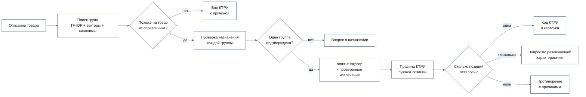
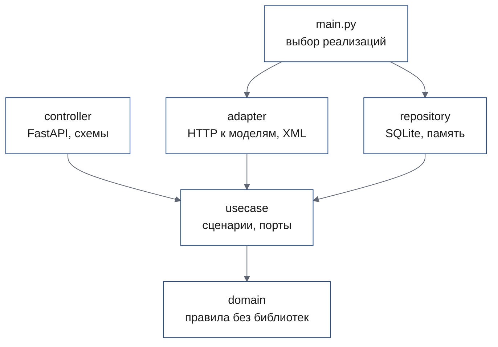

# Архитектура

> Стенд состоит из веб-интерфейса, API на FastAPI с базой SQLite и трёх локальных моделей на GPU:
> эмбеддинги для поиска, OpenJev для проверок и Qwen3.5 для извлечения значений. Ключевое решение
> принимает не модель, а правила справочника: код КТРУ выдаётся, только когда после фильтрации по
> фактам осталась ровно одна позиция. Модели находят кандидатов и проверяют формулировки, но не
> выбирают код сами.

**Читайте, если** вы хотите понять, где принимается каждое решение и что можно заменить ·
**Связано:** [API](api.md) · [зависимости](dependencies.md) · [ADR 0001](adr/0001-layers-and-ports.md)

---

## Из каких частей собран стенд?

| Часть | Что делает | Где в коде |
|---|---|---|
| Веб-интерфейс | Мастер поставщика из четырёх шагов, витрина каталога и карточка товара | [`frontend/`](../frontend/) |
| API | Сессии анализа, справочник КТРУ, поиск групп | [`backend/app/controller/`](../backend/app/controller/) |
| Сценарии | Анализ сообщения, вопросы, правки фактов, пересчёт | [`backend/app/usecase/`](../backend/app/usecase/) |
| Правила | Сужение позиций, диапазоны, единицы, обязательные поля | [`backend/app/domain/`](../backend/app/domain/) |
| База | Справочник, векторы групп, ревизии сессий | SQLite, схема в [`backend/migrations/`](../backend/migrations/) |
| Эмбеддинги | Векторы запросов для поиска групп | `Qwen/Qwen3-Embedding-0.6B`, [`services/qwen/`](../services/qwen/) |
| Проверки | Назначение группы, мусор и «вне КТРУ», проверка извлечённых фактов, сопоставление значений | OpenJev 4B v5, [`services/openjev/`](../services/openjev/) |
| Извлечение | Свободные значения из текста по схеме характеристик | Qwen3.5 в строгом режиме, [`services/qwen/`](../services/qwen/) |

Витрина покупателя берёт товары из мок-сервиса [`frontend/mock-api/`](../frontend/mock-api/): API
витрины на бэкенде нет.

## Как проходит одно сообщение поставщика?

| Шаг | Механизм | Порог или правило |
|---|---|---|
| Поиск групп | TF-IDF по символьным n-граммам, косинус векторов Qwen3-Embedding, словарь синонимов; слияние RRF с `k = 60` | Топ-10 групп (`GROUP_TOP_K`) |
| Вне КТРУ | Косинус ближайшей группы и вопрос OpenJev «товар или мусор» | Косинус ниже 0,45 или P(мусор) ≥ 0,5 |
| Назначение группы | OpenJev для каждой группы: соответствует, противоречит или нет сведений | Автовыбор, только если у одной группы обе оценки ≥ 0,90, а остальные противоречат |
| Факты | Детерминированный парсер чисел, диапазонов и единиц; Qwen3.5 для свободных значений; каждое извлечённое утверждение проверяет NLI OpenJev | Автопринятие при оценке ≥ 0,90, иначе предложение с подтверждением |
| Перечислимые значения | OpenJev выбирает значение из допустимых в справочнике | Автопринятие при ≥ 0,90; неоднозначные части товара всегда на подтверждение |
| Сужение позиций | Факт исключает позицию, если противоречит её допустимым значениям или диапазону | Неизвестное не считается противоречием |
| Статус | Ноль позиций — противоречие, одна — код определён, несколько неразличимых — неоднозначность справочника | [`sessions.py`](../backend/app/usecase/sessions.py), функция анализа |

Подробности поиска — в [поиске групп](search.md), контракт сессии — в [сессиях](sessions.md).

## Как устроены слои бэкенда?

Зависимости идут внутрь, к `domain`; это проверяет
[`test_layers.py`](../backend/tests/test_layers.py). Всё, что можно заменить другой реализацией, —
порт-`Protocol` в [`usecase/interface.py`](../backend/app/usecase/interface.py). Решение — в
[ADR 0001](adr/0001-layers-and-ports.md).

## Что заменяется без правки кода?

| Что | Как заменить |
|---|---|
| Сервис эмбеддингов | Любой OpenAI-совместимый `/v1/embeddings`: `EMBEDDINGS_URL`, `EMBEDDINGS_MODEL`; векторы групп пересобираются из той же ревизии |
| Модель проверок | Любой сервис с API `services/openjev`: `DECISION_URL`; ревизия фиксируется в `DECISION_REVISION` |
| Извлечение значений | `EXTRACTOR_URL`; без него работает только детерминированный парсер |
| Орфография | `SPELLING_URL`; без неё анализ идёт, а ответ несёт замечание `spelling_failed` |
| База | `DATABASE_URL`; схема из миграций Alembic |
| Порог автопринятия | `DECISION_AUTO_ACCEPT_THRESHOLD`, `VERIFIER_THRESHOLD`; выключатели `*_AUTO_ACCEPT_ENABLED` |

## Как устроен интерфейс?

| Слой | Что в нём |
|---|---|
| `src/app` | Оболочка портала: шапка, режим ввода, прокрутка |
| `src/pages` | Главная, каталог, товар, мастер поставщика, страница «не найдено» |
| `src/features` | Мастер поставщика, фильтры каталога, поиск |
| `src/entities` | Позиция КТРУ, товар |
| `src/shared` | Токены дизайн-системы, примитивы интерфейса, движение, тексты, хуки |

Импорты идут только вниз по слоям. Визуальная система — UI-кит Портала поставщиков из Figma:
цвета, шрифт Open Sans и элементы вынесены в токены
[`shared/styles/tokens`](../frontend/src/shared/styles/tokens/). Все тексты интерфейса лежат в
словарях [`shared/i18n/locales/ru`](../frontend/src/shared/i18n/locales/ru/).

## Сколько это требует видеопамяти?

Проверенный профиль — одна A100 40 ГБ: OpenJev 10 016 МиБ, сервис эмбеддингов 3 454 МиБ, экстрактор
23 636 МиБ, всего 37 126 МиБ из 40 960. Замер — в
[`2026-10-10-enum-vram.txt`](../evals/reports/2026-10-10-enum-vram.txt), подробнее — в
[доказательствах](evidence.md#хватает-ли-40-гб-видеопамяти).

---

[Оглавление документации](README.md) · [README проекта](../README.md)
