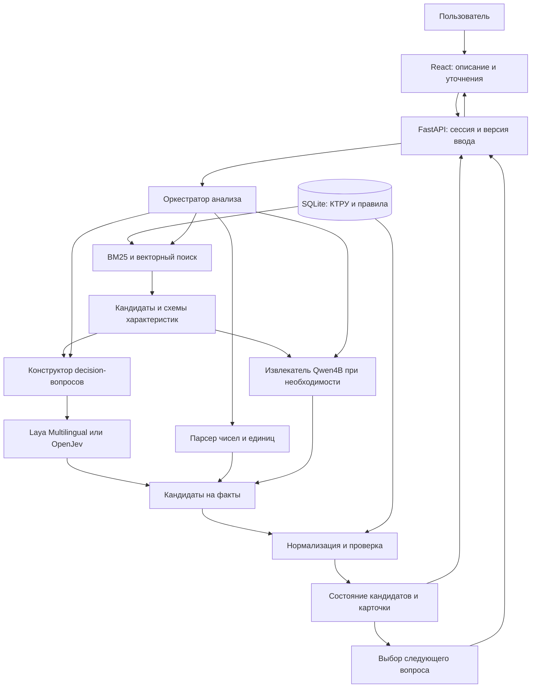

# Технический план: автозаполнение СТЕ и подбор КТРУ с открытой decision-моделью

Дата подготовки: 9 октября 2026 года.

**Статус:** проект реализации. Структура локальных XML и документация моделей изучены; приложение, замеры выбранных моделей на КТРУ и обучение по этому плану ещё не выполнены. Переданные командой измерения небольшого CPU-стенда приведены отдельно в разделе 14.1. Остальные числа для порогов, производительности и объёмов обучения являются стартовыми настройками или целями, а не полученными результатами.

**Содержание**

- [1. Что именно делаем](#1-что-именно-делаем)
- [2. Какие данные уже есть и что из этого следует](#2-какие-данные-уже-есть-и-что-из-этого-следует)
- [3. Модели: конкретный выбор и роль каждой](#3-модели-конкретный-выбор-и-роль-каждой)
- [4. Архитектура и ответственность компонентов](#4-архитектура-и-ответственность-компонентов)
- [5. Подготовка справочника: точная последовательность](#5-подготовка-справочника-точная-последовательность)
- [6. Поиск кандидатов](#6-поиск-кандидатов)
- [7. Decision-слой: какие решения он принимает](#7-decision-слой-какие-решения-он-принимает)
- [8. Извлечение значений и проверка фактов](#8-извлечение-значений-и-проверка-фактов)
- [9. Детерминированный валидатор КТРУ](#9-детерминированный-валидатор-ктру)
- [10. Диалог и выбор следующего вопроса](#10-диалог-и-выбор-следующего-вопроса)
- [11. Полный цикл обработки одного сообщения](#11-полный-цикл-обработки-одного-сообщения)
- [12. API и интеграция](#12-api-и-интеграция)
- [13. Интерфейс](#13-интерфейс)
- [14. Производительность, кэширование и память](#14-производительность-кэширование-и-память)
- [15. Проверка качества и выбор модели](#15-проверка-качества-и-выбор-модели)
- [16. Команда: кто за что отвечает и что передаёт дальше](#16-команда-кто-за-что-отвечает-и-что-передаёт-дальше)
- [17. Этапы реализации с зависимостями и критериями готовности](#17-этапы-реализации-с-зависимостями-и-критериями-готовности)
- [18. Предлагаемая структура репозитория и команды](#18-предлагаемая-структура-репозитория-и-команды)
- [19. Ошибки, отказоустойчивость и масштабирование](#19-ошибки-отказоустойчивость-и-масштабирование)
- [20. BPMN и демонстрация](#20-bpmn-и-демонстрация)
- [21. Приёмка готового решения](#21-приёмка-готового-решения)
- [22. Что делаем первым](#22-что-делаем-первым)

## 1. Что именно делаем

Создаём веб-приложение для поставщика: из свободного описания товара оно извлекает характеристики, сопоставляет их с КТРУ, нормализует значения и единицы, обнаруживает ошибки и поэтапно уточняет подходящий код. Пользователь видит промежуточный результат после каждого ввода, а не только готовую карточку в конце.

В центре семантического сопоставления — **открытая decision-модель семейства Laya / OpenJev**. Она получает описание и ограниченный набор вопросов или гипотез, возвращает оценки вариантов без генерации развёрнутого ответа. Свободные числовые и текстовые значения извлекает отдельный компонент. Ограничения справочника проверяет программный код.

Основной поток:

```text
Описание товара и уточнения пользователя
    → поиск кандидатов КТРУ
    → вопросы и гипотезы, построенные из характеристик кандидатов
    → decision-модель: сопоставление формулировок и проверка гипотез
    → извлечение свободных значений, если необходимо
    → нормализация и проверка по XML
    → пересчёт кандидатов
    → конкретный вопрос / исправление / результат
```

### 1.1. Пользовательский результат

Пользователь получает:

- унифицированные характеристики с исходными фрагментами описания;
- исходные и нормализованные значения, единицы и объяснения преобразований;
- подходящие позиции КТРУ и причины исключения других;
- один следующий полезный вопрос с вариантами ответа;
- сообщения о противоречиях, неоднозначности и некорректных значениях;
- итоговую карточку с кодом, когда он достаточно обоснован;
- возможность сохранить черновик даже при неполных данных.

**Код выбран** и **все обязательные поля карточки заполнены** — разные состояния. Код может уже определиться, хотя часть обязательных характеристик ещё неизвестна.

### 1.2. Ограничения проекта

Работаем на Linux, предоставляем веб-интерфейс, используем открытые модели локально, совокупное потребление VRAM для инференса не превышает 40 ГБ. Low-code/no-code и внешние API проприетарных LLM не используем. Для демонстрации заранее скачиваем веса и собираем индексы: обработка пользовательского описания не требует доступа к интернету.

Основание: [задание организаторов](Презентация_Задачи_Хакатон_Казань_20261009_1900.md). Качество и функциональность дают 40 баллов, распознавание ошибок — ещё 12. Эти сценарии реализуем раньше дополнительной витрины покупателя.

### 1.3. Уточнение относительно первоначальной критики

Идея decision-модели в исходном обсуждении содержательная: пакетные решения и повторное использование общего контекста действительно предусмотрены открытыми реализациями. Нельзя оценивать их как обычный чат, генерирующий ответ токен за токеном.

Но требуется различать три операции: хранение независимых поисковых векторов, повторное использование контекста внутри decision-модели и повторное использование уже полученного решения. У них разные ключи кэша и условия корректности. Отсутствие генерации текста также не означает отсутствие ошибок классификации.

## 2. Какие данные уже есть и что из этого следует

В рабочей папке есть тематические XML, исходный архив КТРУ, описание структуры XML, примеры выгрузок Excel и критерии оценки.

| Рабочий XML | Позиций | `isTemplate=true` | `isTemplate=false` | Вхождений характеристик |
| --- | ---: | ---: | ---: | ---: |
| Одежда | 1 207 | 130 | 1 077 | 5 120 |
| Мебель | 402 | 99 | 303 | 2 888 |
| Инструменты | 358 | 101 | 257 | 2 435 |
| Всего | 1 967 | 330 | 1 637 | 10 443 |

Числа получены непосредственным разбором локальных XML. «Вхождения характеристик» — количество записей внутри позиций, а не число уникальных характеристик. `isTemplate=false` пока не считаем достаточным доказательством, что позиция конечная и пригодна для выдачи: это проверяем по описанию структуры и связям.

В значениях реально присутствуют `qualityDescription`, `valueSet`, `rangeSet`, `valueFormat`, `OKEI`. В диапазонах встречаются математические обозначения границ, например `lessOrEqual`. Следовательно, нельзя свести справочник к плоскому списку названий и строковых значений.

[Отчёт предварительной фильтрации](../data/yandex_disk/КТРУ/xml/filtering_report.json) сообщает о 81 465 исходных записях и тематической выборке из 1 967. В нём прямо указано, что выборка рабочая, а сопоставление периферийных категорий не является официальным соответствием классификаторов. Используем полный архив как источник расширения поиска и не объявляем отсутствующий в выборке товар «несуществующим».

### 2.1. Приоритет источников

1. КТРУ — источник кодов, характеристик, допустимых значений и единиц.
2. Описание XML — источник смысла полей, типов и правил интерпретации.
3. Excel-примеры — источник реальных формулировок и кейсов СТЕ; они не переопределяют КТРУ.
4. Пользователь — источник фактов о конкретном товаре.
5. Модель — механизм сопоставления этих фактов с формальными вариантами.

Связь категории из Excel с КТРУ нельзя объявлять точной без проверки. Торговое название, внутренняя категория портала, ОКПД2 и позиция КТРУ хранятся раздельно.

## 3. Модели: конкретный выбор и роль каждой

### 3.1. Основной набор для реализации

| Роль | Модель | Как используем | Статус выбора |
| --- | --- | --- | --- |
| Быстрые типизированные решения на русском | `convaiinnovations/laya-multilingual` | Сопоставление enum-значений, проверка утверждений, семантическое ранжирование | Первый лёгкий кандидат; допуск после теста КТРУ |
| Альтернатива decision-слою | `AlexWortega/openjev`, подкаталог `qwen3.5-4b-nli-v5` | Проверка «подтверждено / противоречит / недостаточно данных» | Обязательный участник сравнения с Laya |
| Семантический поиск | `Qwen/Qwen3-Embedding-0.6B` | Векторы позиций и запросов, поиск кандидатов | Основной поисковый энкодер |
| Извлечение свободных значений | `Qwen/Qwen3-4B-Instruct-2507` | Числа, единицы, фрагменты текста и привязка к характеристикам | Вызываем только для неразобранных данных |

В рабочем профиле держим **одну выбранную decision-модель**, embedding-модель и извлекатель. Не начинаем с постоянного каскада из Laya, OpenJev и ещё одного reranker. Это усложняет диагностику, расходует память и требует дополнительной калибровки.

Выбор Laya первым кандидатом означает порядок проверки, а не заранее установленное превосходство. Если OpenJev существенно лучше на русском КТРУ при допустимой задержке, в демонстрационном профиле используем его. Контракт приложения от этого не меняется.

### 3.2. Что подтверждено об открытых decision-моделях

**Laya Multilingual.** В карточке указаны mmBERT-base, около 322 млн параметров, Apache-2.0 и типизированные решения без генерации текста. Контекст по умолчанию ограничен 1 024 токенами; расширение до 8 192 требует настройки. Для русского выбираем именно multilingual-вариант. [Карточка модели](https://huggingface.co/convaiinnovations/laya-multilingual).

**Laya и Laya Typed Decisions.** Англоязычная ветка основана на ModernBERT-large, около 421 млн параметров. В документации отдельно предупреждают об ограниченном качестве базовых весов на typed-decisions без адаптации и о потере качества при слишком большом числе вариантов. Поэтому результат специализированного англоязычного checkpoint не переносим на русский каталог. [Карточка семейства и ограничения](https://huggingface.co/convaiinnovations/laya).

**OpenJev от AlexWortega.** Выбираем конкретный репозиторий и v5, поскольку название OpenJev используют разные проекты. Это Qwen3.5 с классификационной головой: на пару «контекст, гипотеза» возвращаются три оценки NLI. В карточке указана MIT-лицензия, доступны варианты 0.8B, 2B и 4B. Русский КТРУ всё равно проверяем самостоятельно. [Карточка OpenJev](https://huggingface.co/AlexWortega/openjev).

В его `predict_hypotheses` реализован общий префикс и пакетное продолжение гипотез. Это подтверждает возможность экономить вычисления общего контекста, но не равенство стоимости любого количества решений. Число и длина гипотез влияют на память и время. [Код обработки гипотез](https://huggingface.co/AlexWortega/openjev/blob/main/modeling_openjev.py).

### 3.3. Какие альтернативы учитываем, но не тащим все в MVP

| Проект | Чем интересен | Решение для нашего проекта |
| --- | --- | --- |
| [Kev](https://github.com/jaredpalmer/kev) | Открытое семейство decision-моделей с типизированными вопросами; код под Apache-2.0 | Дополнительный кандидат, если Laya и OpenJev не проходят минимальный тест; начинаем с 4B, не с 27B |
| [Open-Jev от Zefan-Cai](https://github.com/Zefan-Cai/Open-Jev) | Отдельная реализация с LoRA, scalar head и температурой; нужны базовые веса и собственный loader | Резервный исследовательский вариант; не путать с AlexWortega/openjev |
| [Simple Jev](https://github.com/featherless-ai/simple-jev) | Получает решения из next-token logits открытых моделей без отдельного обучения головы | Контрольный baseline или резерв, если специализированный runtime не запускается |

Наличие открытого сервера не делает любую подключённую модель открытой. В `models.lock.json` фиксируем отдельно код, веса, базовую модель, лицензии и ревизии. Проприетарный Jev API в рабочую систему не подключаем.

### 3.4. Зачем остаются embedding-модель и небольшой извлекатель

`Qwen3-Embedding-0.6B` — отдельная retrieval-модель с векторами до 1 024 измерений. Начинаем с полной размерности и нормализованных векторов. Снижение размерности — только после сравнения качества. [Официальная карточка](https://huggingface.co/Qwen/Qwen3-Embedding-0.6B).

`Qwen3-4B-Instruct-2507` выбираем как конкретный открытый instruction-checkpoint для извлечения свободных значений; используем локально, без генерации рассуждений для пользователя. Карточка указывает Apache-2.0. [Официальная карточка](https://huggingface.co/Qwen/Qwen3-4B-Instruct-2507).

Это наше распределение ролей, а не утверждение, что эти модели уже проверены на КТРУ. Например, decision-модель может выбрать «Сталь» из допустимых материалов, но произвольную длину `123,7 см` удобнее извлечь парсером или извлекателем, чем создавать тысячи числовых вариантов ответа.

## 4. Архитектура и ответственность компонентов

### 4.1. Технологический стек

| Слой | Выбор для MVP | Назначение |
| --- | --- | --- |
| Backend | Python 3.11, FastAPI, Pydantic | HTTP API, валидация контрактов, управление анализом |
| Данные | SQLite, отдельные файлы индекса | Позиции, правила, сессии и версии; один сервер для хакатона |
| Лексический поиск | BM25, нормализация текста и словарь проверенных синонимов | Совпадения по точным словам, кодам и характеристикам |
| Векторный поиск | NumPy, полный поиск по матрице | Для 1 967 позиций отдельная векторная БД не нужна |
| Decision-инференс | PyTorch и официальный runtime выбранного проекта | Laya либо OpenJev через наш адаптер |
| Извлечение | Локальный vLLM-сервис с Qwen4B | Структурированный вывод по ограниченной схеме |
| Frontend | React, TypeScript, Vite | Рабочее место поставщика |
| Проверки | pytest, Ruff; Vitest, Playwright, ESLint, Prettier | Логика правил, API и пользовательские сценарии |
| Доставка | Docker Compose, Linux, NVIDIA GPU | Воспроизводимый запуск и измерение VRAM |

Точные версии библиотек закрепляем после совместного smoke-теста моделей на целевой GPU. Не ставим в документ случайные версии, которые ещё не проверены вместе. Для decision-runtime и vLLM допускаются отдельные контейнеры с разными Python-зависимостями.

Для JSON-извлечения используем structured outputs локального vLLM; поддержку нужной JSON Schema проверяем при запуске. Это ограничивает форму ответа, а не доказывает истинность значений. [Документация vLLM](https://docs.vllm.ai/en/latest/features/structured_outputs/).

### 4.2. Кто кому передаёт данные



Это схема компонентов, не BPMN. Отдельный BPMN-файл готовим для защиты по процессу из раздела 20.

### 4.3. Границы ответственности

| Компонент | Вход | Выход | Чего не решает |
| --- | --- | --- | --- |
| Импортёр | XML и документация структуры | Версионированные позиции и правила | Не выводит правила из здравого смысла модели |
| Retrieval | Описание и подтверждённые факты | Список кандидатов с источниками поиска | Не утверждает окончательную правильность кода |
| Question builder | Кандидаты, их значения, неизвестные поля | Ограниченные вопросы и гипотезы | Не придумывает отсутствующие в справочнике значения |
| Decision adapter | Контекст и вопросы | Распределения по вариантам, метаданные | Не выполняет арифметику и не создаёт новые коды |
| Extractor | Текст и допустимые целевые поля | Фрагменты и необработанные значения | Не заполняет поля по типичным свойствам товара |
| Rule engine | Факты и правила КТРУ | Совместимость, ошибки, нормализация | Не заменяет неизвестное на ложь |
| Dialogue policy | Оставшиеся позиции и недостающие факты | Следующий вопрос или состояние завершения | Не выбирает top-1 только потому, что он первый |
| UI | Состояние анализа | Объяснимый результат и действия пользователя | Не пересчитывает бизнес-правила самостоятельно |

## 5. Подготовка справочника: точная последовательность

### 5.1. Импорт и аудит

Владелец: разработчик данных/backend. Потребители: поиск, decision-вопросы, валидатор и интерфейс.

1. Прочитать описание XML, особенно смысл `type`, `kind`, `choiceType`, `isTemplate`, статусов и периодов действия. Не угадывать перечисления по числовым значениям.
2. Зафиксировать исходные файлы, SHA-256 и дату сборки snapshot.
3. Разбирать XML потоково с учётом namespaces, отключив внешние сущности.
4. Сохранить код, версию, название, ОКПД2, даты, статус, родительские связи и признаки шаблона.
5. Сохранить каждую характеристику вместе с областью действия — конкретной версией позиции.
6. Преобразовать строковые значения, наборы чисел и диапазоны в типизированные правила.
7. Проверить дубликаты, ссылки на отсутствующих родителей, неизвестные единицы, пустые обязательные поля и неподдержанные конструкции.
8. Подготовить отчёт: сколько позиций загружено, сколько допускается в итоговую выдачу и что требует разбора.

Неизвестное правило не игнорируем: помечаем позицию `unsupported_rule` и запрещаем автоматическое подтверждение до корректной реализации. Для browsing и диагностики позиция остаётся доступной.

### 5.2. Предлагаемая схема хранения

| Сущность | Основные поля | Назначение |
| --- | --- | --- |
| `catalog_snapshots` | id, source_hashes, created_at, parser_version | Воспроизводимость каталога |
| `positions` | snapshot_id, code, version, name, okpd2, status, dates, is_template | Официальные позиции |
| `position_relations` | parent_code, child_code, relation_type, resolution_status | Группировка и проверка конечности |
| `position_characteristics` | position_id, characteristic_code, name, type, kind, required, choice_type | Характеристики в контексте позиции |
| `allowed_values` | characteristic_id, value_code, text, unit_code, value_format | Допустимые значения |
| `numeric_constraints` | value_id, exact_value, min, max, min_inclusive, max_inclusive | Наборы и интервалы |
| `aliases` | canonical_id, alias, source, reviewed | Проверенные синонимы |
| `search_documents` | document_id, position_id, part_id, text, hash | Документы для поиска |
| `sessions` | id, revision, snapshot_id, current_status | Состояние диалога |
| `facts` | session_id, characteristic_ref, raw_value, normalized_value, provenance, status | Факты о товаре |
| `analysis_runs` | id, session_revision, model_revisions, timings, status | История вычислений |
| `candidate_checks` | run_id, position_id, rule_id, result, fact_id | Причины решений |

Ключ характеристики включает позицию и версию. Одинаковый код характеристики в разных позициях не означает одинаковые допустимые значения. Уровень нормализованного «понятия», например длины, создаём отдельно и с явным отображением на исходные поля.

Числа храним через decimal-представление. Отсутствующая нижняя граница и ноль — разные вещи; открытая и закрытая граница — тоже.

### 5.3. Генерация поисковых документов

Для каждой позиции собираем детерминированный текст:

```text
Название: Фурнитура для мебели металлическая
Код: 25.72.14.130-00000002
Характеристика: Тип изделия
Допустимое значение: Полка
Характеристика: Металл
Допустимые значения: Железо; Чугун; Сталь; ...
```

Пример основан на локальном XML; многоточие здесь сокращает иллюстрацию, но не является содержимым индексируемой записи. В индекс кладём реальные полные значения. Если запись длинная, делим по характеристикам и сохраняем связь фрагментов с позицией. Не обрезаем молча отличительные признаки.

Отдельно индексируем название, код, значения и проверенные aliases. При поиске объединяем результаты фрагментов по позиции, чтобы длинная позиция с большим числом фрагментов не получила автоматического преимущества.

**Готовность этапа:** повторный импорт создаёт тот же набор записей и хешей; количество позиций сверяется с источником; для каждого правила можно открыть исходный XML-фрагмент.

## 6. Поиск кандидатов

Владелец: разработчик поиска/ML. Вход — текущий текст, подтверждённые факты и snapshot каталога. Выход — ранжированный список позиций и отдельные показатели охвата.

### 6.1. Алгоритм первого запроса

1. Сохраняем исходный текст без изменений.
2. Для поиска нормализуем пробелы, регистр и вариант `ё/е`; исходные координаты текста сохраняем отдельно.
3. При наличии кода выполняем точный поиск. Если код не найден, показываем это и продолжаем поиск по описанию.
4. BM25 возвращает до 100 позиций.
5. Embedding-поиск возвращает до 100 позиций.
6. Объединяем списки через reciprocal rank fusion: суммируем `1 / (60 + rank)` для каждой позиции. Значение 60 — стартовая настройка, которую фиксируем в конфигурации.
7. До 100 лучших позиций идут в подробный анализ. Числа 100/100/100 проверяем по recall, затем при необходимости меняем.
8. Сразу строим группы позиций с одинаковым назначением и похожими схемами, чтобы не задавать одинаковые вопросы сотни раз.

Ограничение категории пользователя используем как предпочтение поиска. Жёсткий фильтр разрешаем только после явного подтверждения, и в интерфейсе остаётся возможность его снять.

### 6.2. Что делаем при нуле или одном результате

Ноль после проверки не означает, что товара нет в КТРУ. Сначала расширяем список, снимаем слабые семантические фильтры и проверяем рабочую тематическую выборку шире. Если её недостаточно — используем подготовленный индекс полного разрешённого исходного каталога либо честно сообщаем, что за пределами загруженной области поиск не выполнен.

Один кандидат в top-100 также не доказывает глобальную уникальность. Перед статусом `resolved` проверяем все альтернативы соответствующей группы и выполняем расширенный поиск. При невозможности подтвердить охват показываем «рекомендованная позиция», а не «единственно возможный код».

Для текущих 1 967 записей детерминированные проверки уже извлечённых фактов можно выполнять по всему snapshot. Это дешевле, чем вызывать decision-модель для каждой записи, и уменьшает риск потери кандидата на retrieval-этапе. Само применение характеристик требует корректного сопоставления их смысла, а не совпадения произвольных строк.

### 6.3. Проверка поиска

Измеряем `Recall@20`, `Recall@50`, `Recall@100` на описаниях с известными кодами. Для неоднозначного описания эталон — множество допустимых кодов: отдельно считаем попадание хотя бы одного и полноту этого множества.

Стартовая цель для однозначных примеров — `Recall@100 ≥ 0,98`. Это целевой порог, не текущий результат. Если порог не достигнут, сначала исправляем документы, aliases и правила объединения, затем меняем embedding-модель.

## 7. Decision-слой: какие решения он принимает

### 7.1. Не один вопрос «какой код правильный», а несколько проверяемых задач

| Задача | Пример входа | Ответ модели | Дальнейшее действие |
| --- | --- | --- | --- |
| Сопоставить смысл типа товара | «стеллаж для архива» и описания возможных типов | Оценки типов | Приоритет кандидатов, без необратимого исключения |
| Сопоставить enum-значение | «стальная» и допустимые металлы | Оценка «Сталь» плюс неизвестность | Кандидат на нормализованный факт |
| Проверить утверждение | «У товара металлический каркас» | Подтверждено / противоречит / недостаточно данных | Подтверждение, вопрос или снижение ранга |
| Разрешить неоднозначную привязку | «ширина полки 80 см» и поля разных объектов | Оценки привязок | Выбрать поле либо запросить уточнение |
| Понять исправление | «нет, не деревянный, металлический» | Новое утверждение и отрицание старого | Предложить замену факта с сохранением истории |

Низкая оценка принадлежности позиции не равна доказанному противоречию. По умолчанию семантическая модель ранжирует и предлагает факты; жёсткое исключение основываем на принятом факте и конкретном правиле каталога.

### 7.2. Построение вопросов

Question builder получает список кандидатов и группирует характеристики по проверенному смысловому соответствию. Затем строит короткие вопросы из реальных названий и значений.

Для каждой неоднозначной проверки задаём три исхода:

- `supported`: описание явно подтверждает утверждение;
- `contradicted`: описание явно несовместимо с утверждением;
- `not_stated`: сведений недостаточно.

Внутри Laya используем нейтральные ключи `a`, `b`, `c` с содержательными описаниями вариантов. Это наш формат, который нужно проверить на КТРУ; он не превращает Laya в модель с гарантированной NLI-семантикой. OpenJev адаптируем из его родных NLI-выходов.

Пример запроса к нашему адаптеру, не к upstream SDK:

```json
{
  "state": "Полка для мебели, стальная, ширина 80 см.",
  "questions": [
    {
      "id": "metal_is_steel",
      "kind": "claim_status",
      "claim": "Металл изделия — сталь.",
      "options": [
        {"id": "a", "meaning": "Описание явно подтверждает утверждение"},
        {"id": "b", "meaning": "Описание явно противоречит утверждению"},
        {"id": "c", "meaning": "В описании недостаточно сведений"}
      ]
    }
  ]
}
```

Все три исхода проверяем на минимальных парах: «стальная», «не стальная», «металл не указан». Не задаём вопрос «подходит ли сталь?» так, чтобы модель могла ответить на физическую возможность, а не на наличие информации в тексте.

### 7.3. Работа с количеством вопросов

Стартовые ограничения приложения:

- до 12 содержательных вариантов в одном enum-вопросе плюс «не указано» и «другое»;
- до 16 коротких проверок в одном микробатче;
- ограничение по суммарным токенам важнее ограничения по числу вопросов;
- широкие справочники значений сначала сужаем поиском, сохраняя возможность расширения;
- распределения из разных наборов `choice` не сравниваем напрямую.

Позиции с одинаковой характеристикой и одинаковым набором значений используют один результат сопоставления. Проверка материала нужна один раз для группы соответствующих характеристик, а не заново для каждой позиции. При различиях правил результаты применения к позиции считаются отдельно.

### 7.4. Общий интерфейс decision-моделей

```python
class DecisionBackend:
    def decide(self, state, questions, *, limits, revision):
        """Возвращает DecisionBatchResult без изменения состояния сессии."""

    def health(self):
        """Модель, ревизия, готовность, устройство и поддержанные режимы."""
```

Каждый ответ включает `question_id`, `option_ids`, `raw_scores`, `probabilities`, `selected_option`, `abstained`, `model_revision`, `schema_hash`, `input_hash`, `latency_ms`, `truncated`.

`raw_scores` сохраняем для диагностики и калибровки, но не выдаём пользователю как доказательство. Если runtime не предоставляет logits, явно отмечаем их отсутствие и не выдаём преобразованные вероятности за исходные logits.

Не прошедший проверку размерности, NaN, неизвестный option ID или обрезанный значимый контекст превращается в техническую ошибку/уточнение. Сервер не принимает частично корректный ответ как успешное решение.

### 7.5. Порог принятия

Пороги определяем на отдельной calibration-выборке для каждого вида задач. Возможная стартовая политика для эксперимента: принять семантическое сопоставление при `p ≥ 0,90` и отрыве от второго варианта `≥ 0,20`; иначе спросить пользователя. До проверки эти значения не считаем вероятностной гарантией.

Долю автоматически принятых решений всегда показываем вместе с долей ошибок среди них. Высокая точность при отказе отвечать почти во всех случаях не считается достаточным качеством.

Для отрицания и неизвестности метрики считаем отдельно. Главная опасная ошибка — превратить «не указано» в конкретное значение или в основание исключить правильный код.

## 8. Извлечение значений и проверка фактов

### 8.1. Быстрый путь без генеративной модели

Сначала выполняем точные сопоставления по проверенным aliases и парсер чисел/единиц. Например, `1,2 м`, `120 см`, `1200 мм` приводим к сопоставимым величинам после определения поля и размерности.

Изолированное `120` не получает автоматически сантиметры. `80×60×75` не превращается в длину, ширину и высоту без установленного порядка. «Стол с металлическими ножками» не означает «материал столешницы — металл».

Если parser, aliases и decision-вопросы покрыли все явно заданные факты, Qwen4B не вызываем.

### 8.2. Когда вызываем Qwen4B

- число есть, но непонятно, к какому полю оно относится;
- значение свободное, а не выбор из короткого перечня;
- описание содержит несколько объектов или составных частей;
- пользователь прислал длинное исправление;
- после decision-слоя остался существенный неразобранный фрагмент.

Передаём исходный текст, текущие принятые факты и ограниченный список целевых характеристик. Не передаём весь каталог и не просим сразу придумать конечный код.

Модель возвращает `attribute_ref`, `raw_value`, `raw_unit`, `source_quote`, `source_message_id`, `negated`, `uncertain`. Числовое преобразование выполняется позже. Генератору разрешён пустой результат; нет обязательного требования заполнить каждое поле.

### 8.3. Контракт факта

```json
{
  "fact_id": "f_17",
  "attribute_ref": "width",
  "raw_value": "80",
  "raw_unit": "см",
  "normalized_value": "800",
  "normalized_unit": "мм",
  "source": {
    "message_id": "m_2",
    "quote": "ширина 80 см",
    "start": 0,
    "end": 12
  },
  "origin": "text_extraction",
  "status": "proposed",
  "normalization_rule": "length.cm_to_mm",
  "supersedes": null
}
```

Здесь координаты иллюстрируют сообщение, состоящее ровно из `ширина 80 см`; конечный индекс в реализации вычисляем кодом по принятой системе координат. Модель не считается надёжным вычислителем offsets. При интеграции фиксируем Unicode code points на backend и корректное преобразование для JS-подсветки.

`attribute_ref` — внутреннее понятие; его связь с исходной характеристикой КТРУ хранится явно. Значения в примере показывают формат, а не готовую универсальную схему всех товаров.

Статусы: `proposed`, `accepted_from_text`, `confirmed_by_user`, `rejected`, `superseded`, `needs_clarification`. Принятый из текста факт и подтверждённый пользователем факт не смешиваем в отчётах качества.

### 8.4. Проверки после извлечения

1. Поле существует в переданном списке.
2. Цитата действительно присутствует в указанном сообщении.
3. Значение связано с цитатой, а не только формально допустимо.
4. Единица известна и совместима с размерностью характеристики.
5. Число распарсилось без потери знака, десятичного разделителя и диапазона.
6. Отрицания не потеряны.
7. Конфликт со старым фактом обработан явно.
8. Значение не записывается в финальную карточку только потому, что оно типично для товара.

Наличие цитаты не доказывает правильность связи с полем. Для сложной привязки используем decision-проверку или уточнение. При ошибке JSON допускаем одну ограниченную повторную попытку; после неё показываем форму ручного ввода.

## 9. Детерминированный валидатор КТРУ

Владелец: backend/data. На этом этапе не вызываем нейросеть для сложения, пересчёта единиц или сравнения с границей.

### 9.1. Правила проверки

Для каждой пары «позиция — факт» получаем один из результатов:

| Результат | Значение | Влияние на кандидата |
| --- | --- | --- |
| `match` | Принятый факт удовлетворяет правилу | Подтверждает совместимость |
| `mismatch` | Принятый факт нарушает конкретное правило | Основание исключения при надёжной привязке факта |
| `unknown` | Нужный факт не сообщён | Кандидат остаётся, возможно уточнение |
| `ambiguous` | Значение или привязка неоднозначны | Кандидат остаётся до уточнения |
| `not_applicable` | Поле не относится к этой позиции | Не используем как автоматическое противоречие |
| `unsupported` | Правило пока не реализовано | Автоподтверждение позиции блокируется |

Несоответствие выбранной позиции может означать, что выбрана неверная позиция, а не что пользователь ошибся в характеристике. Сообщение формулируем как «значение не соответствует этой позиции», пока не доказано иное.

### 9.2. Числа, диапазоны, единицы

- Проверяем размерность до преобразования: длина не сравнивается с массой.
- Учитываем включённость каждой границы интервала.
- Для набора чисел проверяем принадлежность набору, а не только попадание между минимумом и максимумом.
- Если пользователь указал диапазон, задаём смысл сравнения: весь заявленный диапазон должен удовлетворять правилу, если документация не требует иной семантики. Не подменяем это простым пересечением интервалов.
- Несколько вариантов значений внутри характеристики интерпретируем по документации, включая правила одиночного и множественного выбора.
- Масштаб единицы не исправляем по «правдоподобности» без подтверждения.

### 9.3. Ошибки и исправления

| Ситуация | Реакция |
| --- | --- |
| Однозначный проверенный alias или опечатка | Показываем предложенную/выполненную нормализацию и исходник; значимые неоднозначные исправления подтверждает пользователь |
| «100 метров» для небольшой полки | Предупреждение и вопрос о единице; не заменяем автоматически на сантиметры |
| Два разных материала в сообщениях | Если пользователь явно исправил — заменяем с историей; иначе спрашиваем |
| «металлические ножки, деревянная столешница» | Разные компоненты, не конфликт сами по себе |
| Значения нет в enum | Сохраняем исходное значение, предлагаем сопоставление или другой код |
| Свойство отсутствует в схеме позиции | Оставляем как дополнительный факт; не объявляем его несуществующим |
| Отсутствует обязательная характеристика | Показываем незаполненное поле, продолжаем подбор кода |

Правила, запрещающие добавление характеристик или ограничивающие их выбор, переносим из XML только после проверки документированного смысла полей. Дополнительный факт в черновике не означает разрешение включить его в конечный экспорт.

### 9.4. Объяснение результата

Каждое объяснение строим шаблоном из `rule_id`, ссылки на позицию, принятого факта и исходного фрагмента. Например: «Для этой позиции ширина должна быть не более X; в описании указано Y». X и Y берутся из данных, а не генерируются моделью.

Модельный вывод без независимого правила описываем как предположение: «Возможно, имеется в виду…». Не придумываем причину исключения постфактум.

## 10. Диалог и выбор следующего вопроса

### 10.1. Состояния приложения

| Статус | Когда устанавливается | Что видит пользователь |
| --- | --- | --- |
| `draft` | Описание ещё не отправлено | Поле ввода |
| `analyzing` | Идёт обработка новой ревизии | Этап обработки и уже доступные данные |
| `needs_clarification` | Несколько вариантов либо неясный факт | Один полезный вопрос и кандидаты |
| `conflict` | Принятые факты противоречат друг другу | Конкретные значения и варианты исправления |
| `no_match_in_scope` | В проверенной области нет совместимых позиций | Область поиска, причина и действие расширения |
| `recommended` | Есть сильный кандидат, но уникальность не доказана | Рекомендация с оставшейся неопределённостью |
| `resolved_in_scope` | Код обоснован в явно указанной области | Код, характеристики и область проверки |
| `technical_error` | Недоступна модель или произошёл сбой | Сохранённый черновик и возможность повторить |

Отдельные поля: `card_complete`, `missing_required`, `coverage_scope`, `unsupported_rules`. Статус кода не скрывает неполноту карточки.

### 10.2. Как выбираем вопрос

Сначала устраняем конфликт, который делает дальнейшее сравнение бессмысленным. Затем выбираем признак, который помогает различить кандидатов. После определения кода спрашиваем недостающие обязательные характеристики.

Для каждого неизвестного поля:

1. Берём только реальные допустимые значения из схем кандидатов.
2. Для каждого варианта ответа считаем, сколько кандидатов останется совместимыми.
3. Оцениваем ожидаемое уменьшение числа кандидатов.
4. Штрафуем вопросы с большим количеством вариантов, сложной формулировкой или высокой вероятностью «не знаю».
5. Не повторяем вопрос, который пользователь пропустил, пока не изменился контекст.

Начальная эвристика:

```text
полезность вопроса = ожидаемая доля исключённых кандидатов
                    − штраф за сложность ответа
                    − штраф за повтор
```

Перекрывающиеся наборы допустимых значений учитываем явно: один ответ может сохранить несколько позиций. Не считаем эти наборы непересекающимися классами и не выдаём heuristic utility за точную вероятность ответа пользователя.

### 10.3. Пример поведения

Ввод: «металлическая фурнитура для мебели».

1. Поиск находит группу позиций с близким названием.
2. Система видит, что характеристика «Тип изделия» различает позиции.
3. В интерфейсе появляется вопрос о типе изделия с реальными вариантами из группы.
4. Пользователь выбирает «Полка».
5. Система проверяет соответствующие позиции; уточняет металл, если он не указан точнее.
6. Ответ «стальная» сопоставляется с «Сталь».
7. Перед финальной выдачей проверяются альтернативы группы, статус позиции и обязательные поля.

Этот пример не обещает, что указанных двух ответов всегда достаточно для уникального кода во всём каталоге: число оставшихся позиций определяется фактическими данными.

### 10.4. Когда вопросы прекращаются

- Все различимые по доступным характеристикам альтернативы проверены и код обоснован.
- Пользователь не знает требуемых данных: сохраняем несколько кандидатов и список недостающих сведений.
- В справочнике позиции неразличимы по доступным полям: объясняем это, не запускаем бесконечный опрос.
- Пользователь выбирает сохранить черновик.

## 11. Полный цикл обработки одного сообщения

Все шаги работают с фиксированными `session_revision` и `catalog_snapshot_id`.

| Шаг | Исполнитель | Вход | Выход и следующий получатель |
| --- | --- | --- | --- |
| 1 | UI | Описание/ответ/исправление | Запрос API с idempotency key |
| 2 | API | Запрос и текущая сессия | Новая ревизия, запись сообщения, `run_id` |
| 3 | Parser | Новое сообщение | Явные числа, единицы, aliases → facts buffer |
| 4 | Retrieval | Текст и текущие факты | Кандидаты → question builder |
| 5 | Question builder | Схемы кандидатов и неизвестные поля | Decision-вопросы → ML worker |
| 6 | Decision backend | Контекст и вопросы | Предлагаемые сопоставления → facts buffer |
| 7 | Extractor, при необходимости | Неразобранный текст и поля | Свободные значения с цитатами → facts buffer |
| 8 | Fact merger | Старые и новые факты | Замены, конфликты, актуальные факты |
| 9 | Rule engine | Факты и правила | Совместимость → candidate manager |
| 10 | Candidate manager | Проверки, поиск и охват | Кандидаты и причины; при необходимости один цикл расширения |
| 11 | Dialogue policy | Кандидаты и обязательные поля | Следующий вопрос либо результат |
| 12 | API | Полный результат | Атомарная запись только для актуальной ревизии |
| 13 | UI | События/ответ | Карточка, кандидаты, предупреждения, вопрос |

Вызовы между компонентами ограничены. Оркестратор — обычный программный процесс, не автономный LLM-агент, который сам решает, какие инструменты запускать.

При новом сообщении старый результат не может перезаписать новую ревизию. Повтор запроса с тем же idempotency key возвращает прежний `run_id`, а не создаёт дубликат обработки.

Правка одного факта может расширить множество кандидатов. Не применяем к новому состоянию старое необратимое множество исключений.

## 12. API и интеграция

### 12.1. Внешние endpoints приложения

| Метод и путь | Назначение |
| --- | --- |
| `POST /api/v1/sessions` | Создать черновик с фиксированным snapshot |
| `POST /api/v1/sessions/{id}/messages` | Добавить описание или свободный ответ |
| `POST /api/v1/sessions/{id}/answers` | Ответить на конкретный вопрос по `question_id` |
| `PATCH /api/v1/sessions/{id}/facts/{fact_id}` | Подтвердить, исправить или удалить факт с указанием ожидаемой ревизии |
| `GET /api/v1/sessions/{id}` | Получить актуальное состояние |
| `GET /api/v1/runs/{run_id}/events` | SSE-события обработки |
| `GET /api/v1/positions/{code}` | Детали позиции с параметрами snapshot/version |
| `POST /api/v1/sessions/{id}/export` | Получить финальную карточку или явно помеченный черновик |
| `GET /health/live` | Процесс работает |
| `GET /health/ready` | Каталог, индексы и нужные модели готовы |

### 12.2. Пример ответа анализа

```json
{
  "session_id": "s_1",
  "revision": 3,
  "run_id": "r_3",
  "status": "needs_clarification",
  "catalog_snapshot_id": "ktru_snapshot_1",
  "coverage_scope": "thematic_snapshot",
  "card_complete": false,
  "facts": [],
  "candidates": [],
  "candidate_counts": {
    "retrieved": 100,
    "evaluated": 100,
    "compatible": 7,
    "excluded_by_rules": 93
  },
  "next_question": {
    "id": "q_4",
    "attribute_ref": "metal",
    "text": "Какой металл указан для изделия?",
    "options": [],
    "allow_unknown": true
  },
  "warnings": []
}
```

Числа иллюстративные. В реальном ответе массивы содержат соответствующие записи; API не выдаёт пустой массив вместе с ненулевым количеством без явной пагинации. Счётчики «найдено», «проверено» и «совместимо» не смешиваем в один показатель.

События SSE: `accepted`, `retrieval_completed`, `facts_updated`, `validation_completed`, `question_ready`, `completed`, `failed`. Событие содержит `run_id` и `revision`; UI игнорирует устаревшие события. События этапов не имитируют поток токенов.

### 12.3. Интеграционный формат карточки

Экспорт содержит код и версию КТРУ, snapshot, характеристики с исходными идентификаторами, значения, единицы, состояние полноты и происхождение данных. Точный формат для Портала Поставщиков реализуем отдельным адаптером после изучения предоставленной схемы интеграции.

Наш внутренний JSON не объявляем официальным форматом портала. До подтверждения соответствия он служит демонстрационным экспортом, а не готовой внешней интеграцией.

## 13. Интерфейс

Один основной экран, четыре области:

1. **Описание и история уточнений.** Поле ввода, отправка, примеры, сохранение черновика.
2. **Характеристики.** Исходное значение, нормализованное значение, единица, источник, состояние и редактирование.
3. **Кандидаты КТРУ.** Название и код, число совместимых позиций, причины исключения, область поиска.
4. **Следующее действие.** Один вопрос с вариантами либо конкретная ошибка и способ исправления.

Подсветка поля показывает цитату из описания. Для нормализации отображаем, например, `1,2 м → 120 см`. Не показываем ложную «уверенность 99%», если вероятности не откалиброваны на нашей задаче.

Пользователь может ответить «не знаю», изменить предыдущий ответ, снять категорийный фильтр, раскрыть исключённые позиции и сохранить частичную карточку. Сообщение «не хватает данных» всегда сопровождается конкретным полем или объяснением, почему дальнейшее различение невозможно.

После недоступности модели уже введённые данные и результаты предыдущей ревизии сохраняются, но явно помечаются как относящиеся к предыдущему анализу. Проверяем клавиатурную навигацию, читаемость ошибок и поведение на узком экране.

UI-kit портала используем как визуальный ориентир после его изучения. До этого не заявляем соответствие порталу.

## 14. Производительность, кэширование и память

### 14.1. Уже сообщённые измерения стенда

Источник — результаты, предоставленные участником команды в обсуждении. Скрипт, сырые измерения и полный протокол в репозитории пока отсутствуют; результаты здесь не воспроизведены.

Условия: CPU AMD EPYC 9V74 на виртуальной машине, один поток, FP32, batch=1, префикс 128 токенов, 1 800 измерений на вариант, случайные веса.

| Режим | P50, мс | P95, мс | Обновлений/с, как сообщено | Отношение P50 Full / P50 режима |
| --- | ---: | ---: | ---: | ---: |
| Full Forward | 5,17 | 6,62 | 199 | 1,00× |
| Prefix KV | 2,29 | 3,08 | 430 | 2,26× |
| Incremental KV | 1,19 | 3,33 | 667 | 4,34× |
| Latent Cache | 0,72 | 1,39 | 905 | 7,18× |

Full Forward, Prefix KV и Incremental KV измерены на одной модели с одинаковыми весами: 3 Transformer-слоя, hidden size 128, 4 attention heads, causal attention, головы действия и target ID, около 1,91 млн параметров.

**Latent Cache — отдельная модель:** аналогичный Transformer-энкодер плюс 16 latent slots, около 2,74 млн параметров. Сравнение с ней смешивает изменение архитектуры и способа обработки контекста; 7,18× нельзя назвать чистым выигрышем от включения кэша в той же модели.

Определение «обновления», длина добавляемого фрагмента, warm-up, метод вычисления throughput и исходная звёздочка к «обновлений/с» пока не уточнены. Сохраняем числа как сообщённые; не вычисляем throughput как обратную медиану и не заменяем им исходный столбец.

Вывод для проекта: механика кэширования дала выигрыш на небольшом стенде. Переносить миллисекунды на Laya/OpenJev нельзя. Эти замеры не проверяют качество КТРУ и сами по себе не доказывают равенство выходов разных режимов. У Incremental KV медиана ниже, чем у Prefix KV, но P95 выше: 3,33 против 3,08 мс. Без сырых распределений не делаем вывод о статистической значимости разницы.

### 14.2. Какие кэши вводим сразу

| Кэш | Что хранит | Ключ | Где живёт | Когда сбрасываем |
| --- | --- | --- | --- | --- |
| Каталог | Разобранные позиции и правила | snapshot + parser version | Диск/SQLite, оперативная память | Изменился источник или parser |
| Поисковые векторы | Embeddings документов | text hash + model revision + pooling/instruction version | Диск и RAM | Изменился текст или способ embedding |
| Схемы вопросов | Подготовленные варианты из КТРУ | schema hash + template version | RAM | Изменились правила/шаблоны |
| Готовые решения | Точный результат decision-вызова | Полный вход + вопросы + model revision + calibration version | Ограниченный LRU в worker | Любой компонент ключа изменился |
| Проверки правил | Результат «факт — правило» | Нормализованный факт + rule hash | В рамках анализа/сессии | Факт или правило изменились |

Для ready-result кэша учитываем порядок и весь текст options, даже если конкретная модель заявляет устойчивость к перестановке. Кэш разных пользователей не смешиваем без явного решения о приватности; для MVP используем session-scoped ключи для пользовательского текста.

### 14.3. Кэш внутри модели: отдельная оптимизация

**OpenJev:** используем предусмотренный автором путь общих гипотез, сравниваем с обычной попарной обработкой. Не заменяем последовательность hidden states одним retrieval-вектором. Внутренний контекст модели и embedding для поиска — разные представления.

**Laya:** начинаем с штатного пакетного inference выбранной ревизии. До добавления собственного кэша читаем фактический путь encoder/head и проверяем, зависит ли кэшируемое представление от вопроса, prompt budget, позиции токенов и нормализации. Название «encoder» само по себе не доказывает возможность безопасно дописывать его выходы.

**Incremental KV:** допускается только там, где архитектура и runtime сохраняют корректность при добавлении токенов. Правка предыдущего текста требует инвалидировать зависимый суффикс. Сводка текущих фактов часто меняет середину входа, поэтому «новое сообщение» не всегда означает append-only вход модели.

**Latent Cache:** отдельная исследовательская ветка после рабочего MVP. Память из latent slots требует архитектурной совместимости и оценки сохранения сведений. Не объявляем её переключателем для готовой Laya/OpenJev и не обучаем новую архитектуру в критическом пути демонстрации.

### 14.4. Что измеряем на настоящих весах

1. Фиксируем GPU/CPU, драйвер, библиотеку, checkpoint revision, dtype и режим attention.
2. Выполняем warm-up отдельно от замеров; на GPU синхронизируем выполнение перед чтением времени.
3. Берём реальные русские запросы длиной примерно 128, 512 и 1 024 токена, а также самые длинные допустимые.
4. Проверяем 1, 8, 16 и 32 гипотезы, различные длины вариантов и микробатчи.
5. Сравниваем обычный проход, штатное переиспользование префикса и точный result cache по отдельности.
6. Проверяем совпадение выбранных ответов и максимальное отклонение распределений. Допуск выбираем по dtype и документируем, а не требуем универсального побитового равенства.
7. Проверяем исправление середины текста, удаление отрицания, изменение options, перестановку вариантов и новый snapshot.
8. Повторяем замеры при 1, 2 и 4 одновременных сессиях.
9. Сохраняем сырые latency, P50/P95, throughput, объём памяти и качество.

Сравнение кэшей имеет смысл при одинаковой задаче и одинаковом наборе решений. Отдельно считаем cache hit rate: высокая скорость повторов одного запроса не описывает поток новых товаров.

### 14.5. Бюджет памяти

Приближённая арифметика хранения весов в BF16/FP16, без активаций, кэшей и накладных расходов:

| Модель | Порядок объёма весов |
| --- | ---: |
| Laya Multilingual, около 322M | 0,64 ГБ |
| OpenJev 4B | около 8 ГБ |
| Qwen3 Embedding 0.6B | около 1,2 ГБ |
| Qwen3 Instruct 4B | около 8 ГБ |
| Профиль Laya + embedding + extractor | около 9,8 ГБ только весов |
| Профиль OpenJev + embedding + extractor | около 17,2 ГБ только весов |

Это десятичные ГБ и оценка по параметрам, не измеренная VRAM; фактический checkpoint может содержать дополнительные компоненты. FP32 примерно удваивает соответствующую часть веса. Память выделяется также под activations, attention/cache, временные буферы, CUDA graphs и allocator.

Начинаем без агрессивной квантизации, если профиль помещается. Для vLLM ограничиваем память и контекст с учётом соседних процессов, а не отдаём сервису всю карту по умолчанию. Плановый внутренний лимит — до 32 ГБ совокупного пика, чтобы оставить запас до требования 40 ГБ. Соответствие проверяем измерением при нагрузке, включая одновременную работу моделей.

Сначала уменьшаем микробатч и длину входа без потери значимых фактов, затем рассматриваем precision/quantization с повторной проверкой качества. Готовые веса разных моделей не загружаем одновременно только ради удобства переключения.

### 14.6. Цели по скорости

Предварительные цели после прогрева на целевой GPU:

- первый видимый промежуточный результат — до 1 секунды;
- типовой анализ без Qwen-извлечения — P95 до 2 секунд;
- анализ с извлечением — P95 до 5 секунд;
- никаких необработанных OOM на объявленной нагрузке.

Это цели разработки, не обещания из характеристик модели. Отдельно показываем model-only latency и end-to-end с очередью, поиском, проверкой и передачей в UI.

## 15. Проверка качества и выбор модели

### 15.1. Сначала небольшой обязательный тест

До большой интеграции создаём 60 вручную проверенных кейсов: по 20 на область. Включаем одинаковые названия с разными характеристиками, отрицания, отсутствие данных, опечатки, числовые единицы и исправления предыдущего ответа.

На них проверяем:

- Laya Multilingual;
- OpenJev 4B v5;
- точный словарный baseline там, где он применим.

Embedding retrieval и extraction оцениваем отдельно. Не делаем вывод, что decision-модель плохая, если правильного варианта вообще не было среди вопросов.

Эти 60 кейсов — набор разработки, не итоговый независимый тест. После изменения шаблонов по его ошибкам он больше не считается unseen-оценкой.

### 15.2. Итоговый оценочный набор

Планируем минимум 300 проверенных кейсов, сбалансированных между тремя областями. Каждый кейс содержит исходный текст, ожидаемые факты, множество допустимых кодов, ожидаемые предупреждения и допустимые следующие вопросы.

Включаем:

- полное однозначное описание;
- неполное описание с несколькими допустимыми кодами;
- одинаковые наименования соседних позиций;
- семантически близкие, но разные материалы и типы;
- отрицание и двойные формулировки;
- разные единицы, десятичные запятые и границы интервалов;
- составной товар и принадлежность характеристики части товара;
- противоречивые сообщения и явное исправление;
- товар вне тематической выборки;
- заведомо неподходящие варианты ответа;
- длинное описание, где критический признак стоит в конце;
- посторонние инструкции внутри товарного описания.

Рабочее разделение для 300 примеров: 120 development, 60 calibration и 120 test. Группируем по товарной семье/позиции и исходному описанию: перефразы одной записи не должны попадать в разные части. На таком размере публикуем ещё и абсолютное число ошибок, а не только красивые проценты; для устойчивых статистических выводов набор расширяем.

### 15.3. Метрики по слоям

| Слой | Метрики |
| --- | --- |
| Поиск | Recall@K, покрытие допустимого множества кодов |
| Извлечение | Precision/recall/F1 по полям и нормализованным значениям, ошибки привязки к объекту |
| Decision | Accuracy и macro-F1 по задачам, матрица ошибок `supported/contradicted/not_stated` |
| Калибровка | Brier/ECE при достаточном числе примеров, risk–coverage, доля отказов |
| Правила | Ошибки на границах, единицах, enum и множественном выборе |
| Конечный код | Точность среди автоматически выбранных и доля автоматически завершённых кейсов |
| Неоднозначность | Доля случаев, где система корректно сохранила несколько кодов |
| Диалог | Число уточнений, завершённость, повторные бесполезные вопросы |
| Система | P50/P95, throughput, VRAM, ошибки и таймауты |

Начальные цели: точность автоматически выбранного кода не ниже 95% при опубликованной доле автоматического завершения; macro-F1 семантических решений не ниже 0,90; отсутствие выдуманных характеристик в критических ручных сценариях. Эти цели пересматриваем по сложности набора до фиксации test, а не после просмотра его результатов.

### 15.4. Как окончательно выбираем Laya или OpenJev

1. Оба адаптера должны успешно запускаться и возвращать валидный контракт.
2. На development выбираем формулировки вопросов и ограничения длины.
3. На calibration настраиваем пороги и, при необходимости, температуры.
4. Фиксируем конфигурацию до test.
5. Сравниваем качество, автоматическое покрытие, задержку и память.
6. Выбираем самый лёгкий профиль, который проходит согласованные требования качества.

Если ни одна модель не проходит, сначала ограничиваем автоматическое принятие и улучшаем постановку вопросов. Затем проверяем Kev или адаптацию Laya. Не маскируем провал бесконечным увеличением порога до полного отказа от ответов.

### 15.5. Дообучение Laya — опциональный этап

Дообучение начинаем только после рабочего цикла приложения и классификации ошибок. Цель — улучшить понимание наших вопросов и русских характеристик, сохранив способность работать с новыми списками значений.

Предлагаемая подготовка данных:

1. Генерируем из XML корректные примеры «описание — характеристика — значение».
2. Добавляем трудные отрицательные примеры из соседних позиций.
3. Получаем `not_stated` удалением признака из описания; проверяем, что он не следует из оставшегося текста.
4. Добавляем явные отрицания, исправления, варианты единиц и реальные формулировки из выгрузок.
5. Отдельно вручную проверяем выборку естественных описаний.
6. Разделяем семейства товаров до создания перефразов.

Стартовый объём эксперимента — 3–10 тысяч типизированных решений, а не обещание достаточного объёма. Открытая локальная LLM может помогать перефразировать текст; эталонные значения и отрицательные примеры проверяются правилами и человеком. Закрытый внешний teacher не нужен.

Используем поддерживаемый авторами путь обучения выбранного checkpoint после проверки совместимости с multilingual. Сначала короткий smoke-run и оценка, затем ограниченное обучение с early stopping по development. Калибровку выполняем на отдельном наборе. Не обучаем новую архитектуру или RL-процедуру с нуля ради хакатона.

Новый checkpoint принимается только при улучшении end-to-end результатов без ухудшения отрицаний, неизвестности и переноса на отложенные семейства. Под него заново строим зависящие от модели кэши и фиксируем revision.

## 16. Команда: кто за что отвечает и что передаёт дальше

Имена участников пока неизвестны. Используем роли A–D; один человек может совмещать несколько ролей. Это план распределения работы команды, а не указание запускать автономных агентов.

| Роль | Ответственность | Что передаёт | Кому |
| --- | --- | --- | --- |
| A — данные и правила | XML, SQLite, версии, ограничения, единицы, candidate checks | Схема каталога, snapshot, API правил, эталонные примеры | B, C, D |
| B — ML и поиск | Embeddings, Laya/OpenJev, extraction, модели, замеры | Decision/extraction adapters, индексы, результаты сравнения | A и C через согласованные контракты |
| C — приложение и интеграция | FastAPI, сессии, orchestration, React, SSE, экспорт | Рабочий пользовательский цикл и Linux-сборка | D для проверки, A/B для интеграции |
| D — качество и защита | Разметка кейсов, приёмка, BPMN, демонстрация, презентация | Ошибки с воспроизведением, метрики, сценарий защиты | A/B/C; затем жюри |

При трёх участниках A берёт backend/orchestration, C сосредотачивается на frontend, D совмещается с участниками по очереди. При двух участниках объединяем A+B и C+D, исключаем необязательное дообучение и дополнительные модельные сравнения после основного выбора.

### 16.1. Договорённости до параллельной разработки

Зафиксировать JSON-контракты `Fact`, `Candidate`, `RuleCheck`, `DecisionQuestion`, `DecisionResult`, `SessionState` и `NextQuestion`. Создать несколько общих fixtures. Frontend начинает на этих fixtures, ML — на том же формате вопросов, rule engine — на тех же фактах.

Не передавать между участниками произвольные текстовые ответы модели. Изменение контракта сопровождается изменением версии и fixture. Ответственный за интеграцию принимает только воспроизводимый пример входа и выхода.

## 17. Этапы реализации с зависимостями и критериями готовности

Время ниже — ориентир для небольшой команды на хакатоне после получения доступа к GPU. Этапы частично идут параллельно. Загрузка весов и поиск ошибок окружения могут увеличить сроки; не обещаем весь план «за ночь».

### Этап 0. Зафиксировать границы и подготовить окружение

**Владелец:** C, вместе с A/B/D. **Ориентир:** 1–2 часа.

Что делаем:

- фиксируем область данных, целевую Linux-машину и её GPU;
- создаём структуру проекта, ignore rules, примеры конфигурации;
- согласуем контракты и 5 демонстрационных fixtures;
- записываем критерии финального кода и допускаемого черновика;
- проверяем, что ограничения кейса выполняются выбранной схемой.

**Результат:** skeleton проекта, configuration template, контракт API, список задач. **Передача:** всем ролям. **Готово:** каждый может прочитать один и тот же fixture и объяснить, кто создаёт каждое поле.

### Этап 1. Импорт и проверка КТРУ

**Владелец:** A. **Зависимость:** этап 0. **Ориентир:** 3–5 часов.

Что делаем:

- реализуем importer и schema mapping;
- изучаем числовые диапазоны и правила выбора по документации;
- загружаем три тематических XML;
- создаём отчёт неоднозначных/неподдержанных правил;
- выбираем по нескольку реальных семей позиций для тестов;
- готовим минимальный rule engine на enum, числе и диапазоне.

**Результат:** SQLite snapshot, normalized data, unit mapping, fixtures правил. **Передача:** B получает документы и кандидатов; C получает карточки позиций; D — примеры для разметки. **Готово:** данные воспроизводимы, правила проверены на границах, неизвестные конструкции видны в отчёте.

### Этап 2. Запуск моделей и проверка пригодности

**Владелец:** B; D готовит первые кейсы. **Зависимость:** этап 0, начальные fixtures A. **Ориентир:** 2–4 часа без гарантии времени скачивания.

Что делаем:

- скачиваем и фиксируем revisions Laya Multilingual, OpenJev4B, embedding и extractor;
- проверяем лицензии репозиториев и базовых весов;
- запускаем каждую модель на коротких русских примерах;
- создаём общий decision adapter;
- прогоняем development-набор на Laya и OpenJev;
- измеряем latency и VRAM на настоящем backbone;
- выбираем предварительный профиль, сохраняя оба отчёта.

**Результат:** `models.lock.json`, runtime-конфигурация, адаптеры, benchmark JSON. **Передача:** A/C получают стабильный интерфейс вызова; D — сравнительную таблицу. **Готово:** запуск не зависит от случайного состояния ноутбука, ответы имеют правильные ID, веса помещаются в лимит.

Если runtime одного кандидата не запускается за разумный ограниченный слот, продолжаем с работающим вторым и записываем проблему. Не останавливаем весь проект из-за оптимизированного ядра или экспериментального serving.

### Этап 3. Retrieval и генерация вопросов

**Владелец:** B, помощь A. **Зависимость:** этапы 1 и 2 для embedding. **Ориентир:** 2–3 часа.

Что делаем:

- строим BM25 и матрицу embeddings;
- добавляем объединение выдачи, поиск кодов и расширение кандидатов;
- группируем повторяющиеся характеристики;
- создаём decision-вопросы из допустимых значений;
- проверяем, что вопросы не теряют текст из-за token budget.

**Результат:** `retrieve()` и `build_questions()` с fixtures. **Передача:** C подключает к orchestration; D проверяет recall. **Готово:** правильные позиции попадают в кандидаты, неизвестность есть в вопросах, усечение обнаруживается.

### Этап 4. Факты, нормализация и диалог

**Владелец:** A для правил, B для extraction, C для orchestration. **Зависимость:** этапы 1–3. **Ориентир:** 4–6 часов.

Что делаем:

- реализуем parser и короткий extraction-вызов;
- объединяем результаты без потери отрицаний и provenance;
- добавляем историю изменений фактов;
- реализуем candidate checks и объяснения;
- выбираем следующий вопрос;
- вводим состояния неполноты, конфликта, отсутствия совпадений и обоснованного результата;
- добавляем версии сессии и отмену устаревших результатов.

**Результат:** полный backend-цикл для одной мебельной семьи, затем тех же типов сценариев в двух других областях. **Передача:** C подключает UI, D прогоняет end-to-end кейсы. **Готово:** успешный пример, неполные данные, ошибка единицы и исправление пользователя проходят без ручного вмешательства разработчика.

### Этап 5. Пользовательский интерфейс

**Владелец:** C. **Зависимость:** начинать после этапа 0 на fixtures, подключать реальный backend после этапа 4. **Ориентир:** 4–6 часов совокупно.

Что делаем:

- собираем экран описания, характеристик, кандидатов и вопроса;
- показываем происхождение фактов и изменения единиц;
- реализуем ответ вариантами и редактирование;
- показываем прогресс и технические ошибки;
- добавляем экспорт и сохранение черновика;
- проверяем, что быстрый повторный ввод не показывает устаревший результат.

**Результат:** веб-приложение на Linux. **Передача:** D для пользовательской приёмки. **Готово:** сценарий выполняется из браузера без просмотра логов и ручных API-вызовов.

### Этап 6. Качество, оптимизация и окончательный выбор модели

**Владелец:** D ведёт проверку, B — модели/скорость, A/C исправляют ошибки. **Зависимость:** этапы 4–5. **Ориентир:** 3–5 часов первой итерации.

Что делаем:

- фиксируем eval-набор и model config;
- сравниваем варианты системы с decision-слоем и без него;
- настраиваем пороги на calibration;
- измеряем нагрузку и совокупную VRAM;
- включаем только проверенные кэши;
- повторяем test один раз после фиксации конфигурации;
- документируем ограничения и незавершённые сценарии.

**Результат:** отчёт качества и производительности, выбранный deployment profile. **Готово:** каждый заявленный результат можно воспроизвести; нет скрытой подмены новых запросов записанными ответами.

Дообучение — отдельная дополнительная ветка. Если оно не даёт доказанного улучшения до заморозки, оставляем проверенный исходный checkpoint.

### Этап 7. Сборка, BPMN и защита

**Владелец:** C — доставка, D — защита; A/B проверяют технические утверждения. **Зависимость:** рабочий этап 5; начинается до завершения всех оптимизаций. **Ориентир:** 2–3 часа.

Что делаем:

- проверяем чистый запуск по README на целевой машине;
- сохраняем конфигурации, ревизии и отчёты;
- собираем BPMN 2.0 и презентацию;
- репетируем 5-минутную защиту с параллельной демонстрацией;
- готовим резервную запись с явной пометкой, что это запись;
- замораживаем рабочий профиль перед защитой.

**Результат:** воспроизводимый репозиторий/архив, живая демонстрация, BPMN и презентация. **Готово:** другой участник запускает систему по инструкции и повторяет сценарии.

### 17.1. Критический путь и порядок сокращения объёма

Критический путь: корректный импорт → работающий decision adapter → факты и правила → диалог → UI → end-to-end проверка.

При нехватке времени убираем в таком порядке: исследование Latent Cache, дообучение, третий decision-кандидат, кастомный serving, дополнительные визуальные эффекты, расширенные экспорты. Сохраняем обработку неизвестности, единиц, противоречий, видимое сужение и воспроизводимый запуск.

## 18. Предлагаемая структура репозитория и команды

Следующая структура — план создания файлов, а не описание уже существующей реализации:

```text
src/
  backend/
    api/                 # endpoints и публичные схемы
    catalog/             # XML importer, SQLite, позиции и версии
    retrieval/           # BM25, embeddings, объединение кандидатов
    decisions/           # адаптеры Laya/OpenJev, построение вопросов
    extraction/          # parser и клиент Qwen4B
    normalization/       # единицы, decimal, aliases
    validation/          # правила КТРУ и объяснения
    dialogue/            # состояние, история фактов, следующий вопрос
    orchestration/       # полный цикл, ревизии, ограничения повторов
    telemetry/           # timings и отчёты
  frontend/
    src/
      components/
      features/
      api/
tests/
  unit/
  integration/
  e2e/
  fixtures/
evals/
  datasets/              # проверенные примеры и manifest разделения
  adapters/
  reports/               # компактные отчёты; сырые большие файлы вне git
scripts/
  import_catalog.py
  build_index.py
  download_models.py
  evaluate.py
  benchmark.py
configs/
  app.example.yaml
  models.example.yaml
  models.lock.json
assets/
docs/
  Предлагаемое решение.md
  architecture.bpmn
  data_dictionary.md
  benchmark_protocol.md
deploy/
  compose.yaml
  Dockerfile.api
  Dockerfile.ml
  Dockerfile.web
README.md
AGENTS.md
pyproject.toml
uv.lock
.gitignore
```

Веса, runtime-кэши, локальные настройки, SQLite-файлы с сессиями и приватные данные не коммитим. Для большого каталога и индекса сохраняем manifest с хешами и инструкцию воспроизведения.

### 18.1. Команды, которые должны появиться при реализации

| Действие | Предлагаемый контракт команды |
| --- | --- |
| Установка backend | `uv sync --frozen` |
| Установка frontend | `npm ci --prefix src/frontend` |
| Загрузка весов | `uv run python scripts/download_models.py --manifest configs/models.lock.json` |
| Импорт | `uv run python scripts/import_catalog.py --config configs/app.yaml` |
| Индекс | `uv run python scripts/build_index.py --config configs/app.yaml` |
| Backend development | `uv run uvicorn backend.api.main:app --app-dir src --reload` |
| Frontend development | `npm run dev --prefix src/frontend` |
| Backend tests | `uv run pytest` |
| Frontend tests | `npm test --prefix src/frontend` |
| Форматирование Python | `uv run ruff format .` |
| Линтер Python | `uv run ruff check .` |
| Frontend lint/format | `npm run lint --prefix src/frontend`, `npm run format --prefix src/frontend` |
| Production build frontend | `npm run build --prefix src/frontend` |
| Сборка контейнеров | `docker compose -f deploy/compose.yaml build` |
| Запуск | `docker compose -f deploy/compose.yaml up -d` |
| Оценка качества | `uv run python scripts/evaluate.py --config configs/app.yaml --split test` |
| Замеры | `uv run python scripts/benchmark.py --config configs/app.yaml` |

Сейчас эти команды не настроены. Во время реализации создаём соответствующие entry points и scripts, проверяем их, затем переносим фактически работающие команды в README и обновляем AGENTS.md.

Конфигурация должна включать snapshot, пути индексов, выбранный decision backend, checkpoint revisions, token/microbatch limits, время ожидания, профиль памяти и пороги. Реальные пороги калибровки и runtime-настройки версионируются вместе с моделью.

## 19. Ошибки, отказоустойчивость и масштабирование

### 19.1. Технические ограничения MVP

Один backend-процесс управляет сессиями и bounded-очередью. Один ML worker владеет decision-моделью и embedding-моделью; extractor обслуживается отдельно. Не запускаем несколько web workers так, чтобы каждый незаметно загрузил собственную копию весов.

При заполненной очереди возвращаем понятный статус занятости и срок повторной попытки. Для одного запроса ограничиваем число расширений поиска и повторных обращений к extractor, чтобы не получить бесконечный цикл.

При OOM уменьшаем микробатч и допускаем один повтор. Повторная ошибка даёт технический статус с сохранением черновика; она не превращается в «нет подходящего КТРУ».

### 19.2. Граница доверия

Описание товара и значения справочника — данные, а не инструкции для исполнения. У model worker нет инструментов записи файлов, shell и доступа к внешним системам. В тексте может встретиться «выбери код X»; это не даёт права обходить проверку каталога.

Логи по умолчанию содержат ID, хеши, метрики и причины ошибок. Полные пользовательские описания сохраняются только в необходимом для сессии объёме и в согласованном режиме отладки. Публичные endpoints не раскрывают содержимое чужой сессии; случайный ID сам по себе не заменяет авторизацию при внешнем развёртывании.

### 19.3. Масштабирование после хакатона

- При росте каталога заменяем полный векторный поиск на ANN-индекс, сохраняя retrieval-контракт и проверяя recall.
- При нескольких backend-репликах переносим сессии в PostgreSQL и очередь в отдельный сервис.
- ML worker масштабируем отдельно по нагрузке и памяти.
- Новый snapshot строим отдельно, проверяем, затем переключаем атомарно.
- Уже открытая сессия остаётся на своей версии каталога либо явно мигрирует с повторным анализом.
- При добавлении категории переиспользуем importer и question builder, но обязательно проверяем новые единицы, схемы и качество русского сопоставления.

Добавление XML без переобучения возможно архитектурно, но не означает автоматическую гарантию качества на любой новой предметной области.

## 20. BPMN и демонстрация

### 20.1. Что рисуем в BPMN 2.0

Пулы/дорожки: пользователь, веб-приложение, сервис анализа, каталог/правила, модельный сервис.

Процесс:

1. Start event: пользователь вводит описание.
2. User task: отправить описание/уточнение.
3. Service task: сохранить ревизию и извлечь явные факты.
4. Service task: найти позиции и построить вопросы.
5. Service task: получить decision-ответы.
6. Exclusive gateway: нужны свободные значения? Если да — extraction task.
7. Service task: нормализовать и проверить правила.
8. Exclusive gateway: техническая ошибка? Путь сохранения черновика и повторной попытки.
9. Exclusive gateway: конфликт или нет совпадений? Показать причину и корректирующее действие.
10. Exclusive gateway: код обоснован? Если нет — выбрать вопрос и вернуть управление пользователю.
11. Exclusive gateway: обязательные поля заполнены? Если нет — предложить дополнить или сохранить черновик.
12. End event: карточка готова либо черновик сохранён.

Каталог показываем как data store, вызовы между самостоятельными участниками — корректными BPMN message flows. Не сдаём Mermaid-блок вместо требуемой BPMN-схемы. Файл `docs/architecture.bpmn` создаём и проверяем в BPMN-редакторе.

### 20.2. Демонстрационные сценарии

| Сценарий | Что показываем |
| --- | --- |
| Неполное описание мебели | Кандидаты → полезный вопрос → обоснованный код |
| Опечатка в инструменте | Распознавание → исходная форма и нормализация |
| Единицы и диапазон | Преобразование → проверка границы по XML |
| Противоречивое описание одежды | Обнаружение конфликта → уточнение без выдуманного ответа |
| Исправление предыдущего факта | Возврат ранее исключённого кандидата |
| Товар вне проверенной области | Честный статус охвата и предложение расширить поиск |

Для живой защиты выбираем короткие примеры из реально проверенных записей. Не подменяем итоговый код заранее записанным результатом. Если показываем резервное видео, обозначаем его как запись.

### 20.3. Структура 5-минутной защиты

- Проблема: свободное описание не совпадает со строгой схемой КТРУ.
- Пользовательский сценарий с неполным вводом.
- Архитектура: retrieval → decision → факты → правила → уточнение.
- Почему decision-модель: типизированные решения, компактные выходы, пакетная проверка гипотез.
- Метрики на собственных данных и реальном оборудовании.
- Ошибки, ограничения, масштабирование и интеграционный формат.

Отдельно показываем, что конкретно дала decision-модель относительно retrieval + правил: прирост качества сопоставления, сокращение ручных уточнений или уменьшение времени. Если прироста на измеренном наборе нет, не заявляем его.

## 21. Приёмка готового решения

### Данные и правила

- [ ] Исходные XML, версии и хеши зафиксированы.
- [ ] Смысл типов, выбора значений и конечных позиций проверен по документации.
- [ ] Коды и характеристики берутся из snapshot, а не генерируются.
- [ ] Строковые значения, числовые наборы и диапазоны проверяются корректно.
- [ ] Поддержаны размерности, границы и неизвестные единицы.
- [ ] Неизвестные правила видны и блокируют необоснованное автоподтверждение.

### Модели

- [ ] Выбрана открытая decision-модель на основании собственных примеров.
- [ ] Веса, код, лицензии и ревизии закреплены.
- [ ] Русские отрицания и отсутствие информации проверены отдельно.
- [ ] Ответы валидируются по ID, форме и полноте контекста.
- [ ] Свободные значения имеют проверяемый источник.
- [ ] Кэширование не меняет решения сверх установленного допуска.

### Продукт

- [ ] Видны характеристики, нормализация, кандидаты и следующий вопрос.
- [ ] Есть «не знаю», правка ответа и сохранение черновика.
- [ ] Код и полнота карточки отражаются раздельно.
- [ ] Исправление пересчитывает кандидатов и может расширить их множество.
- [ ] Ошибка модели не выглядит как отсутствие товара в КТРУ.
- [ ] Рекомендация не выдаётся за доказанную глобальную уникальность.

### Доставка и защита

- [ ] Чистый Linux-запуск воспроизводится по README.
- [ ] Все необходимые веса и индексы доступны без интернета во время демонстрации.
- [ ] Совокупная VRAM измерена и не превышает 40 ГБ.
- [ ] Отдельно опубликованы качество, автоматическое покрытие, P50/P95 и условия измерений.
- [ ] Реализованы реальные кейсы трёх областей, включая неполные и ошибочные данные.
- [ ] Подготовлены BPMN, демонстрация и презентация.

## 22. Что делаем первым

Практический старт состоит из трёх связанных задач:

1. **A:** импортировать мебель и корректно представить enum, `valueSet`, `rangeSet` и единицы; отдать реальные схемы десяти соседних позиций.
2. **B + D:** сравнить Laya Multilingual и OpenJev4B на одинаковых русских вопросах по этим схемам; проверить «не указано», отрицания, latency и память.
3. **C:** собрать экран на согласованном fixture и подключить цепочку «описание → кандидаты → один вопрос → перерасчёт».

Первый рубеж — один целиком работающий пользовательский цикл с настоящим справочником и настоящими весами. После него расширяем покрытие правил и категорий, закрепляем качество и оптимизируем измеренное узкое место.
