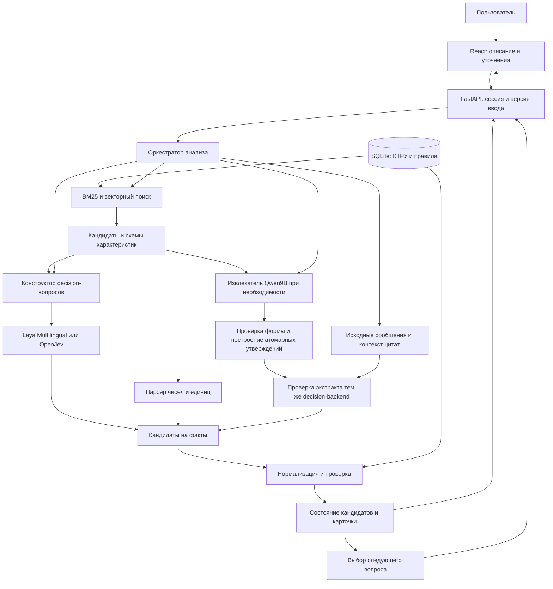

# Технический план: автозаполнение СТЕ и подбор КТРУ с открытой decision-моделью

Дата подготовки: 9 октября 2026 года.

**Статус:** проект реализации. Структура локальных XML и документация моделей изучены; приложение, замеры выбранных моделей на КТРУ и обучение по этому плану ещё не выполнены. Переданные командой измерения небольшого CPU-стенда приведены отдельно в разделе 14.1. Остальные числа для порогов, производительности и объёмов обучения являются стартовыми настройками или целями, а не полученными результатами.

**Содержание**

- [1. Что именно делаем](#1-что-именно-делаем)
- [2. Какие данные уже есть и что из этого следует](#2-какие-данные-уже-есть-и-что-из-этого-следует)
- [3. Модели: конкретный выбор и роль каждой](#3-модели-конкретный-выбор-и-роль-каждой)
- [4. Архитектура и ответственность компонентов](#4-архитектура-и-ответственность-компонентов)
- [5. Подготовка справочника: точная последовательность](#5-подготовка-справочника-точная-последовательность)
- [6. Поиск кандидатов](#6-поиск-кандидатов)
- [7. Decision-слой: какие решения он принимает](#7-decision-слой-какие-решения-он-принимает)
- [8. Извлечение значений и проверка фактов](#8-извлечение-значений-и-проверка-фактов)
- [9. Детерминированный валидатор КТРУ](#9-детерминированный-валидатор-ктру)
- [10. Диалог и выбор следующего вопроса](#10-диалог-и-выбор-следующего-вопроса)
- [11. Полный цикл обработки одного сообщения](#11-полный-цикл-обработки-одного-сообщения)
- [12. API и интеграция](#12-api-и-интеграция)
- [13. Интерфейс](#13-интерфейс)
- [14. Производительность, кэширование и память](#14-производительность-кэширование-и-память)
- [15. Проверка качества и выбор модели](#15-проверка-качества-и-выбор-модели)
- [16. Команда: кто за что отвечает и что передаёт дальше](#16-команда-кто-за-что-отвечает-и-что-передаёт-дальше)
- [17. Этапы реализации с зависимостями и критериями готовности](#17-этапы-реализации-с-зависимостями-и-критериями-готовности)
- [18. Предлагаемая структура репозитория и команды](#18-предлагаемая-структура-репозитория-и-команды)
- [19. Ошибки, отказоустойчивость и масштабирование](#19-ошибки-отказоустойчивость-и-масштабирование)
- [20. BPMN и демонстрация](#20-bpmn-и-демонстрация)
- [21. Приёмка готового решения](#21-приёмка-готового-решения)
- [22. Что делаем первым](#22-что-делаем-первым)

## 1. Что именно делаем

Создаём веб-приложение для поставщика: из свободного описания товара оно извлекает характеристики, сопоставляет их с КТРУ, нормализует значения и единицы, обнаруживает ошибки и поэтапно уточняет подходящий код. Пользователь видит промежуточный результат после каждого ввода, а не только готовую карточку в конце.

В центре семантического сопоставления — **открытая decision-модель семейства Laya / OpenJev**. Она получает описание и ограниченный набор вопросов или гипотез, возвращает оценки вариантов без генерации развёрнутого ответа. У неё две роли: сопоставлять описание со справочником и проверять, подтверждается ли каждый факт из LLM-экстракта исходным текстом. Свободные числовые и текстовые значения извлекает отдельный компонент. Ограничения справочника проверяет программный код.

Основной поток:

```text
Описание товара и уточнения пользователя
    → поиск кандидатов КТРУ
    → вопросы и гипотезы, построенные из характеристик кандидатов
    → decision-модель: сопоставление формулировок и проверка гипотез
    → извлечение свободных значений, если необходимо
    → decision-проверка каждого извлечённого утверждения по исходному контексту
    → принятие подтверждённых фактов или уточнение спорных
    → нормализация и проверка по XML
    → пересчёт кандидатов
    → конкретный вопрос / исправление / результат
```

### 1.1. Пользовательский результат

Пользователь получает:

- унифицированные характеристики с исходными фрагментами описания;
- исходные и нормализованные значения, единицы и объяснения преобразований;
- подходящие позиции КТРУ и причины исключения других;
- один следующий полезный вопрос с вариантами ответа;
- сообщения о противоречиях, неоднозначности и некорректных значениях;
- итоговую карточку с кодом, когда он достаточно обоснован;
- возможность сохранить черновик даже при неполных данных.

**Код выбран** и **все обязательные поля карточки заполнены** — разные состояния. Код может уже определиться, хотя часть обязательных характеристик ещё неизвестна.

### 1.2. Ограничения проекта

Работаем на Linux, предоставляем веб-интерфейс, используем открытые модели локально, совокупное потребление VRAM для инференса не превышает 40 ГБ. Low-code/no-code и внешние API проприетарных LLM не используем. Для демонстрации заранее скачиваем веса и собираем индексы: обработка пользовательского описания не требует доступа к интернету.

Основание: [задание организаторов](Презентация_Задачи_Хакатон_Казань_20261009_1900.md). Качество и функциональность дают 40 баллов, распознавание ошибок — ещё 12. Эти сценарии реализуем раньше дополнительной витрины покупателя.

### 1.3. Уточнение относительно первоначальной критики

Идея decision-модели в исходном обсуждении содержательная: пакетные решения и повторное использование общего контекста действительно предусмотрены открытыми реализациями. Нельзя оценивать их как обычный чат, генерирующий ответ токен за токеном.

Но требуется различать три операции: хранение независимых поисковых векторов, повторное использование контекста внутри decision-модели и повторное использование уже полученного решения. У них разные ключи кэша и условия корректности. Отсутствие генерации текста также не означает отсутствие ошибок классификации.

## 2. Какие данные уже есть и что из этого следует

В рабочей папке есть тематические XML, исходный архив КТРУ, описание структуры XML, примеры выгрузок Excel и критерии оценки.

| Рабочий XML | Позиций | `isTemplate=true` | `isTemplate=false` | Вхождений характеристик |
| --- | ---: | ---: | ---: | ---: |
| Одежда | 1 207 | 130 | 1 077 | 5 120 |
| Мебель | 402 | 99 | 303 | 2 888 |
| Инструменты | 358 | 101 | 257 | 2 435 |
| Всего | 1 967 | 330 | 1 637 | 10 443 |

Числа получены непосредственным разбором локальных XML. «Вхождения характеристик» — количество записей внутри позиций, а не число уникальных характеристик. Группа КТРУ — шаблон (`isTemplate=true`) или позиция без родителя. Конечные позиции группы определяются связью `parentPositionInfo`. Шаблон с потомками не является конечной позицией; группа без потомков, включая шаблон, сама является единственной конечной позицией (`Group.of`). У позиции `Position.group` указывает на неё саму, если это группа, иначе на родителя. Единственная позиция не отменяет проверку назначения группы.

Семантика полей, исключения и статистика дерева закреплены в [словаре данных КТРУ](Словарь%20данных%20КТРУ.md). Основной источник вида характеристики — `Characteristic.kind`: `fixed`, `single`, `multiple`. `choiceType` используется только как fallback при отсутствии `kind`; сам по себе `choiceType=2` не означает множественный выбор.

В значениях реально присутствуют `qualityDescription`, `valueSet`, `rangeSet`, `valueFormat`, `OKEI`. В диапазонах встречаются математические обозначения границ, например `lessOrEqual`. Следовательно, нельзя свести справочник к плоскому списку названий и строковых значений.

[Отчёт предварительной фильтрации](../data/yandex_disk/КТРУ/xml/filtering_report.json) сообщает о 81 465 исходных записях и тематической выборке из 1 967. В нём прямо указано, что выборка рабочая, а сопоставление периферийных категорий не является официальным соответствием классификаторов. Используем полный архив как источник расширения поиска и не объявляем отсутствующий в выборке товар «несуществующим».

### 2.1. Приоритет источников

1. КТРУ — источник кодов, характеристик, допустимых значений и единиц.
2. Описание XML — источник смысла полей, типов и правил интерпретации.
3. Excel-примеры — источник реальных формулировок и кейсов СТЕ; они не переопределяют КТРУ.
4. Пользователь — источник фактов о конкретном товаре.
5. Модель — механизм сопоставления этих фактов с формальными вариантами.

Связь категории из Excel с КТРУ нельзя объявлять точной без проверки. Торговое название, внутренняя категория портала, ОКПД2 и позиция КТРУ хранятся раздельно.

## 3. Модели: конкретный выбор и роль каждой

### 3.1. Основной набор для реализации

| Роль | Модель | Как используем | Статус выбора |
| --- | --- | --- | --- |
| Быстрые типизированные решения на русском | `convaiinnovations/laya-multilingual` | Сопоставление enum-значений, проверка LLM-экстракта по исходнику, семантическое ранжирование | Первый лёгкий кандидат; допуск после теста КТРУ |
| Альтернатива decision-слою | `AlexWortega/openjev`, подкаталог `qwen3.5-4b-nli-v5` | Проверка «подтверждено / противоречит / недостаточно данных» | Обязательный участник сравнения с Laya |
| Семантический поиск | `Qwen/Qwen3-Embedding-0.6B` | Векторы позиций и запросов, поиск кандидатов | Основной поисковый энкодер |
| Извлечение свободных значений | `Qwen/Qwen3.5-9B` | Числа, единицы, фрагменты текста и привязка к характеристикам | Вызываем только для неразобранных данных |

В рабочем профиле держим **одну выбранную decision-модель**, embedding-модель и извлекатель. Не начинаем с постоянного каскада из Laya, OpenJev и ещё одного reranker. Это усложняет диагностику, расходует память и требует дополнительной калибровки.

Выбор Laya первым кандидатом означает порядок проверки, а не заранее установленное превосходство. Если OpenJev существенно лучше на русском КТРУ при допустимой задержке, в демонстрационном профиле используем его. Контракт приложения от этого не меняется.

### 3.2. Что подтверждено об открытых decision-моделях

**Laya Multilingual.** В карточке указаны mmBERT-base, около 322 млн параметров, Apache-2.0 и типизированные решения без генерации текста. Контекст по умолчанию ограничен 1 024 токенами; расширение до 8 192 требует настройки. Для русского выбираем именно multilingual-вариант. [Карточка модели](https://huggingface.co/convaiinnovations/laya-multilingual).

**Laya и Laya Typed Decisions.** Англоязычная ветка основана на ModernBERT-large, около 421 млн параметров. В документации отдельно предупреждают об ограниченном качестве базовых весов на typed-decisions без адаптации и о потере качества при слишком большом числе вариантов. Поэтому результат специализированного англоязычного checkpoint не переносим на русский каталог. [Карточка семейства и ограничения](https://huggingface.co/convaiinnovations/laya).

**OpenJev от AlexWortega.** Выбираем конкретный репозиторий и v5, поскольку название OpenJev используют разные проекты. Это Qwen3.5 с классификационной головой: на пару «контекст, гипотеза» возвращаются три оценки NLI. В карточке указана MIT-лицензия, доступны варианты 0.8B, 2B и 4B. Русский КТРУ всё равно проверяем самостоятельно. [Карточка OpenJev](https://huggingface.co/AlexWortega/openjev).

В его `predict_hypotheses` реализован общий префикс и пакетное продолжение гипотез. Это подтверждает возможность экономить вычисления общего контекста, но не равенство стоимости любого количества решений. Число и длина гипотез влияют на память и время. [Код обработки гипотез](https://huggingface.co/AlexWortega/openjev/blob/main/modeling_openjev.py).

### 3.3. Какие альтернативы учитываем, но не тащим все в MVP

| Проект | Чем интересен | Решение для нашего проекта |
| --- | --- | --- |
| [Kev](https://github.com/jaredpalmer/kev) | Открытое семейство decision-моделей с типизированными вопросами; код под Apache-2.0 | Дополнительный кандидат, если Laya и OpenJev не проходят минимальный тест; начинаем с 4B, не с 27B |
| [Open-Jev от Zefan-Cai](https://github.com/Zefan-Cai/Open-Jev) | Отдельная реализация с LoRA, scalar head и температурой; нужны базовые веса и собственный loader | Резервный исследовательский вариант; не путать с AlexWortega/openjev |
| [Simple Jev](https://github.com/featherless-ai/simple-jev) | Получает решения из next-token logits открытых моделей без отдельного обучения головы | Контрольный baseline или резерв, если специализированный runtime не запускается |

Наличие открытого сервера не делает любую подключённую модель открытой. В `models.lock.json` фиксируем отдельно код, веса, базовую модель, лицензии и ревизии. Проприетарный Jev API в рабочую систему не подключаем.

### 3.4. Зачем остаются embedding-модель и небольшой извлекатель

`Qwen3-Embedding-0.6B` — отдельная retrieval-модель с векторами до 1 024 измерений. Начинаем с полной размерности и нормализованных векторов. Снижение размерности — только после сравнения качества. [Официальная карточка](https://huggingface.co/Qwen/Qwen3-Embedding-0.6B).

`Qwen3.5-9B` выбираем как конкретный открытый instruction-checkpoint для извлечения свободных значений; используем локально, без генерации рассуждений для пользователя. Карточка указывает Apache-2.0. [Официальная карточка](https://huggingface.co/Qwen/Qwen3.5-9B).

Это наше распределение ролей, а не утверждение, что эти модели уже проверены на КТРУ. Например, decision-модель может выбрать «Сталь» из допустимых материалов, но произвольную длину `123,7 см` удобнее извлечь парсером или извлекателем, чем создавать тысячи числовых вариантов ответа.

## 4. Архитектура и ответственность компонентов

### 4.1. Технологический стек

| Слой | Выбор для MVP | Назначение |
| --- | --- | --- |
| Backend | Python 3.11, FastAPI, Pydantic | HTTP API, валидация контрактов, управление анализом |
| Данные | SQLite, отдельные файлы индекса | Позиции, правила, сессии и версии; один сервер для хакатона |
| Лексический поиск | BM25, нормализация текста и словарь проверенных синонимов | Совпадения по точным словам, кодам и характеристикам |
| Векторный поиск | NumPy, полный поиск по матрице | Для 1 967 позиций отдельная векторная БД не нужна |
| Decision-инференс | PyTorch и официальный runtime выбранного проекта | Laya либо OpenJev через наш адаптер |
| Извлечение | Локальный vLLM-сервис с Qwen9B | Структурированный вывод по ограниченной схеме |
| Frontend | React, TypeScript, Vite | Рабочее место поставщика |
| Проверки | pytest, Ruff; Vitest, Playwright, ESLint, Prettier | Логика правил, API и пользовательские сценарии |
| Доставка | Docker Compose, Linux, NVIDIA GPU | Воспроизводимый запуск и измерение VRAM |

Точные версии библиотек закрепляем после совместного smoke-теста моделей на целевой GPU. Не ставим в документ случайные версии, которые ещё не проверены вместе. Для decision-runtime и vLLM допускаются отдельные контейнеры с разными Python-зависимостями.

Для JSON-извлечения используем structured outputs локального vLLM; поддержку нужной JSON Schema проверяем при запуске. Это ограничивает форму ответа, а не доказывает истинность значений. [Документация vLLM](https://docs.vllm.ai/en/latest/features/structured_outputs/).

### 4.2. Кто кому передаёт данные



Это схема компонентов, не BPMN. Отдельный BPMN-файл готовим для защиты по процессу из раздела 20.

### 4.3. Границы ответственности

| Компонент | Вход | Выход | Чего не решает |
| --- | --- | --- | --- |
| Импортёр | XML и документация структуры | Версионированные позиции и правила | Не выводит правила из здравого смысла модели |
| Retrieval | Описание и подтверждённые факты | Список кандидатов с источниками поиска | Не утверждает окончательную правильность кода |
| Question builder | Кандидаты, их значения, неизвестные поля | Ограниченные вопросы и гипотезы | Не придумывает отсутствующие в справочнике значения |
| Decision adapter | Контекст и вопросы | Распределения по вариантам, метаданные | Не выполняет арифметику и не создаёт новые коды |
| Extractor | Текст и допустимые целевые поля | Фрагменты и необработанные значения | Не заполняет поля по типичным свойствам товара |
| Extraction verifier | Исходный контекст и отдельные утверждения экстракта | Подтверждение, противоречие или недостаток данных по каждому факту | Не считает сам экстракт доказательством и не заменяет проверку КТРУ |
| Rule engine | Факты и правила КТРУ | Совместимость, ошибки, нормализация | Не заменяет неизвестное на ложь |
| Dialogue policy | Оставшиеся позиции и недостающие факты | Следующий вопрос или состояние завершения | Не выбирает top-1 только потому, что он первый |
| UI | Состояние анализа | Объяснимый результат и действия пользователя | Не пересчитывает бизнес-правила самостоятельно |

## 5. Подготовка справочника: точная последовательность

### 5.1. Импорт и аудит

Владелец: разработчик данных/backend. Потребители: поиск, decision-вопросы, валидатор и интерфейс.

1. Прочитать описание XML, особенно смысл `type`, `kind`, `choiceType`, `isTemplate`, статусов и периодов действия. Не угадывать перечисления по числовым значениям.
2. Зафиксировать исходные файлы, SHA-256 и дату сборки snapshot.
3. Разбирать XML потоково с учётом namespaces, отключив внешние сущности.
4. Сохранить код, версию, название, ОКПД2, даты, статус, родительские связи и признаки шаблона.
5. Сохранить каждую характеристику вместе с областью действия — конкретной версией позиции.
6. Преобразовать строковые значения, наборы чисел и диапазоны в типизированные правила.
7. Проверить дубликаты, ссылки на отсутствующих родителей, неизвестные единицы, пустые обязательные поля и неподдержанные конструкции.
8. Подготовить отчёт: сколько позиций загружено, сколько допускается в итоговую выдачу и что требует разбора.

Неизвестное правило не игнорируем: помечаем позицию `unsupported_rule` и запрещаем автоматическое подтверждение до корректной реализации. Для browsing и диагностики позиция остаётся доступной.

### 5.2. Предлагаемая схема хранения

| Сущность | Основные поля | Назначение |
| --- | --- | --- |
| `catalog_snapshots` | id, source_hashes, created_at, parser_version | Воспроизводимость каталога |
| `positions` | snapshot_id, code, version, name, okpd2, status, dates, is_template | Официальные позиции |
| `position_relations` | parent_code, child_code, relation_type, resolution_status | Группировка и проверка конечности |
| `position_characteristics` | position_id, characteristic_code, name, type, kind, required, choice_type | Характеристики в контексте позиции |
| `allowed_values` | characteristic_id, value_code, text, unit_code, value_format | Допустимые значения |
| `numeric_constraints` | value_id, exact_value, min, max, min_inclusive, max_inclusive | Наборы и интервалы |
| `aliases` | canonical_id, alias, source, reviewed | Проверенные синонимы |
| `search_documents` | document_id, position_id, part_id, text, hash | Документы для поиска |
| `sessions` | id, revision, snapshot_id, current_status | Состояние диалога |
| `facts` | session_id, characteristic_ref, raw_value, normalized_value, provenance, status | Факты о товаре |
| `analysis_runs` | id, session_revision, model_revisions, timings, status | История вычислений |
| `candidate_checks` | run_id, position_id, rule_id, result, fact_id | Причины решений |

Ключ характеристики включает позицию и версию. Одинаковый код характеристики в разных позициях не означает одинаковые допустимые значения. Уровень нормализованного «понятия», например длины, создаём отдельно и с явным отображением на исходные поля.

Числа храним через decimal-представление. Отсутствующая нижняя граница и ноль — разные вещи; открытая и закрытая граница — тоже.

### 5.3. Генерация поисковых документов

Для каждой позиции собираем детерминированный текст:

```text
Название: Фурнитура для мебели металлическая
Код: 25.72.14.130-00000002
Характеристика: Тип изделия
Допустимое значение: Полка
Характеристика: Металл
Допустимые значения: Железо; Чугун; Сталь; ...
```

Пример основан на локальном XML; многоточие здесь сокращает иллюстрацию, но не является содержимым индексируемой записи. В индекс кладём реальные полные значения. Если запись длинная, делим по характеристикам и сохраняем связь фрагментов с позицией. Не обрезаем молча отличительные признаки.

Отдельно индексируем название, код, значения и проверенные aliases. При поиске объединяем результаты фрагментов по позиции, чтобы длинная позиция с большим числом фрагментов не получила автоматического преимущества.

**Готовность этапа:** повторный импорт создаёт тот же набор записей и хешей; количество позиций сверяется с источником; для каждого правила можно открыть исходный XML-фрагмент.

## 6. Поиск кандидатов

Подбор состоит из двух этапов: поиск и проверка назначения групп, затем сужение всех конечных позиций подтверждённой группы. Контракты — [поиск групп](search.md) и [сессии анализа](sessions.md).

### 6.1. Алгоритм первого запроса

1. Сохраняем исходное описание. Поиск получает сообщения и уточнения назначения в хронологическом порядке; для поиска нормализуем пробелы, регистр и `ё/е`.
2. Код группы или конечной позиции поднимает соответствующую группу на первое место. Неизвестный код не останавливает поиск по описанию.
3. Объединяем лексический TF-IDF, векторный поиск и проверенные синонимы через RRF с `k=60`. Если в поисковом API задана категория, она применяется как жёсткий фильтр до ранжирования.
4. Берём разные группы из top-K (`GROUP_TOP_K=5|10`, по умолчанию 10). Дочерние позиции и дубли не занимают отдельные места.
5. Проверяем назначение каждой группы через decision-модель по исходному описанию, уточнениям и сведениям каталога. Результаты `supported`, `contradicted`, `not_stated` сохраняются в `group_checks`. Top-1 поиска сам по себе не подтверждает группу.
6. Автоматически выбираем единственную подтверждённую группу, если остальные проверенные группы противоречат назначению. После явного ответа пользователя о назначении достаточно подтверждения выбранной им группы. В обоих случаях действуют пороги проверки из контракта сессий.
7. После подтверждения берём **все конечные позиции группы**, независимо от их попадания в поисковый top-K. Принятые факты и ответы пользователя пересчитывают совместимость по правилам каждой позиции.

### 6.2. Неопределённое назначение и число позиций

При неоднозначности, пустой выдаче или отклонении всех top-K возвращаем `needs_clarification`, `path: null`, пустые `candidates` и вопрос `kind: purpose`. Вопросы о характеристиках неподтверждённой группы не задаём. Текущая реализация уточняет назначение без автоматического расширения поиска; отклонение top-K не доказывает отсутствие товара в каталоге и само по себе не даёт `out_of_scope`. Сбой проверки назначения даёт `technical_error`.

Ответ о назначении добавляет уточнение и запускает поиск и проверку заново, а не принудительно выбирает код. Группа без потомков, в том числе шаблон, после подтверждения назначения рассматривается как группа с одной конечной позицией.

После проверки характеристик ноль совместимых конечных позиций означает `conflict`, одна — `resolved`. Несколько позиций требуют различающего вопроса; если доступные характеристики их не различают, возвращаем `ambiguous_in_catalog`. Это результат в выбранной группе, а не доказательство уникальности во всём каталоге. Полнота обязательных характеристик учитывается отдельно от определения кода.

### 6.3. Проверка поиска

Охват поиска измеряем по группам: код эталонной позиции переводим в её группу через `Position.group`, затем считаем Recall@K для применяемых K=5 и K=10. Проверку назначения оцениваем отдельно от ранжирования; методика и ограничения — [замер проверки групп](../evals/reports/2026-10-10-group-validation.md).

После подтверждения группы проверяем охват всех её конечных позиций: поисковый лимит не должен ограничивать множество для детерминированных правил и диалога.

## 7. Decision-слой: какие решения он принимает

### 7.1. Не один вопрос «какой код правильный», а несколько проверяемых задач

| Задача | Пример входа | Ответ модели | Дальнейшее действие |
| --- | --- | --- | --- |
| Сопоставить смысл типа товара | «стеллаж для архива» и описания возможных типов | Оценки типов | Приоритет кандидатов, без необратимого исключения |
| Сопоставить enum-значение | «стальная» и допустимые металлы | Оценка «Сталь» плюс неизвестность | Кандидат на нормализованный факт |
| Проверить утверждение | «У товара металлический каркас» | Подтверждено / противоречит / недостаточно данных | Подтверждение, вопрос или снижение ранга |
| Проверить LLM-экстракт | Исходный фрагмент и утверждение «Материал столешницы — металл» | Подтверждено / противоречит / недостаточно данных | Допуск факта к принятию либо исправление/уточнение |
| Разрешить неоднозначную привязку | «ширина полки 80 см» и поля разных объектов | Оценки привязок | Выбрать поле либо запросить уточнение |
| Понять исправление | «нет, не деревянный, металлический» | Новое утверждение и отрицание старого | Предложить замену факта с сохранением истории |

Низкая оценка принадлежности позиции не равна доказанному противоречию. По умолчанию семантическая модель ранжирует и предлагает факты; жёсткое исключение основываем на принятом факте и конкретном правиле каталога.

### 7.2. Построение вопросов

Question builder получает список кандидатов и группирует характеристики по проверенному смысловому соответствию. Затем строит короткие вопросы из реальных названий и значений.

Для каждой неоднозначной проверки задаём три исхода:

- `supported`: описание явно подтверждает утверждение;
- `contradicted`: описание явно несовместимо с утверждением;
- `not_stated`: сведений недостаточно.

Внутри Laya используем нейтральные ключи `a`, `b`, `c` с содержательными описаниями вариантов. Это наш формат, который нужно проверить на КТРУ; он не превращает Laya в модель с гарантированной NLI-семантикой. OpenJev адаптируем из его родных NLI-выходов.

Пример запроса к нашему адаптеру, не к upstream SDK:

```json
{
  "state": "Полка для мебели, стальная, ширина 80 см.",
  "questions": [
    {
      "id": "metal_is_steel",
      "kind": "claim_status",
      "claim": "Металл изделия — сталь.",
      "options": [
        {"id": "a", "meaning": "Описание явно подтверждает утверждение"},
        {"id": "b", "meaning": "Описание явно противоречит утверждению"},
        {"id": "c", "meaning": "В описании недостаточно сведений"}
      ]
    }
  ]
}
```

Все три исхода проверяем на минимальных парах: «стальная», «не стальная», «металл не указан». Не задаём вопрос «подходит ли сталь?» так, чтобы модель могла ответить на физическую возможность, а не на наличие информации в тексте.

### 7.3. Работа с количеством вопросов

Стартовые ограничения приложения; окончательные размеры выбираем по профилированию, а не фиксируем произвольно:

- до 12 содержательных вариантов в одном enum-вопросе плюс «не указано» и «другое»;
- начинаем с 16 коротких проверок в микробатче, сравниваем 8/16/32/64 и выбираем размер под длину входа, память и P95;
- ограничение по суммарным токенам важнее ограничения по числу вопросов;
- широкие справочники значений сначала сужаем поиском, сохраняя возможность расширения;
- распределения из разных наборов `choice` не сравниваем напрямую.

Позиции с одинаковой характеристикой и одинаковым набором значений используют один результат сопоставления. Проверка материала нужна один раз для группы соответствующих характеристик, а не заново для каждой позиции. При различиях правил результаты применения к позиции считаются отдельно.

Decision-вызовы выполняем через общий планировщик: убрать дубликаты → найти готовые результаты → сгруппировать оставшееся по контексту и длине → выполнить микробатчи → раздать результаты потребителям. Не делаем последовательный вызов модели для каждой позиции, характеристики или факта. Конкретные кэши и правила планирования описаны в разделах 14.7–14.13.

### 7.4. Общий интерфейс decision-моделей

```python
class DecisionBackend:
    def decide(self, state, questions, *, limits, revision):
        """Возвращает DecisionBatchResult без изменения состояния сессии."""

    def decide_batch(self, requests, *, limits):
        """Пакет независимых запросов с сохранением request_id/question_id."""

    def health(self):
        """Модель, ревизия, готовность, устройство и поддержанные режимы."""
```

Это наш прикладной интерфейс. Адаптер преобразует его в поддержанные операции конкретного runtime; одинаковый HTTP-пакет не обязательно означает один физический forward. Для измерений сохраняем число реальных проходов, обработанных пар и повторных вычислений контекста.

Каждый ответ включает `question_id`, `option_ids`, `raw_scores`, `probabilities`, `selected_option`, `abstained`, `model_revision`, `schema_hash`, `input_hash`, `latency_ms`, `truncated`.

`raw_scores` сохраняем для диагностики и калибровки, но не выдаём пользователю как доказательство. Если runtime не предоставляет logits, явно отмечаем их отсутствие и не выдаём преобразованные вероятности за исходные logits.

Не прошедший проверку размерности, NaN, неизвестный option ID или обрезанный значимый контекст превращается в техническую ошибку/уточнение. Сервер не принимает частично корректный ответ как успешное решение.

### 7.5. Порог принятия

Пороги определяем на отдельной calibration-выборке для каждого вида задач. Возможная стартовая политика для эксперимента: принять семантическое сопоставление при `p ≥ 0,90` и отрыве от второго варианта `≥ 0,20`; иначе спросить пользователя. До проверки эти значения не считаем вероятностной гарантией.

Долю автоматически принятых решений всегда показываем вместе с долей ошибок среди них. Высокая точность при отказе отвечать почти во всех случаях не считается достаточным качеством.

Для отрицания и неизвестности метрики считаем отдельно. Главная опасная ошибка — превратить «не указано» в конкретное значение или в основание исключить правильный код.

## 8. Извлечение значений и проверка фактов

### 8.1. Быстрый путь без генеративной модели

Сначала выполняем точные сопоставления по проверенным aliases и парсер чисел/единиц. Например, `1,2 м`, `120 см`, `1200 мм` приводим к сопоставимым величинам после определения поля и размерности.

Изолированное `120` не получает автоматически сантиметры. `80×60×75` не превращается в длину, ширину и высоту без установленного порядка. «Стол с металлическими ножками» не означает «материал столешницы — металл».

Если parser, aliases и decision-вопросы покрыли все явно заданные факты, пропускаем генеративное извлечение. Проверка русского написания — отдельный проход (§8.8): покрытие фактов не доказывает отсутствие опечаток.

### 8.2. Когда вызываем Qwen9B

Для извлечения фактов вызов нужен в следующих случаях; отдельную проверку написания запускаем по §8.8.

- число есть, но непонятно, к какому полю оно относится;
- значение свободное, а не выбор из короткого перечня;
- описание содержит несколько объектов или составных частей;
- пользователь прислал длинное исправление;
- после decision-слоя остался существенный неразобранный фрагмент.

Передаём исходный текст, текущие принятые факты и ограниченный список целевых характеристик. Не передаём весь каталог и не просим сразу придумать конечный код.

Модель возвращает `attribute_ref`, `raw_value`, `raw_unit`, `source_quote`, `source_message_id`, `negated`, `uncertain`, а при описании составного товара — `subject_ref` для объекта или его части. Неоднозначный объект не назначаем автоматически. Числовое преобразование выполняется позже. Генератору разрешён пустой результат; нет обязательного требования заполнить каждое поле.

### 8.3. Контракт факта

```json
{
  "fact_id": "f_17",
  "attribute_ref": "width",
  "raw_value": "80",
  "raw_unit": "см",
  "normalized_value": "800",
  "normalized_unit": "мм",
  "source": {
    "message_id": "m_2",
    "quote": "ширина 80 см",
    "start": 0,
    "end": 12
  },
  "origin": "text_extraction",
  "status": "proposed",
  "normalization_rule": "length.cm_to_mm",
  "supersedes": null
}
```

Здесь координаты иллюстрируют сообщение, состоящее ровно из `ширина 80 см`; конечный индекс в реализации вычисляем кодом по принятой системе координат. Модель не считается надёжным вычислителем offsets. При интеграции фиксируем Unicode code points на backend и корректное преобразование для JS-подсветки.

`attribute_ref` — внутреннее понятие; его связь с исходной характеристикой КТРУ хранится явно. Значения в примере показывают формат, а не готовую универсальную схему всех товаров.

Статусы: `proposed`, `accepted_from_text`, `confirmed_by_user`, `rejected`, `superseded`, `needs_clarification`. Принятый из текста факт и подтверждённый пользователем факт не смешиваем в отчётах качества.

### 8.4. Проверки после извлечения

1. Поле существует в переданном списке.
2. Цитата действительно присутствует в указанном сообщении.
3. Значение связано с цитатой, а не только формально допустимо.
4. Единица известна и совместима с размерностью характеристики.
5. Число распарсилось без потери знака, десятичного разделителя и диапазона.
6. Отрицания не потеряны.
7. Конфликт со старым фактом обработан явно.
8. Значение не записывается в финальную карточку только потому, что оно типично для товара.

Наличие цитаты не доказывает правильность связи с полем. Каждый факт, предложенный генеративным извлекателем, перед автоматическим принятием проходит отдельную decision-проверку по разделу 8.5. Она не требуется для значения, которое пользователь сам явно ввёл и подтвердил в конкретном поле, но проверка правил КТРУ остаётся обязательной. При ошибке JSON допускаем одну ограниченную повторную попытку; после неё показываем форму ручного ввода.

### 8.5. Decision-модель как валидатор LLM-экстракта

**Задача:** установить, следует ли извлечённый факт из исходного описания. Сравниваем два представления: исходный текстовый фрагмент с необходимым контекстом и одно атомарное утверждение, построенное из результата извлечения.

Проверять весь JSON одним вопросом «всё ли верно?» недостаточно: один неправильный материал может затеряться среди нескольких правильных чисел. Поэтому каждому факту назначаем `fact_id` и получаем отдельный вердикт. Пакетная обработка позволяет проверить несколько утверждений по общему контексту в одном запросе к model worker.

Пример исходника: «Стол с металлическими ножками, столешница деревянная, ширина 120 см».

| Атомарное утверждение из экстракта | Эталонный вердикт | Действие |
| --- | --- | --- |
| Ножки стола металлические | `supported` | Допустить факт к принятию при достаточной уверенности |
| Столешница стола металлическая | `contradicted` | Не принимать; предложить исправление или уточнить |
| Ширина стола составляет 120 см | `supported` | Проверить привязку, принять исходное значение и затем нормализовать |
| Высота стола составляет 75 см | `not_stated` | Оставить высоту неизвестной |

Это ожидаемые ответы теста, а не уже измеренные результаты Laya/OpenJev.

**Порядок работы verifier:**

1. Проверить структуру экстракта, допустимость ссылок на поля и наличие цитаты в реальном сообщении.
2. По шаблону собрать утверждение из объекта, характеристики, исходного значения, единицы и отрицания. Например: «Материал столешницы стола — металл». Не поручать второй LLM свободно пересказывать факт: при пересказе можно потерять существенный признак.
3. Получить контекст из сохранённых сообщений по их ID. Цитата, предложенная извлекателем, служит указателем, а не единственным источником доказательства.
4. Передать контекст и утверждения выбранному decision-backend. Текст задания: проверить подтверждение сведений в источнике, а не их правдоподобность или допустимость в КТРУ.
5. Сохранить распределение по `supported`, `contradicted`, `not_stated`, вердикт, отказ от решения и provenance проверки.
6. Применить отдельный продуктовый порог verifier `supported >= 0,90` для закреплённой ревизии OpenJev. Автопринятие включено при структурной корректности, однозначной привязке и актуальности. Это сырая оценка модели, не гарантия 90% правильности; предварительное доказательство 99% точности не требуется. Порог enum сюда не переносится.
7. Передать разрешённые факты в fact merger; спорные сохранить для уточнения. Ни одна неподтверждённая гипотеза не становится основанием жёсткого исключения позиции.

В OpenJev используем NLI-оценки для пары «контекст — утверждение» через существующий адаптер. В Laya задаём трёхвариантный вопрос с явно описанными исходами. Это две реализации одного прикладного контракта, а не утверждение об одинаковом качестве или взаимозаменяемости их вероятностей.

### 8.6. Контекст проверки и решение по вердикту

Для короткого описания передаём полное сообщение. Для длинного — предложения вокруг цитаты, заголовок или наименование объекта и связанные уточнения из диалога. Размер окна выбираем по фактическому token budget; при недостатке контекста расширяем его или запрашиваем уточнение, а не молча отрезаем значимые части.

В контекст должны попадать отрицания, условия, ссылки на части товара и последующие исправления. Например, старое «ширина 120 см» не считается актуальным доказательством после «исправляю: ширина 100 см». Проверка принадлежит конкретной ревизии сессии; изменение связанных сообщений инвалидирует результат.

Не добавляем описание кандидата КТРУ или текст самого экстракта в блок исходных фактов: иначе валидатор может принять предложенное значение за сведения пользователя. Наименование поля и объекта передаём как проверяемую гипотезу или метаданные задания, а не как доказательство.

| Результат проверки | Состояние факта | Следующее действие |
| --- | --- | --- |
| `supported >= 0,90`, ревизия, структура, привязка и актуальность проверены | `accepted_from_model` | Нормализация и проверка КТРУ |
| Уверенный `contradicted` | `rejected` для этой версии предложения | Одна ограниченная попытка повторного извлечения, затем повторная проверка |
| `not_stated` | `needs_clarification`; значение не принято | Не заполнять поле; спросить только при необходимости |
| Низкая уверенность, спорные оценки, недостаточный контекст | `needs_clarification` | Расширить контекст в пределах лимита либо задать вопрос |
| Таймаут, сбой или невалидный ответ verifier | Остаётся `proposed` | Не принимать автоматически; сохранить черновик и предложить подтверждение |

Повторное извлечение при противоречии — максимум одна семантическая коррекция на анализ, отдельно от одной попытки починить невалидный JSON. Повтор получает тот же источник и указание проблемного поля, но не готовое «правильное» значение от verifier. Новый экстракт обязательно проверяется заново; бесконечного цикла нет.

Verifier проверяет исходные значения, например `120 см`. Преобразование `120 см → 1200 мм` выполняет код и проверяет отдельным правилом: decision-модель не используется как арифметический арбитр.

### 8.7. Хранение, кэш и проверка качества verifier

Продуктовый extractor — Qwen3.5-9B, ревизия `c202236235762e1c871ad0ccb60c8ee5ba337b9a`. Рабочий контракт и точные поля хранения — [docs/sessions.md](sessions.md#проверяемое-извлечение-свободных-значений), независимые результаты и ограничения — [отчёт verifier](../evals/reports/2026-10-10-verified-extraction.md).

В `Fact.verification` сохраняем `claim`, `message_ids`, `context_hash`, `session_revision`, `extractor_revision`, `model_revision`, `verdict`, `probabilities`, `binding_valid`, `template_version`, `policy_version`, `threshold`. Отсутствие результата verifier отмечается вердиктом `unavailable`; технические распределения доступны в API, а пользователь видит источник и понятное состояние.

Используем тот же model worker и выбранный decision-checkpoint; дополнительная копия модели не нужна. Факты группируем по одинаковому исходному контексту, затем проверяем штатным батчем. Включаем повторное использование префикса только в поддержанном и проверенном режиме. Ключ result cache включает контекст, полное утверждение, ревизии модели/шаблона/калибровки и актуальность сессии.

Отдельно измеряем:

- долю ошибочных экстрактов, которые verifier ошибочно пропустил как подтверждённые;
- долю правильных фактов, ошибочно отклонённых или отправленных на уточнение;
- точность принятых фактов и долю автоматически принятых предложений;
- ошибки по объектам, отрицаниям, числам, единицам и исправлениям в диалоге;
- добавленную P50/P95-задержку и число повторных извлечений;
- конечное качество подбора кода с verifier и без него при одинаковом входе.

Тестируем как реальные ошибки извлекателя, так и контролируемые искажения: подмена материала, перенос свойства между частями товара, выдуманная высота, неверная единица, потерянное отрицание, устаревшее значение после исправления. В независимый test включаем и правильные экстракты, чтобы обнаружить чрезмерное отклонение полезных фактов.

Decision-проверка снижает риск принятия недостоверного экстракта, но не доказывает его истинность: модели могут ошибаться одинаково. Она также не обнаруживает автоматически все пропущенные извлекателем факты. Полноту извлечения оцениваем отдельно по эталонной разметке; обязательные неизвестные характеристики обрабатывает dialogue policy.

### 8.8. Русские опечатки и проверенные синонимы

Сохраняем исходное сообщение неизменным. Орфографический проход Qwen3.5-9B получает каждое новое русское описание, возвращает предложения и может вернуть пустой список. Его `corrected_text` не заменяет текст пользователя: проверяем соответствие заявленных замен исходным цитатам, затем показываем предложения. Пропуск ошибки моделью не означает корректность входа. Числа, единицы, бренды и артикулы не меняются по орфографической гипотезе.

OpenJev не используем как обязательный фильтр перед этим проходом: на 40 development-примерах порог 0,3 нашёл 20/20 ошибок, но отправил в LLM 38/40 текстов; порог 0,4 пропустил 2/20. Пороги выбраны на этом же наборе и не откалиброваны. Прямой Qwen-проход нашёл по списку ошибок 11/20, точно исправил 13/20 и сохранил 20/20 корректных текстов. Это экспериментальные результаты, а не приёмка всего распознавания ошибок; [полный отчёт](../evals/reports/2026-10-10-qwen4b-typos-api.md).

Для перечислимой характеристики добавляем воспроизводимый словарный путь:

1. Сначала точное сопоставление и проверенный alias в контексте конкретного поля/компонента. Для сравнения допускаем регистр, пробелы и е/ё, сохраняя исходник. Совпадение alias даёт `synonym`, а не `typo`.
2. Собираем значения из полного объявленного scope и индекса символьных 3-грамм. Для коротких слов используем 2-граммы; итоговое расстояние считаем по всем допустимым значениям, чтобы ограничение retrieval не стало доказательством отсутствия.
3. Считаем расстояние Дамерау–Левенштейна по нормализованной строке (вставка, удаление, замена, перестановка соседних символов). Начальные пределы: длина до 3 — только точное совпадение; 4–7 — расстояние ≤1; от 8 — ≤2 и доля правок ≤0,25. Длину берём как максимум длин исходника и кандидата; для фраз дополнительно проверяем расстояние слов и сохраняем порядок. Эти пределы — baseline, калибровать их нужно отдельно (§15).
4. Если точного значения нет, но есть близкое, выдаём `typo` с исходником, расстояниями и допустимыми кандидатами. Равные лучшие варианты либо несколько близких значений требуют выбора пользователя. Никакая замена не применяется скрыто.
5. Если близких значений нет, передаём проверку enum в §9.3. LLM может предложить альтернативу, но не объявляет новое значение частью справочника.

Словарь aliases хранится как данные: `id`, `alias`, `canonical`, `source` (файл, лист, ячейка), `reviewed`, контекст и ограничение применения. Начальные три записи из выгрузок включены в [fixture](../evals/datasets/errors_ru_v1.json). «х/б напыление» относится к напылению перчатки; не переносим хлопок на материал основы. Пополнение словаря за пределами этих проверенных примеров в этот этап не входит.

## 9. Детерминированный валидатор КТРУ

Владелец: backend/data. На этом этапе не вызываем нейросеть для сложения, пересчёта единиц или сравнения с границей.

### 9.1. Правила проверки

Для каждой пары «позиция — факт» получаем один из результатов:

| Результат | Значение | Влияние на кандидата |
| --- | --- | --- |
| `match` | Принятый факт удовлетворяет правилу | Подтверждает совместимость |
| `mismatch` | Принятый факт нарушает конкретное правило | Основание исключения при надёжной привязке факта |
| `unknown` | Нужный факт не сообщён | Кандидат остаётся, возможно уточнение |
| `ambiguous` | Значение или привязка неоднозначны | Кандидат остаётся до уточнения |
| `not_applicable` | Поле не относится к этой позиции | Не используем как автоматическое противоречие |
| `unsupported` | Правило пока не реализовано | Автоподтверждение позиции блокируется |

Несоответствие выбранной позиции может означать, что выбрана неверная позиция, а не что пользователь ошибся в характеристике. Сообщение формулируем как «значение не соответствует этой позиции», пока не доказано иное.

### 9.2. Числа, диапазоны, единицы

- Проверяем размерность до преобразования: длина не сравнивается с массой.
- Учитываем включённость каждой границы интервала.
- Для набора чисел проверяем принадлежность набору, а не только попадание между минимумом и максимумом.
- Если пользователь указал диапазон, задаём смысл сравнения: весь заявленный диапазон должен удовлетворять правилу, если документация не требует иной семантики. Не подменяем это простым пересечением интервалов.
- Несколько вариантов значений внутри характеристики интерпретируем по документации, включая правила одиночного и множественного выбора.
- Масштаб единицы не исправляем по «правдоподобности» без подтверждения.

### 9.3. Ошибки и исправления

| Класс / ситуация | Реакция |
| --- | --- |
| `typo`: нет точного значения, есть близкое допустимое | Исходная цитата → предложение, список кандидатов и расстояния по §8.8; исправление видно пользователю |
| `value_not_in_catalog`: enum отсутствует во всём полном scope и не близок к допустимому | Ошибка ввода в указанной области; показываем полный перечень допустимых и ближайшие значения без автоматической замены |
| `out_of_range`: число вне `rangeSet` или `valueSet` | Цитируем границы с включённостью, единицу или дискретный список и XML-ссылку; показываем введённое число |
| `synonym`: проверенное бытовое название | Запись в `normalizations`, не в `errors`; исходник → термин и источник словаря |
| Значение не подходит одной позиции, но подходит другой в группе | `RuleCheck.mismatch` и смена кандидата; не объявляем ошибку ввода |
| «100 метров» для полки, у которой нет подтверждённого ограничения | Только предположение и вопрос о единице; правдоподобие не создаёт `out_of_range` |
| Два разных материала в сообщениях | Явное исправление заменяет факт с историей; иначе уточнение |
| «металлические ножки, деревянная столешница» | Разные компоненты, не конфликт сами по себе |
| Свойство отсутствует в схеме позиции | Дополнительный факт; отсутствие свойства отличается от запрещённого значения перечислимой характеристики |
| Отсутствует обязательная характеристика | `warnings` о неполноте и следующий вопрос |

**Позиция и группа.** Scope содержит snapshot и явный список/идентификатор группы позиций. Проверяем объединение значений одной и той же характеристики и компонента, включая ранее исключённых по этому факту кандидатов, иначе ошибка была бы круговым выводом. Если значение есть хоть в одной позиции, показываем несовместимость конкретного кандидата. `value_not_in_catalog` означает «значения нет в проверенной группе», а не «товар не существует». При неполном top-K, неподдержанном правиле или неизвестной привязке поля вывод об отсутствии запрещён: расширяем scope либо уточняем. Если близкий вариант найден, выбираем `typo`, а не две ошибки на один факт. За пределами enum свободное значение сохраняется без такого диагноза.

**Числа.** Используем Decimal после проверки размерности; допустимость определяется объединением всех вариантов `rangeSet`/`valueSet`, а не одним первым интервалом. Например, 135° не принадлежит набору {90°, 180°}, хотя лежит между его минимумом и максимумом. Соседнюю единицу мм ↔ см ↔ м предлагаем только если пересчёт делает число совместимым с реальным правилом. Это гипотеза о единице с подтверждением, исходная единица остаётся. При совместимости другого кандидата показываем позиционное несоответствие; при несовместимости всей полной группы — `out_of_range` в этой группе.

Правила, запрещающие добавление характеристик или ограничивающие их выбор, переносим из XML только после проверки документированного смысла полей. Дополнительный факт в черновике не означает разрешение включить его в конечный экспорт.

### 9.4. Объяснение результата

Каждое объяснение строим шаблоном из `rule_id`, ссылки на позицию, принятого факта и исходного фрагмента. Например: «Для этой позиции ширина должна быть не более X; в описании указано Y». X и Y берутся из данных, а не генерируются моделью.

Модельный вывод без независимого правила описываем как предположение: «Возможно, имеется в виду…». Не придумываем причину исключения постфактум.

## 10. Диалог и выбор следующего вопроса

### 10.1. Состояния приложения

| Статус | Когда устанавливается | Что видит пользователь |
| --- | --- | --- |
| `draft` | Описание ещё не отправлено | Поле ввода |
| `needs_clarification` | Не подтверждено назначение группы либо нужны сведения для сужения | Вопрос о назначении или характеристике |
| `conflict` | Противоречивые факты либо нет совместимых конечных позиций группы | Конкретные значения и причины несовместимости |
| `resolved` | В подтверждённой группе осталась одна совместимая конечная позиция | «Код определён» и состояние карточки |
| `ambiguous_in_catalog` | Несколько совместимых позиций неразличимы по доступным характеристикам | Оставшиеся позиции и общие поля |
| `out_of_scope` | Описание не относится к товару | Просьба описать товар |
| `technical_error` | Недоступна модель или произошёл сбой | Сохранённые данные и возможность повторить |

Определение кода и заполненность карточки независимы: `resolved` допускает `card_complete: false`. Недостающие обязательные характеристики перечислены в `missing_required`, неподдержанные правила — в `unsupported_rules`. До подтверждения группы `path` равен `null`; после подтверждения содержит категорию, группу и число совместимых конечных позиций.

### 10.2. Как выбираем вопрос

На первом этапе уточняем **назначение** (`kind: purpose`). До подтверждения группы не спрашиваем её специфические характеристики. Выбор пользователем варианта назначения требует повторной проверки группы; «Другое» и «Не знаю» предлагают дополнить описание.

На втором этапе работаем со всеми конечными позициями подтверждённой группы. Сначала устраняем конфликт фактов (`kind: conflict`), затем различаем оставшиеся совместимые позиции (`kind: discriminate`). После определения кода заполняем недостающие обязательные характеристики (`kind: required`).

Для каждого неизвестного поля:

1. Берём реальные допустимые значения из схем оставшихся совместимых конечных позиций группы.
2. Для каждого варианта ответа считаем, сколько этих позиций останется совместимыми.
3. Оцениваем ожидаемое уменьшение их числа.
4. Штрафуем большое число вариантов и повтор вопроса.
5. После «Не знаю» не повторяем вопрос по характеристике до смены контекста.

Эвристика:

```text
полезность вопроса = ожидаемая доля исключённых конечных позиций
                    − штраф за число вариантов
                    − штраф за повтор
```

Перекрывающиеся допустимые значения учитываем явно: один ответ может сохранить несколько позиций. Полезность — эвристика, а не вероятность ответа пользователя. Вопросы формируются по правилам каталога с учётом `Characteristic.kind`, а не универсальной трактовки `choiceType`.

### 10.3. Пример поведения

Условный тестовый каталог: группа «Стол» с двумя конечными позициями, которые различаются материалом столешницы — ДСП и ЛДСП.

1. Пользователь вводит «стол»; поиск находит группу, проверка подтверждает назначение.
2. Путь показывает «Мебель → Стол → 2 позиции».
3. Система спрашивает материал столешницы по значениям обеих конечных позиций.
4. Пользователь выбирает «ЛДСП». Ответ сохраняется в `dialog` и как факт `confirmed_by_user` в `facts`.
5. Правила пересчитываются для обеих позиций. Позиция с ДСП исключается, но остаётся в `candidates` с причиной. Путь показывает одну совместимую позицию, статус — `resolved`.
6. Если остались обязательные незаполненные поля, `card_complete` остаётся `false` и следующий вопрос заполняет карточку. Единственные допустимые значения обязательных полей могут быть выведены из каталога.

Это иллюстрация тестового каталога, а не обещание выбрать реальный код по одному ответу. При неуверенности в назначении первый вопрос был бы о группе, а не о материале.

### 10.4. Когда вопросы прекращаются

- Код определён и обязательные поля заполнены.
- Пользователь не знает требуемых данных: сохраняем состояние, `unanswered` и недостающие обязательные поля.
- Позиции неразличимы по доступным характеристикам: `ambiguous_in_catalog`, общие поля в `common_fields`, без бесконечного опроса.

Отсутствие следующего вопроса не означает автоматически ни определённый код, ни полную карточку: проверяем `status` и `card_complete` раздельно.

## 11. Полный цикл обработки одного сообщения

Все шаги работают с фиксированными `session_revision` и `catalog_snapshot_id`.

| Шаг | Исполнитель | Вход | Выход и следующий получатель |
| --- | --- | --- | --- |
| 1 | UI | Описание/ответ/исправление | Запрос API с idempotency key |
| 2 | API | Запрос и текущая сессия | Новая ревизия, запись сообщения, `run_id` |
| 3 | Parser | Новое сообщение | Явные числа, единицы, aliases → facts buffer |
| 4 | Retrieval | Текст и текущие факты | Кандидаты → question builder |
| 5 | Question builder | Схемы кандидатов и неизвестные поля | Decision-вопросы → ML worker |
| 6 | Decision backend | Контекст и вопросы | Предлагаемые сопоставления → facts buffer |
| 7 | Extractor, при необходимости | Неразобранный текст и поля | Предложенные свободные значения с цитатами → extraction verifier |
| 8 | Extraction verifier через decision-backend | Атомарные утверждения и исходный контекст | Вердикты по фактам → facts buffer; при противоречии — ограниченная коррекция |
| 9 | Fact merger | Старые факты и новые предложения с результатами проверки | Принятые факты, замены, конфликты и непринятые предложения для уточнения |
| 10 | Rule engine | Принятые факты и правила | Совместимость → candidate manager |
| 11 | Candidate manager | Проверки, поиск и охват | Кандидаты и причины; при необходимости один цикл расширения |
| 12 | Dialogue policy | Кандидаты, спорные предложения и обязательные поля | Следующий вопрос либо результат |
| 13 | API | Полный результат | Атомарная запись только для актуальной ревизии |
| 14 | UI | События/ответ | Карточка, кандидаты, предупреждения, вопрос |

Вызовы между компонентами ограничены. Оркестратор — обычный программный процесс, не автономный LLM-агент, который сам решает, какие инструменты запускать.

При новом сообщении старый результат не может перезаписать новую ревизию. Повтор запроса с тем же idempotency key возвращает прежний `run_id`, а не создаёт дубликат обработки.

Правка одного факта может расширить множество кандидатов. Не применяем к новому состоянию старое необратимое множество исключений.

## 12. API и интеграция

### 12.1. Внешние endpoints приложения

| Метод и путь | Назначение |
| --- | --- |
| `POST /api/v1/sessions` | Создать черновик сессии |
| `POST /api/v1/sessions/{id}/messages` | Добавить описание или свободный ответ |
| `POST /api/v1/sessions/{id}/answers` | Ответить на конкретный вопрос по `question_id` |
| `PATCH /api/v1/sessions/{id}/facts/{fact_id}` | Подтвердить, исправить или удалить факт с указанием ожидаемой ревизии |
| `GET /api/v1/sessions/{id}` | Получить актуальное состояние |
| `GET /api/v1/positions/{code}` | Детали позиции |
| `GET /health/live` | Процесс работает |
| `GET /health/ready` | Справочник загружен |
| `GET /health/models` | Состояние модели эмбеддингов и поискового индекса |

SSE обработки и экспорт карточки остаются планируемыми интеграциями; действующий ответ сессии описан ниже.

### 12.2. Пример ответа анализа

Успешные операции сессии синхронно возвращают `SessionState`; актуальные поля и запросы описаны в [контракте сессий](sessions.md), тип ответа — `backend/app/domain/sessions.py`. В этом ответе нет `run_id`, `catalog_snapshot_id` или `coverage_scope`. SSE не является частью действующего контракта сессий.

Ниже согласованный пример контракта для сценария §10.3: описание «стол», затем ответ `{"question_id": "q1", "option_id": "o1"}` («ЛДСП»). Каталог и проверка назначения — из HTTP-фикстур `table_group` / `group_api` в `backend/tests/conftest.py`: `tables`, `table-large`, `table-small` — условные идентификаторы, не реальные коды КТРУ; оценки `fixture` не являются замером модели. Единственная допустимая ширина выбранной позиции заполнена из каталога, поэтому карточка полна.

Пример основан на HTTP-ответе этого сценария с одним исправлением для согласованности: `path.positions` указан как 1, равный `candidate_counts.compatible`. При проверке текущей реализации после ответа о характеристике это поле сохраняет прежнее значение 2. Исправление пересчёта пути требует отдельной правки backend; остальные поля примера взяты из ответа без изменений.

```json
{
  "session_id": "e21fff85-fca0-4be1-b204-8d4359d2178f",
  "revision": 2,
  "status": "resolved",
  "messages": [
    {
      "id": "5c7267b9-a9d2-4468-9b7f-024ddafda863",
      "text": "стол",
      "created_at": "2026-10-10T10:47:17.609087+00:00"
    }
  ],
  "path": {
    "category": "Мебель",
    "group": {"code": "tables", "name": "Стол", "role": "group_template"},
    "positions": 1
  },
  "alternatives": [],
  "candidates": [
    {
      "code": "table-large",
      "name": "Стол",
      "excluded": false,
      "reason": null,
      "matched_facts": ["answer:q1"],
      "checks": [{"fact_id": "answer:q1", "result": "match"}],
      "returned_reason": null,
      "role": "ktru_position"
    },
    {
      "code": "table-small",
      "name": "Стол",
      "excluded": true,
      "reason": {
        "fact_id": "answer:q1",
        "characteristic": "Вид материала столешницы",
        "allowed": "дсп",
        "given": "лдсп",
        "text": "для этой позиции вид материала столешницы: дсп; указано лдсп"
      },
      "matched_facts": [],
      "checks": [{"fact_id": "answer:q1", "result": "mismatch"}],
      "returned_reason": null,
      "role": "ktru_position"
    }
  ],
  "candidate_counts": {"in_group": 2, "compatible": 1, "excluded_by_rules": 1},
  "facts": [
    {
      "id": "answer:q1",
      "field": "Вид материала столешницы",
      "characteristic_name": "Вид материала столешницы",
      "raw_value": "ЛДСП",
      "raw_unit": null,
      "value": "лдсп",
      "unit_code": null,
      "kind": "text",
      "source": null,
      "normalization_rule": "catalog_value",
      "origin": "user",
      "status": "confirmed_by_user",
      "bounds": null,
      "component": null,
      "superseded_by": null,
      "model_revision": null,
      "model_score": null,
      "verification": null,
      "negated": false,
      "uncertain": false,
      "requires_binding": false
    },
    {
      "id": "catalog:width",
      "field": "Ширина",
      "characteristic_name": "Ширина",
      "raw_value": "≥ 900 и ≤ 1400 мм",
      "raw_unit": "мм",
      "value": "≥ 900 и ≤ 1400 мм",
      "unit_code": null,
      "kind": "interval",
      "source": null,
      "normalization_rule": "catalog_value",
      "origin": "catalog",
      "status": "derived_from_catalog",
      "bounds": {
        "code": "width-range",
        "text": null,
        "unit": "мм",
        "unit_code": "003",
        "concrete": null,
        "min": "900",
        "min_op": null,
        "max": "1400",
        "max_op": null
      },
      "component": null,
      "superseded_by": null,
      "model_revision": null,
      "model_score": null,
      "verification": null,
      "negated": false,
      "uncertain": false,
      "requires_binding": false
    }
  ],
  "errors": [],
  "normalizations": [],
  "warnings": [],
  "next_question": null,
  "dialog": [
    {
      "question_id": "q1",
      "kind": "discriminate",
      "characteristic": "Вид материала столешницы",
      "revision": 2,
      "messages": 1,
      "option_id": "o1",
      "fact": {
        "id": "answer:q1",
        "field": "Вид материала столешницы",
        "characteristic_name": "Вид материала столешницы",
        "raw_value": "ЛДСП",
        "raw_unit": null,
        "value": "лдсп",
        "unit_code": null,
        "kind": "text",
        "source": null,
        "normalization_rule": "catalog_value",
        "origin": "user",
        "status": "confirmed_by_user",
        "bounds": null,
        "component": null,
        "superseded_by": null,
        "model_revision": null,
        "model_score": null,
        "verification": null,
        "negated": false,
        "uncertain": false,
        "requires_binding": false
      },
      "group": "tables",
      "clarification": null
    }
  ],
  "card_complete": true,
  "missing_required": [],
  "common_fields": [],
  "unanswered": [],
  "unsupported_rules": [],
  "fact_history": [
    {
      "action": "confirm",
      "revision": 2,
      "created_at": "2026-10-10T10:47:17.617836+00:00",
      "before": [],
      "after": [
        {
          "id": "answer:q1",
          "field": "Вид материала столешницы",
          "characteristic_name": "Вид материала столешницы",
          "raw_value": "ЛДСП",
          "raw_unit": null,
          "value": "лдсп",
          "unit_code": null,
          "kind": "text",
          "source": null,
          "normalization_rule": "catalog_value",
          "origin": "user",
          "status": "confirmed_by_user",
          "bounds": null,
          "component": null,
          "superseded_by": null,
          "model_revision": null,
          "model_score": null,
          "verification": null,
          "negated": false,
          "uncertain": false,
          "requires_binding": false
        }
      ],
      "group": "tables",
      "restored_from": null,
      "message_count": 1
    }
  ],
  "results_stale": false,
  "analysis_revision": 2,
  "editable_fields": ["Вид материала столешницы", "Ширина"],
  "group_checks": [
    {
      "code": "tables",
      "name": "Стол",
      "verdict": "supported",
      "scores": {"supported": 1.0, "contradicted": 0.0, "not_stated": 0.0},
      "support_scores": {"supported": 1.0, "contradicted": 0.0, "not_stated": 0.0},
      "model_revision": "fixture",
      "criterion": "Проверь соответствие назначения товара группе КТРУ. Исходный текст и уточнения пользователя — в контексте в хронологическом порядке; позднее явное исправление назначения заменяет прежнее. Отсутствие характеристики не означает противоречия. Не выбирай группу только потому, что она похожа на запрос.\nГруппа/шаблон: tables; Стол. Категория: Мебель. ОКПД2:  . Рубрики: .\nХарактеристики группы и конечных позиций: Вид материала столешницы: ЛДСП; ДСП\nШирина: ≥ 900 и ≤ 1400 мм; ≥ 900 и ≤ 1100 мм",
      "analysis_revision": 1,
      "role": "group_template"
    }
  ],
  "enum_proposals": [],
  "enum_resolutions": []
}
```

`candidate_counts.in_group` — все конечные позиции группы; `compatible` — оставшиеся совместимые, `excluded_by_rules` — исключённые правилами. Здесь `2 = 1 + 1`. Обе позиции остаются в `candidates`: у исключённой есть `excluded: true`, `reason` и результат `mismatch` в `checks`. Длина массива не равна числу совместимых позиций.

Применённые ответы представлены существующими `dialog` и `facts`: запись диалога сохраняет вопрос, вариант, группу, ревизию и полученный факт; факт ответа имеет `origin: user`, `status: confirmed_by_user`, `source: null`. Факт из текста содержит цитату и координаты в `source`, а выведенный из каталога — `origin: catalog`, `status: derived_from_catalog`. История правок сохраняется в `fact_history`; отдельного поля «применённые ответы» нет. `checks[].fact_id` и `matched_facts` связывают проверки с фактами.

Ответ «Не знаю» сохраняется в `dialog` без `option_id` и без факта. Ответ о назначении имеет `kind: purpose` и уточнение в `clarification`; он запускает повторную проверку группы. Характеристики пересчитываются по принятым фактам своей группы; замещённые, удалённые и непринятые предложения не исключают позиции.

До подтверждения группы `path: null`, `candidates: []`, счётчики равны нулю, даже если в `alternatives` есть найденные группы. При необходимости уточнения `next_question.kind` равен `purpose`. После подтверждения `next_question` содержит `question_id`, `kind`, `characteristic`, `text`, `options: [{id, label}]`, `allow_unknown`; в завершённом примере он равен `null`. Значения `status: resolved` и `card_complete: true` проверяются независимо.

### 12.3. Интеграционный формат карточки

Экспорт содержит код и версию КТРУ, snapshot, характеристики с исходными идентификаторами, значения, единицы, состояние полноты и происхождение данных. Точный формат для Портала Поставщиков реализуем отдельным адаптером после изучения предоставленной схемы интеграции.

Наш внутренний JSON не объявляем официальным форматом портала. До подтверждения соответствия он служит демонстрационным экспортом, а не готовой внешней интеграцией.

## 13. Интерфейс

Один основной экран. Над кандидатами показываем путь **«категория → группа → число оставшихся совместимых конечных позиций»** из `SessionState.path`. Группу подписываем «Группа/шаблон», конечные позиции — «Позиция КТРУ». До подтверждения назначения (`path: null`) путь не показываем как выбранный; предлагаем уточнить назначение.

Четыре области экрана:

1. **Описание и история уточнений.** Поле ввода, отправка, примеры, сохранение черновика.
2. **Характеристики.** Исходное значение, нормализованное значение, единица, источник, состояние и редактирование.
3. **Кандидаты КТРУ.** Название и код, число совместимых позиций, причины исключения, область поиска.
4. **Следующее действие.** Один вопрос с вариантами либо конкретная ошибка и способ исправления.

После ответа пользователя обновляем путь, факты, причины исключения и следующий вопрос единым снимком ревизии; запоздалый ответ не перезаписывает новое состояние. По смыслу контракта число в пути должно равняться `candidate_counts.compatible`, а не длине `candidates` (обнаруженное ограничение пересчёта после ответа отмечено в §12.2): исключённые позиции остаются в массиве. Правка или удаление факта может вернуть позиции в совместимое множество. Новое описание назначения запускает выбор группы заново; ответы другой группы не применяются.

«Код определён» и «Карточка заполнена» показываем раздельно: одна оставшаяся позиция не гарантирует заполненность обязательных характеристик.

Подсветка поля показывает цитату из описания. Для нормализации отображаем, например, `1,2 м → 120 см`. Не показываем ложную «уверенность 99%», если вероятности не откалиброваны на нашей задаче.

Пользователь может ответить «не знаю», изменить предыдущий ответ, снять категорийный фильтр, раскрыть исключённые позиции и сохранить частичную карточку. Сообщение «не хватает данных» всегда сопровождается конкретным полем или объяснением, почему дальнейшее различение невозможно.

После недоступности модели уже введённые данные и результаты предыдущей ревизии сохраняются, но явно помечаются как относящиеся к предыдущему анализу. Проверяем клавиатурную навигацию, читаемость ошибок и поведение на узком экране.

UI-kit портала используем как визуальный ориентир после его изучения. До этого не заявляем соответствие порталу.

## 14. Производительность, кэширование и память

### 14.1. Уже сообщённые измерения стенда

Источник — результаты, предоставленные участником команды в обсуждении. Скрипт, сырые измерения и полный протокол в репозитории пока отсутствуют; результаты здесь не воспроизведены.

Условия: CPU AMD EPYC 9V74 на виртуальной машине, один поток, FP32, batch=1, префикс 128 токенов, 1 800 измерений на вариант, случайные веса.

| Режим | P50, мс | P95, мс | Обновлений/с, как сообщено | Отношение P50 Full / P50 режима |
| --- | ---: | ---: | ---: | ---: |
| Full Forward | 5,17 | 6,62 | 199 | 1,00× |
| Prefix KV | 2,29 | 3,08 | 430 | 2,26× |
| Incremental KV | 1,19 | 3,33 | 667 | 4,34× |
| Latent Cache | 0,72 | 1,39 | 905 | 7,18× |

Full Forward, Prefix KV и Incremental KV измерены на одной модели с одинаковыми весами: 3 Transformer-слоя, hidden size 128, 4 attention heads, causal attention, головы действия и target ID, около 1,91 млн параметров.

**Latent Cache — отдельная модель:** аналогичный Transformer-энкодер плюс 16 latent slots, около 2,74 млн параметров. Сравнение с ней смешивает изменение архитектуры и способа обработки контекста; 7,18× нельзя назвать чистым выигрышем от включения кэша в той же модели.

Определение «обновления», длина добавляемого фрагмента, warm-up, метод вычисления throughput и исходная звёздочка к «обновлений/с» пока не уточнены. Сохраняем числа как сообщённые; не вычисляем throughput как обратную медиану и не заменяем им исходный столбец.

Вывод для проекта: механика кэширования дала выигрыш на небольшом стенде. Переносить миллисекунды на Laya/OpenJev нельзя. Эти замеры не проверяют качество КТРУ и сами по себе не доказывают равенство выходов разных режимов. У Incremental KV медиана ниже, чем у Prefix KV, но P95 выше: 3,33 против 3,08 мс. Без сырых распределений не делаем вывод о статистической значимости разницы.

### 14.2. Какие кэши вводим сразу

| Кэш | Что хранит | Ключ | Где живёт | Когда сбрасываем |
| --- | --- | --- | --- | --- |
| Каталог | Разобранные позиции и правила | snapshot + parser version | Диск/SQLite, оперативная память | Изменился источник или parser |
| Поисковые векторы | Embeddings документов | text hash + model revision + pooling/instruction version | Диск и RAM | Изменился текст или способ embedding |
| Схемы вопросов | Подготовленные варианты из КТРУ | schema hash + template version | RAM | Изменились правила/шаблоны |
| Готовые решения | Точный результат decision-вызова | Полный вход + вопросы + model revision + calibration version | Ограниченный LRU в worker | Любой компонент ключа изменился |
| Проверки правил | Результат «факт — правило» | Нормализованный факт + rule hash | В рамках анализа/сессии | Факт или правило изменились |

Для ready-result кэша учитываем порядок и весь текст options, даже если конкретная модель заявляет устойчивость к перестановке. Кэш разных пользователей не смешиваем без явного решения о приватности; для MVP используем session-scoped ключи для пользовательского текста.

### 14.3. Кэш внутри модели: отдельная оптимизация

**OpenJev:** используем предусмотренный автором путь общих гипотез, сравниваем с обычной попарной обработкой. Не заменяем последовательность hidden states одним retrieval-вектором. Внутренний контекст модели и embedding для поиска — разные представления.

**Laya:** начинаем со штатного пакетного inference выбранной ревизии. До добавления собственного кэша читаем фактический путь encoder/head и проверяем, зависит ли кэшируемое представление от вопроса, prompt budget, позиции токенов и нормализации. Название «encoder» само по себе не доказывает возможность безопасно дописывать его выходы.

**Incremental KV:** допускается только там, где архитектура и runtime сохраняют корректность при добавлении токенов. Правка предыдущего текста требует инвалидировать зависимый суффикс. Сводка текущих фактов часто меняет середину входа, поэтому «новое сообщение» не всегда означает append-only вход модели.

**Latent Cache:** отдельная исследовательская ветка после рабочего MVP. Память из latent slots требует архитектурной совместимости и оценки сохранения сведений. Не объявляем её переключателем для готовой Laya/OpenJev и не обучаем новую архитектуру в критическом пути демонстрации.

### 14.4. Что измеряем на настоящих весах

1. Фиксируем GPU/CPU, драйвер, библиотеку, checkpoint revision, dtype и режим attention.
2. Выполняем warm-up отдельно от замеров; на GPU синхронизируем выполнение перед чтением времени.
3. Берём реальные русские запросы длиной примерно 128, 512 и 1 024 токена, а также самые длинные допустимые.
4. Проверяем 1, 8, 16 и 32 гипотезы, различные длины вариантов и микробатчи.
5. Сравниваем обычный проход, штатное переиспользование префикса и точный result cache по отдельности.
6. Проверяем совпадение выбранных ответов и максимальное отклонение распределений. Допуск выбираем по dtype и документируем, а не требуем универсального побитового равенства.
7. Проверяем исправление середины текста, удаление отрицания, изменение options, перестановку вариантов и новый snapshot.
8. Повторяем замеры при 1, 2 и 4 одновременных сессиях.
9. Сохраняем сырые latency, P50/P95, throughput, объём памяти и качество.

Сравнение кэшей имеет смысл при одинаковой задаче и одинаковом наборе решений. Отдельно считаем cache hit rate: высокая скорость повторов одного запроса не описывает поток новых товаров.

### 14.5. Бюджет памяти

Приближённая арифметика хранения весов в BF16/FP16, без активаций, кэшей и накладных расходов:

| Модель | Порядок объёма весов |
| --- | ---: |
| Laya Multilingual, около 322M | 0,64 ГБ |
| OpenJev 4B | около 8 ГБ |
| Qwen3 Embedding 0.6B | около 1,2 ГБ |
| Qwen3.5 9B | около 18 ГБ |
| Профиль Laya + embedding + extractor | около 19,8 ГБ только весов |
| Профиль OpenJev + embedding + extractor | около 27,2 ГБ только весов |

Это десятичные ГБ и оценка по параметрам, не измеренная VRAM; фактический checkpoint может содержать дополнительные компоненты. FP32 примерно удваивает соответствующую часть веса. Память выделяется также под activations, attention/cache, временные буферы, CUDA graphs и allocator.

Начинаем без агрессивной квантизации, если профиль помещается. Для vLLM ограничиваем память и контекст с учётом соседних процессов, а не отдаём сервису всю карту по умолчанию. У профиля Qwen3.5-9B + OpenJev + embeddings наблюдалось 36,26 GiB из 40 GiB суммарной выделенной памяти; прежний внутренний ориентир 32 ГБ с этим профилем не достигнут. См. ограничения окна замера в отчёте verifier. Соответствие проверяем измерением при нагрузке, включая одновременную работу моделей.

Сначала уменьшаем микробатч и длину входа без потери значимых фактов, затем рассматриваем precision/quantization с повторной проверкой качества. Готовые веса разных моделей не загружаем одновременно только ради удобства переключения.

### 14.6. Цели по скорости

Предварительные цели после прогрева на целевой GPU:

- первый видимый промежуточный результат — до 1 секунды;
- типовой анализ без Qwen-извлечения — P95 до 2 секунд;
- анализ с извлечением — P95 до 5 секунд;
- никаких необработанных OOM на объявленной нагрузке.

Это цели разработки, не обещания из характеристик модели. Анализ с извлечением включает обязательную decision-проверку экстракта; её время нельзя исключать из end-to-end метрики. Отдельно показываем model-only latency и end-to-end с очередью, поиском, проверкой и передачей в UI.

### 14.7. Главный принцип ускорения: сначала меньше работы, затем более быстрый inference

Приоритет оптимизации:

1. Не вызывать модель там, где ответ уже есть в подтверждённом поле, точном alias или детерминированном правиле.
2. Проверять уникальные утверждения, а не повторять одинаковую проверку для каждого кода КТРУ.
3. Возвращать точные ранее полученные результаты из кэша.
4. Переиспользовать подготовленные входы и общий контекст в поддержанном runtime.
5. Выполнять независимые проверки микробатчами подходящей длины.
6. Пересчитывать только решения, чьи зависимости изменились.
7. После этого оптимизировать precision, kernels, compilation и serving.

Пример расчёта нагрузки, не результат измерения: 100 позиций × 8 повторяющихся характеристик могут породить 800 проверок при наивной реализации. Если после точного сопоставления областей действия остаётся 24 уникальных вопроса, модель должна решить 24 задачи, а rule engine применить ответы к 100 позициям. Выигрыш возникает до запуска GPU. Не гарантируем такое соотношение на любом товаре — сохраняем фактические счётчики.

Дедупликация допустима только при одинаковых исходных фактах, объекте, смысле поля, вариантах, инструкции и политике принятия. Одинаковое слово «материал» у ножек и столешницы не делает проверки одинаковыми. Embedding-близость не используем как основание точного cache hit.

### 14.8. Полная схема кэшей

Расширяем базовые кэши раздела 14.2 следующими слоями. Все ограничены по памяти; кэш является оптимизацией, а не единственным хранилищем фактов.

| Слой | Что сохраняем | Ключ и область действия | Условие сброса |
| --- | --- | --- | --- |
| Подготовленные правила | Компилированные enum, интервалы, преобразования единиц, группы эквивалентных полей | Snapshot + версия parser/rule engine | Изменение данных или семантики правила |
| Статические входы | Тексты гипотез, схемы, токенизированные шаблоны, длины | Полный текст + tokenizer revision + template version + настройки special tokens | Изменение любого элемента ключа |
| Embedding запроса | Вектор идентичного поискового запроса | Текст + модель/инструкция/pooling + precision | Изменение текста или способа вычисления |
| Подготовленный контекст | Точные token IDs, маски и границы исходного контекста | Session + хеш точного входа + tokenizer/config revision | Изменение входа или конфигурации |
| Внутреннее состояние модели | Prefix cache либо encoder states только в проверенном пути runtime | Точные токены, позиции/маски, checkpoint, dtype и параметры вычисления | Любое изменение зависимости; вытеснение по VRAM |
| Результат атомарной проверки | Raw scores, если доступны, и распределение для неизменной задачи | Session + context hash + полное утверждение/options + модель + шаблон + calibration version | Изменение контекста, модели, вопроса или калибровки |
| In-flight deduplication | Ссылка на уже выполняющуюся идентичную задачу | Тот же точный ключ проверки | Завершение, ошибка или отмена задачи |
| Проверка факта по позиции | Совместимость и объяснение | Нормализованный факт + правило + snapshot + версия engine | Изменение факта или правила |

Для токенизации не считаем, что `tokens(prefix) + tokens(suffix)` всегда совпадает с токенизацией полной строки. Границы объединения проверяем на реальном tokenizer. Кэшированный текстовый фрагмент не даёт права произвольно приклеить его token IDs к другому prompt.

**Разделяем сохранённое вычисление и актуальность результата.** После нового сообщения сессии прежний результат можно использовать лишь после проверки, что все его смысловые зависимости остались неизменными. Новый ответ содержит текущую ревизию и ссылку на переиспользованное вычисление; нельзя просто выдать старый ответ с новым revision ID.

Если применяем новую калибровку, старый принятый вердикт недействителен. При сохранённых совместимых raw scores можно заново применить калибровку и пороги без backbone; иначе выполняем проверку снова.

Ошибки, таймауты, NaN и ответы с усечённым значимым контекстом не записываем как успешные результаты. Изолируем пользовательские кэши по сессии/владельцу; статические данные каталога можно разделять глобально. GPU cache хранит только наиболее востребованные состояния с ограничением по байтам. Вытеснение не должно уничтожать источник или принятый факт.

### 14.9. Пакеты запросов и общий контекст

У батчинга три разных уровня:

- **Логический:** несколько вопросов передаются одним вызовом нашего сервиса. Экономит транспорт и сериализацию.
- **Вычислительный:** runtime объединяет независимые примеры в один tensor batch. Экономит запуск и повышает загрузку устройства, но может добавить padding.
- **Переиспользование контекста:** общая часть вычисляется один раз для нескольких гипотез. Это отдельная возможность архитектуры/runtime, а не автоматическое следствие большого batch.

**OpenJev.** Для нескольких утверждений над одним исходником используем `predict_hypotheses`, а для независимых пар сравниваем обычный `predict` с группировкой по длине. В просмотренном коде общий префикс вычисляется внутри вызова; готовый кэш между разными вызовами не сохраняется. Путь с префиксом разветвляет состояние на гипотезы, поэтому память растёт с числом ветвей. Нельзя считать обычный параметр `bs` гарантией ограничения всех ветвей этого пути. Разбиение большой группы и лимит памяти обеспечиваем адаптером. [Исходный код OpenJev](https://huggingface.co/AlexWortega/openjev/blob/main/modeling_openjev.py).

Сначала измеряем штатный путь. Если повторный prefill между микробатчами существенен, добавляем контролируемый интерфейс `prepare_context → score_hypotheses → release_context` как нашу доработку runtime, с проверкой эквивалентности. Пока он не реализован, не заявляем, что префикс вычисляется один раз на весь запрос из нескольких микробатчей.

Для проверки одного утверждения OpenJev уже возвращает три NLI-оценки. Не превращаем его в три отдельных вызова «подтверждено?», «противоречит?» и «не указано?». При сокращении готового typed-choice интерфейса сохраняем исходную семантику нормализации и повторно проверяем качество.

**Laya.** Используем штатный пакетный API выбранной ревизии, несколько вопросов над одним state и поддержанное разбиение по длине. Документация описывает `predict_batch`, ограничения размера batch и сортировку по длине; конкретное поведение закрепляем тестом адаптера. [Документация Laya](https://github.com/NandhaKishorM/laya).

Не соединяем много вопросов в один произвольный текст вместо нативной схемы: это может изменить их смысл и распределение token budget. Кэш encoder states вводим только после проверки, какую часть состояния можно переиспользовать при другом наборе вопросов. Для двунаправленного контекста нельзя предполагать, что добавление текста сохраняет все прежние hidden states.

**Общая стратегия:** разные пользователи могут попасть в один вычислительный batch, но не в один общий текст или attention-контекст. Каждая строка и каждый вопрос сохраняют `session_id`, `revision`, `request_id`, `question_id`; после сортировки восстанавливаем исходное соответствие результатов.

### 14.10. Планировщик decision-задач

Владелец: B реализует runtime и профили, C — очередь и deadlines. Один worker владеет моделью и объединяет обращения от semantic matching и extraction verifier.

Алгоритм:

1. Получить готовые к выполнению задачи. Зависимые от ещё не завершённого извлечения утверждения в очередь не добавлять.
2. Проверить актуальность ревизии, точный result cache и in-flight задачи. Повторный потребитель подписывается на существующую задачу вместо второго forward.
3. Удалить дубликаты и объединить потребителей одинаковой проверки.
4. Разделить задачи по модели, runtime, dtype и совместимому формату. Затем сгруппировать одинаковые контексты.
5. Внутри групп сортировать по длине и формировать микробатчи по числу физических примеров, padded length и оценке пикового объёма памяти.
6. Запустить пакет при заполнении бюджета либо истечении короткого окна ожидания. При пустой очереди и готовом пакете не ждать искусственно ради заполнения.
7. Отдать результаты каждому потребителю, сохранить кэш и освободить невостребованные GPU-состояния.

**Стартовая конфигурация для настройки, не универсальные оптимальные значения:**

| Параметр | Начальное решение | Как выбираем окончательно |
| --- | --- | --- |
| Окно добора совместимых задач | До 2–5 мс при существующей очереди | Сравнить с 0/2/5/10 мс по P95 и throughput |
| Размер микробатча | 16 физических примеров | Проверить 8/16/32/64 отдельно по модели и длине |
| Группы длин | До 128/256/512/1024 токенов; длинные отдельно | Проверить padding waste и задержку |
| Память батча | В пределах измеренного профиля и общего лимита | Настроить по прогретому пику с запасом |
| Приоритет | Актуальные пользовательские уточнения перед фоновым пересчётом | Проверить fairness, не допустить голодания длинных задач |
| Дополнительное ожидание | Не выходить за остаток deadline запроса | Отправить неполный батч вместо ожидания |

«Физический пример» определяется адаптером: вопрос с несколькими options может порождать несколько ветвей и не равен одной строке вычислений. Планировщик использует реальную оценку работы адаптера, а не только число полей JSON.

Суммарные токены — лишь один показатель: padding и внутренний attention/cache тоже расходуют память. Для разных размеров контекста храним измеренную таблицу допустимых batch sizes. Длинный запрос не должен раздувать padding десятков коротких или останавливать их очередь.

При превышении срока ожидания возвращаем статус занятости/незавершённого анализа, а не пропускаем обязательную проверку экстракта. OOM запускает один меньший пакет с пересмотренным лимитом; повторный OOM завершает обработку технической ошибкой.

### 14.11. Минимум последовательных волн и пересчёт изменений

После retrieval у нас уже есть схемы полей. Можно готовить decision-вопросы и, если парсер явно выявил необходимость свободного извлечения, запускать extraction независимо от завершения всех semantic matching вопросов. Если необходимость extraction выясняется только по их ответам, сохраняем эту зависимость. Не запускаем генератор безусловно ради видимости параллельности.

Обычная цель — **до двух логических волн decision-проверок**:

1. Сопоставление описания с уникальными типами и значениями из кандидатов.
2. Проверка всех новых LLM-утверждений по исходнику одним логическим пакетом с нужным количеством физических микробатчей.

Если первая волна не нужна из-за точных правил/кэша, её пропускаем. Если LLM не нужен, нет и второй волны. Коррекция ошибочного экстракта или расширение поиска могут добавить волну; считаем это отдельно, не скрываем в средних значениях. Вторая волна не может начаться до появления проверяемых утверждений.

CPU-подготовку, поиск и сборку вопросов выполняем параллельно там, где они независимы. Одновременный GPU-inference decision-модели и extractor включаем только если измерения улучшают end-to-end P95: конкуренция за одну карту может замедлить оба процесса. Программная асинхронность не является доказательством вычислительного ускорения.

Для повторных сообщений храним зависимости:

```text
исходные сообщения и объект товара
    → извлечённый факт
    → утверждение и контекст его проверки
    → decision-результат
    → проверки факта по позициям
    → кандидаты и следующий вопрос
```

Правка подтверждённой ширины пересчитывает числовые правила и связанные кандидаты; она не обязана заново проверять материал. Но если decision-ответ о материале опирался на полный текст, который изменился, его нельзя автоматически считать независимым. Переиспользование допускаем только при неизменном контексте и проверенной области зависимостей.

Правка типа товара, объекта или неоднозначное свободное сообщение инвалидирует все потенциально связанные результаты. MVP начинает с консервативного сброса таких групп; точечное обновление добавляем после тестов. Явное структурированное исправление проще безопасно обработать частично, чем произвольный новый текст.

### 14.12. Порядок реализации оптимизаций

| Приоритет | Что делаем | Ответственный | Критерий готовности |
| --- | --- | --- | --- |
| P0 | Счётчики задач, модельных проходов и времён по этапам | B + C | Видно, куда уходит время одного запроса |
| P0 | Дедупликация вопросов и применение одного ответа к нескольким позициям | A + B | Те же решения при меньшем числе уникальных проверок |
| P0 | Точный result cache и in-flight deduplication | C | Повтор не создаёт второй forward; stale-результат не принимается |
| P0 | Нативный batch, группировка по длине, общий контекст в поддержанном режиме | B | Улучшение end-to-end P95/throughput без роста ошибок |
| P0 | Прогрев выбранного профиля, кэш токенизации и статических схем | B + C | Нет загрузки весов и сборки индексов на пользовательском запросе |
| P1 | Dependency tracking и точечный пересчёт структурированных правок | A + C | Исправление инвалидирует все нужные результаты и только доказанно независимые сохраняет |
| P1 | Долгоживущий context cache внутри runtime, если prefill остаётся узким местом | B | Эквивалентность обычному пути и измеренная экономия памяти/времени |
| P1 | BF16/FP16, поддержанные быстрые kernels, compilation для повторяющихся shapes | B | Стабильность, отсутствие регрессий качества и измеренный выигрыш |
| P2 | Квантизация, специализированный serving или доработка kernels | B | Дополнительный выигрыш после P0/P1 оправдывает сложность |
| P2 | Новая архитектура Latent Cache | Отдельный эксперимент | Самостоятельная проверка качества и скорости; вне критического пути MVP |

Тяжёлые оптимизации включаем по одной. Для compilation/CUDA graphs отдельно учитываем время прогрева и число перекомпиляций; выигрыш на одном фиксированном shape не переносим автоматически на разнообразные запросы.

### 14.13. Как доказываем, что ускорили весь сценарий

Сравниваем одинаковые запросы и фиксированные веса в конфигурациях: последовательный baseline → дедупликация → batch → общий контекст → result cache → частичный пересчёт → дополнительные runtime-оптимизации. Добавляем их последовательно, чтобы видеть вклад каждой.

Наборы нагрузки:

- новые описания без пользовательских cache hits;
- несколько гипотез над одним новым контекстом;
- точный повтор запроса;
- исправление одного структурированного поля;
- свободное исправление с отрицанием;
- изменение options или версии каталога;
- смесь коротких и длинных описаний;
- 1/2/4 одновременные сессии с известной скоростью поступления запросов.

Для каждой конфигурации сохраняем:

- число кандидатов, исходных вопросов и уникальных задач после дедупликации;
- cache hit rate по каждому слою и число in-flight объединений;
- число физических forward, prefill и повторно обработанных токенов контекста;
- batch size, реальные и padded tokens, время очереди;
- время токенизации, подготовки, CPU/GPU inference и доставки результатов;
- decision-волны и их длительность, verifier отдельно;
- полный P50/P95, throughput, совокупный пик VRAM;
- совпадение вердиктов, отклонение распределений и качество конечного кода.

Предварительный внутренний бюджет на типовой прогретый запрос: сумма очереди, подготовки и выполнения decision-волн — P95 до 500 мс. Это цель для выбора профиля, которую подтверждаем на целевой машине и объявленном диапазоне длин/нагрузки. Она входит в общие цели раздела 14.6; latency разных этапов не складываем как сумму их независимых P95 — измеряем полный путь.

Не считаем оптимизацию успешной, если она ускоряет точные повторы, но замедляет новые описания или повышает долю ошибочно принятых фактов. Не сокращаем контекст с отрицанием и не пропускаем verifier ради выполнения бюджета. Если бюджет не достигнут, показываем измеренное ограничение, пересматриваем профиль модели, вычислительный план или нагрузку.

## 15. Проверка качества и выбор модели

### 15.1. Сначала небольшой обязательный тест

До большой интеграции создаём 60 вручную проверенных кейсов: по 20 на область. Включаем одинаковые названия с разными характеристиками, отрицания, отсутствие данных, опечатки, числовые единицы и исправления предыдущего ответа.

На них проверяем:

- Laya Multilingual;
- OpenJev 4B v5;
- точный словарный baseline там, где он применим.

Embedding retrieval и extraction оцениваем отдельно. Не делаем вывод, что decision-модель плохая, если правильного варианта вообще не было среди вопросов.

Эти 60 кейсов — набор разработки, не итоговый независимый тест. После изменения шаблонов по его ошибкам он больше не считается unseen-оценкой.

### 15.2. Итоговый оценочный набор

Планируем минимум 300 проверенных кейсов, сбалансированных между тремя областями. Каждый кейс содержит исходный текст, ожидаемые факты, множество допустимых кодов, ожидаемые предупреждения и допустимые следующие вопросы.

Включаем:

- полное однозначное описание;
- неполное описание с несколькими допустимыми кодами;
- одинаковые наименования соседних позиций;
- семантически близкие, но разные материалы и типы;
- отрицание и двойные формулировки;
- разные единицы, десятичные запятые и границы интервалов;
- составной товар и принадлежность характеристики части товара;
- противоречивые сообщения и явное исправление;
- товар вне тематической выборки;
- заведомо неподходящие варианты ответа;
- длинное описание, где критический признак стоит в конце;
- посторонние инструкции внутри товарного описания.

Рабочее разделение для 300 примеров: 120 development, 60 calibration и 120 test. Группируем по товарной семье/позиции и исходному описанию: перефразы одной записи не должны попадать в разные части. На таком размере публикуем ещё и абсолютное число ошибок, а не только красивые проценты; для устойчивых статистических выводов набор расширяем.

### 15.3. Метрики по слоям

| Слой | Метрики |
| --- | --- |
| Поиск | Recall@K, покрытие допустимого множества кодов |
| Извлечение | Precision/recall/F1 по полям и нормализованным значениям, ошибки привязки к объекту |
| Проверка экстракта | Доля пропущенных ошибок извлечения, ошибочные отклонения правильных фактов, точность и покрытие принятия, дополнительная задержка |
| Decision | Accuracy и macro-F1 по задачам, матрица ошибок `supported/contradicted/not_stated` |
| Калибровка | Brier/ECE при достаточном числе примеров, risk–coverage, доля отказов |
| Правила | Ошибки на границах, единицах, enum и множественном выборе |
| Конечный код | Точность среди автоматически выбранных и доля автоматически завершённых кейсов |
| Неоднозначность | Доля случаев, где система корректно сохранила несколько кодов |
| Диалог | Число уточнений, завершённость, повторные бесполезные вопросы |
| Система | P50/P95, throughput, VRAM, ошибки и таймауты |

Начальные цели: точность автоматически выбранного кода не ниже 95% при опубликованной доле автоматического завершения; macro-F1 семантических решений не ниже 0,90; отсутствие выдуманных характеристик в критических ручных сценариях. Эти цели пересматриваем по сложности набора до фиксации test, а не после просмотра его результатов.

### 15.4. Как окончательно выбираем Laya или OpenJev

1. Оба адаптера должны успешно запускаться и возвращать валидный контракт.
2. На development выбираем формулировки вопросов и ограничения длины.
3. На calibration настраиваем пороги и, при необходимости, температуры.
4. Фиксируем конфигурацию до test.
5. Сравниваем качество, автоматическое покрытие, задержку и память.
6. Выбираем самый лёгкий профиль, который проходит согласованные требования качества.

Если ни одна модель не проходит, сначала ограничиваем автоматическое принятие и улучшаем постановку вопросов. Затем проверяем Kev или адаптацию Laya. Не маскируем провал бесконечным увеличением порога до полного отказа от ответов.

### 15.5. Дообучение Laya — опциональный этап

Дообучение начинаем только после рабочего цикла приложения и классификации ошибок. Цель — улучшить понимание наших вопросов и русских характеристик, сохранив способность работать с новыми списками значений.

Предлагаемая подготовка данных:

1. Генерируем из XML корректные примеры «описание — характеристика — значение».
2. Добавляем трудные отрицательные примеры из соседних позиций.
3. Получаем `not_stated` удалением признака из описания; проверяем, что он не следует из оставшегося текста.
4. Добавляем явные отрицания, исправления, варианты единиц и реальные формулировки из выгрузок.
5. Отдельно вручную проверяем выборку естественных описаний.
6. Разделяем семейства товаров до создания перефразов.

Стартовый объём эксперимента — 3–10 тысяч типизированных решений, а не обещание достаточного объёма. Открытая локальная LLM может помогать перефразировать текст; эталонные значения и отрицательные примеры проверяются правилами и человеком. Закрытый внешний teacher не нужен.

Используем поддерживаемый авторами путь обучения выбранного checkpoint после проверки совместимости с multilingual. Сначала короткий smoke-run и оценка, затем ограниченное обучение с early stopping по development. Калибровку выполняем на отдельном наборе. Не обучаем новую архитектуру или RL-процедуру с нуля ради хакатона.

Новый checkpoint принимается только при улучшении end-to-end результатов без ухудшения отрицаний, неизвестности и переноса на отложенные семейства. Под него заново строим зависящие от модели кэши и фиксируем revision.

### 15.6. Отдельная оценка распознавания ошибок

[errors_ru_v1.json](../evals/datasets/errors_ru_v1.json) содержит 24 development-кейса: четыре класса × три категории с корректным контролем на каждый. Шесть характеристик скопированы целиком из XML, включая идентификаторы, операторы границ, все варианты и SHA256 источников; три alias имеют ссылку на ячейки выгрузок. Тексты синтетические, scope ограничен fixture. Этот набор проверяет постановку задачи, не доказывает качество на всей категории.

Для каждого класса публикуем TP/FN/FP/TN, recall = TP/(TP+FN), false positive rate = FP/(FP+TN) и абсолютные числа. Пустой знаменатель — `null`, не 100%. Помимо наличия класса в тексте считаем точность конкретного диагноза по паре класс + исходная цитата, правильность предложенного исправления и обоснования (`rule_ref`, область проверки, реальные допустимые значения). `synonym` оцениваем отдельно как нормализацию; появление его в `errors` — нарушение контракта. На корректных текстах и синонимах считаем долю ложных ошибок. Метрики неполноты, conflicts и retrieval не подменяют эти показатели.

Повторяем оценку на отложенных семьях: опечатки разных длин/перестановки, неоднозначные близкие варианты, допустимое значение только у соседнего кандидата, неполный scope, свободное поле, неизвестный alias, границы с открытым концом, разрывы интервалов, discrete valueSet, несовпадение размерностей и компонентные значения. Источник каждого эталонного диагноза фиксируем до вызова модели. Разделение по семье/минимальной паре предотвращает утечку в calibration/test.

Команда `python3 evals/errors/score.py --predictions /path/to/predictions.jsonl` считает метрики из настоящих ответов API. Каждая строка: `id`, `errors`, `normalizations`; диагностика содержит `kind`, `source_quote`, `suggestion` и продуктовые поля по §16.1. Пропущенные/повторные id, несуществующие цитаты и `synonym` в errors отклоняются. Тесты scorer проверяют подсчёт метрик, не качество модели. Прогона всех четырёх классов через приложение пока нет; не публикуем для них выдуманную accuracy.

Измеренные результаты для русского написания: [OpenJev](../evals/reports/2026-10-10-openjev-typos-api.md), [Qwen3.5-4B](../evals/reports/2026-10-10-qwen4b-typos-api.md). Пользователь допускает лишние вызовы LLM: оптимизируем пропуски и правильность исправлений; ложные тревоги продолжаем измерять. Фильтр OpenJev пока не окупает дополнительный проход (38/40 вызовов при recall 20/20 на development). Прямой вызов Qwen тоже не гарантирует полноты: 11/20 обнаружено, 13/20 исправлено точно, 0/20 ложных тревог. HTTP p50/p95 1171/1651 мс включают SSH и сеть; это не локальная задержка GPU. Числовые/enum проверки остаются детерминированными и не зависят от орфографического вывода.

## 16. Команда: кто за что отвечает и что передаёт дальше

Имена участников пока неизвестны. Используем роли A–D; один человек может совмещать несколько ролей. Это план распределения работы команды, а не указание запускать автономных агентов.

| Роль | Ответственность | Что передаёт | Кому |
| --- | --- | --- | --- |
| A — данные и правила | XML, SQLite, версии, ограничения, единицы, candidate checks | Схема каталога, snapshot, API правил, эталонные примеры | B, C, D |
| B — ML и поиск | Embeddings, Laya/OpenJev, extraction, модели, замеры | Decision/extraction adapters, индексы, результаты сравнения | A и C через согласованные контракты |
| C — приложение и интеграция | FastAPI, сессии, orchestration, React, SSE, экспорт | Рабочий пользовательский цикл и Linux-сборка | D для проверки, A/B для интеграции |
| D — качество и защита | Разметка кейсов, приёмка, BPMN, демонстрация, презентация | Ошибки с воспроизведением, метрики, сценарий защиты | A/B/C; затем жюри |

При трёх участниках A берёт backend/orchestration, C сосредотачивается на frontend, D совмещается с участниками по очереди. При двух участниках объединяем A+B и C+D, исключаем необязательное дообучение и дополнительные модельные сравнения после основного выбора.

### 16.1. Договорённости до параллельной разработки

Зафиксировать JSON-контракты `Fact`, `Candidate`, `RuleCheck`, `DecisionQuestion`, `DecisionResult`, `SessionState`, `NextQuestion` и `ErrorDiagnostic`. Создать несколько общих fixtures. Frontend начинает на этих fixtures, ML — на том же формате вопросов, rule engine — на тех же фактах.

`ErrorDiagnostic` — общий контракт записи, версия 1:

| Поле | Тип и смысл |
| --- | --- |
| `kind` | `typo` / `value_not_in_catalog` / `out_of_range` / `synonym` |
| `fact_id` | id факта; `null` только до принятия/привязки, цитата всё равно обязательна |
| `source_quote` | Непустой дословный фрагмент исходного сообщения; приложение также хранит message_id и offsets |
| `expected` | Объект: допустимые values, диапазоны с min/max и операторами, unit; только данные правила |
| `suggestion` | Предложенная строка либо `null`, если однозначного исправления нет; кандидаты с расстояниями могут идти отдельным списком |
| `rule_ref` | snapshot_id, position_code, characteristic_code, value_codes, source для XML; alias id + файл/лист/ячейки для synonym; для общей орфографии — версия проверки, а не вымышленная XML-ссылка |
| `scope` | Идентификатор/список проверенной группы, completeness; обязательны для вывода об отсутствии |
| `requires_confirmation` | bool: изменение неоднозначной формы/значения/единицы требует подтверждения |

Первые три kind идут только в `SessionState.errors`; `synonym` — только в `SessionState.normalizations`. `warnings` содержит неполноту и предположения без доказанного правила. Чистая несовместимость выбранной позиции остаётся в `RuleCheck`, не превращается автоматически в ошибку пользователя. Подтверждение предложения создаёт новую ревизию и повторяет проверки; старое правило/цитата не теряются.

Не передавать между участниками произвольные текстовые ответы модели. Изменение контракта сопровождается изменением версии и fixture. Ответственный за интеграцию принимает только воспроизводимый пример входа и выхода.

## 17. Этапы реализации с зависимостями и критериями готовности

Время ниже — ориентир для небольшой команды на хакатоне после получения доступа к GPU. Этапы частично идут параллельно. Загрузка весов и поиск ошибок окружения могут увеличить сроки; не обещаем весь план «за ночь».

### Этап 0. Зафиксировать границы и подготовить окружение

**Владелец:** C, вместе с A/B/D. **Ориентир:** 1–2 часа.

Что делаем:

- фиксируем область данных, целевую Linux-машину и её GPU;
- создаём структуру проекта, ignore rules, примеры конфигурации;
- согласуем контракты и 5 демонстрационных fixtures;
- записываем критерии финального кода и допускаемого черновика;
- проверяем, что ограничения кейса выполняются выбранной схемой.

**Результат:** skeleton проекта, configuration template, контракт API, список задач. **Передача:** всем ролям. **Готово:** каждый может прочитать один и тот же fixture и объяснить, кто создаёт каждое поле.

### Этап 1. Импорт и проверка КТРУ

**Владелец:** A. **Зависимость:** этап 0. **Ориентир:** 3–5 часов.

Что делаем:

- реализуем importer и schema mapping;
- изучаем числовые диапазоны и правила выбора по документации;
- загружаем три тематических XML;
- создаём отчёт неоднозначных/неподдержанных правил;
- выбираем по нескольку реальных семей позиций для тестов;
- готовим минимальный rule engine на enum, числе и диапазоне.

**Результат:** SQLite snapshot, normalized data, unit mapping, fixtures правил. **Передача:** B получает документы и кандидатов; C получает карточки позиций; D — примеры для разметки. **Готово:** данные воспроизводимы, правила проверены на границах, неизвестные конструкции видны в отчёте.

### Этап 2. Запуск моделей и проверка пригодности

**Владелец:** B; D готовит первые кейсы. **Зависимость:** этап 0, начальные fixtures A. **Ориентир:** 2–4 часа без гарантии времени скачивания.

Что делаем:

- скачиваем и фиксируем revisions Laya Multilingual, OpenJev4B, embedding и extractor;
- проверяем лицензии репозиториев и базовых весов;
- запускаем каждую модель на коротких русских примерах;
- создаём общий decision adapter;
- сразу реализуем пакетный контракт и счётчики реальных forward/prefill, чтобы baseline не был последовательным циклом HTTP-вызовов;
- прогоняем development-набор на Laya и OpenJev;
- измеряем latency и VRAM на настоящем backbone;
- выбираем предварительный профиль, сохраняя оба отчёта.

**Результат:** `models.lock.json`, runtime-конфигурация, адаптеры, benchmark JSON. **Передача:** A/C получают стабильный интерфейс вызова; D — сравнительную таблицу. **Готово:** запуск не зависит от случайного состояния ноутбука, ответы имеют правильные ID, веса помещаются в лимит.

Если runtime одного кандидата не запускается за разумный ограниченный слот, продолжаем с работающим вторым и записываем проблему. Не останавливаем весь проект из-за оптимизированного ядра или экспериментального serving.

### Этап 3. Retrieval и генерация вопросов

**Владелец:** B, помощь A. **Зависимость:** этапы 1 и 2 для embedding. **Ориентир:** 2–3 часа.

Что делаем:

- строим BM25 и матрицу embeddings;
- добавляем объединение выдачи, поиск кодов и расширение кандидатов;
- группируем повторяющиеся характеристики;
- строим точные ключи задач и список потребителей, чтобы одинаковые проверки выполнялись один раз;
- создаём decision-вопросы из допустимых значений;
- проверяем, что вопросы не теряют текст из-за token budget.

**Результат:** `retrieve()` и `build_questions()` с fixtures. **Передача:** C подключает к orchestration; D проверяет recall. **Готово:** правильные позиции попадают в кандидаты, неизвестность есть в вопросах, усечение обнаруживается.

### Этап 4. Факты, нормализация и диалог

**Владелец:** A для правил, B для extraction и decision-verifier, C для orchestration, D для проверки ошибок извлечения. **Зависимость:** этапы 1–3. **Ориентир:** 4–6 часов; после первого прогона уточняем оценку с учётом verifier.

Что делаем:

- реализуем parser и короткий extraction-вызов;
- добавляем построение атомарных утверждений и обязательную decision-проверку LLM-экстракта по исходному контексту;
- вводим вердикты, provenance проверки, лимит повторного извлечения и запрет автоматического принятия при сбое verifier;
- объединяем результаты без потери отрицаний и provenance;
- добавляем историю изменений фактов;
- реализуем candidate checks и объяснения;
- выбираем следующий вопрос;
- вводим состояния неполноты, конфликта, отсутствия совпадений и обоснованного результата;
- добавляем версии сессии и отмену устаревших результатов.

**Результат:** полный backend-цикл для одной мебельной семьи, затем тех же типов сценариев в двух других областях. **Передача:** C подключает UI, D прогоняет end-to-end кейсы. **Готово:** успешный пример, неполные данные, ошибка единицы и исправление пользователя проходят без ручного вмешательства разработчика; контролируемые ошибки экстракта, включая выдуманное значение и перенос свойства между частями товара, не попадают автоматически в принятые факты.

### Этап 5. Пользовательский интерфейс

**Владелец:** C. **Зависимость:** начинать после этапа 0 на fixtures, подключать реальный backend после этапа 4. **Ориентир:** 4–6 часов совокупно.

Что делаем:

- собираем экран описания, характеристик, кандидатов и вопроса;
- показываем происхождение фактов и изменения единиц;
- реализуем ответ вариантами и редактирование;
- показываем прогресс и технические ошибки;
- добавляем экспорт и сохранение черновика;
- проверяем, что быстрый повторный ввод не показывает устаревший результат.

**Результат:** веб-приложение на Linux. **Передача:** D для пользовательской приёмки. **Готово:** сценарий выполняется из браузера без просмотра логов и ручных API-вызовов.

### Этап 6. Качество, оптимизация и окончательный выбор модели

**Владелец:** D ведёт проверку, B — модели/скорость, A/C исправляют ошибки. **Зависимость:** этапы 4–5. **Ориентир:** 3–5 часов первой итерации.

Что делаем:

- фиксируем eval-набор и model config;
- сравниваем варианты системы с decision-слоем и без него;
- отдельно сравниваем принятие одинаковых LLM-экстрактов с verifier и без него, сохраняя поиск и извлечение неизменными;
- настраиваем пороги на calibration;
- измеряем нагрузку и совокупную VRAM;
- включаем только проверенные кэши;
- выполняем обязательные оптимизации P0 из раздела 14.12: result cache, in-flight deduplication, группировку по длине и нативный batch;
- сравниваем новые запросы, повторы и исправления отдельно, учитывая время очереди и обе decision-волны;
- повторяем test один раз после фиксации конфигурации;
- документируем ограничения и незавершённые сценарии.

**Результат:** отчёт качества и производительности, выбранный deployment profile. **Готово:** каждый заявленный результат можно воспроизвести; нет скрытой подмены новых запросов записанными ответами.

Дообучение — отдельная дополнительная ветка. Если оно не даёт доказанного улучшения до заморозки, оставляем проверенный исходный checkpoint.

### Этап 7. Сборка, BPMN и защита

**Владелец:** C — доставка, D — защита; A/B проверяют технические утверждения. **Зависимость:** рабочий этап 5; начинается до завершения всех оптимизаций. **Ориентир:** 2–3 часа.

Что делаем:

- проверяем чистый запуск по README на целевой машине;
- сохраняем конфигурации, ревизии и отчёты;
- собираем BPMN 2.0 и презентацию;
- репетируем 5-минутную защиту с параллельной демонстрацией;
- готовим резервную запись с явной пометкой, что это запись;
- замораживаем рабочий профиль перед защитой.

**Результат:** воспроизводимый репозиторий/архив, живая демонстрация, BPMN и презентация. **Готово:** другой участник запускает систему по инструкции и повторяет сценарии.

### 17.1. Критический путь и порядок сокращения объёма

Критический путь: корректный импорт → работающий decision adapter → факты и правила → диалог → UI → end-to-end проверка.

При нехватке времени убираем в таком порядке: исследование Latent Cache, дообучение, третий decision-кандидат, кастомный serving, дополнительные визуальные эффекты, расширенные экспорты. Сохраняем обработку неизвестности, единиц, противоречий, видимое сужение и воспроизводимый запуск.

## 18. Предлагаемая структура репозитория и команды

Следующая структура — план создания файлов, а не описание уже существующей реализации:

```text
src/
  backend/
    api/                 # endpoints и публичные схемы
    catalog/             # XML importer, SQLite, позиции и версии
    retrieval/           # BM25, embeddings, объединение кандидатов
    decisions/           # адаптеры Laya/OpenJev, построение вопросов
    extraction/          # parser и клиент Qwen9B
    verification/        # атомарные утверждения, контекст и decision-проверка экстракта
    normalization/       # единицы, decimal, aliases
    validation/          # правила КТРУ и объяснения
    dialogue/            # состояние, история фактов, следующий вопрос
    orchestration/       # полный цикл, ревизии, ограничения повторов
    scheduling/          # очереди, deadlines, микробатчи и in-flight deduplication
    caching/             # ключи, лимиты памяти, зависимости и инвалидация
    telemetry/           # timings и отчёты
  frontend/
    src/
      components/
      features/
      api/
tests/
  unit/
  integration/
  e2e/
  fixtures/
evals/
  datasets/              # проверенные примеры и manifest разделения
  adapters/
  reports/               # компактные отчёты; сырые большие файлы вне git
scripts/
  import_catalog.py
  build_index.py
  download_models.py
  evaluate.py
  benchmark.py
configs/
  app.example.yaml
  models.example.yaml
  models.lock.json
assets/
docs/
  Предлагаемое решение.md
  architecture.bpmn
  data_dictionary.md
  benchmark_protocol.md
deploy/
  compose.yaml
  Dockerfile.api
  Dockerfile.ml
  Dockerfile.web
README.md
AGENTS.md
pyproject.toml
uv.lock
.gitignore
```

Веса, runtime-кэши, локальные настройки, SQLite-файлы с сессиями и приватные данные не коммитим. Для большого каталога и индекса сохраняем manifest с хешами и инструкцию воспроизведения.

### 18.1. Команды, которые должны появиться при реализации

| Действие | Предлагаемый контракт команды |
| --- | --- |
| Установка backend | `uv sync --frozen` |
| Установка frontend | `npm ci --prefix src/frontend` |
| Загрузка весов | `uv run python scripts/download_models.py --manifest configs/models.lock.json` |
| Импорт | `uv run python scripts/import_catalog.py --config configs/app.yaml` |
| Индекс | `uv run python scripts/build_index.py --config configs/app.yaml` |
| Backend development | `uv run uvicorn backend.api.main:app --app-dir src --reload` |
| Frontend development | `npm run dev --prefix src/frontend` |
| Backend tests | `uv run pytest` |
| Frontend tests | `npm test --prefix src/frontend` |
| Форматирование Python | `uv run ruff format .` |
| Линтер Python | `uv run ruff check .` |
| Frontend lint/format | `npm run lint --prefix src/frontend`, `npm run format --prefix src/frontend` |
| Production build frontend | `npm run build --prefix src/frontend` |
| Сборка контейнеров | `docker compose -f deploy/compose.yaml build` |
| Запуск | `docker compose -f deploy/compose.yaml up -d` |
| Оценка качества | `uv run python scripts/evaluate.py --config configs/app.yaml --split test` |
| Замеры | `uv run python scripts/benchmark.py --config configs/app.yaml` |

Сейчас эти команды не настроены. Во время реализации создаём соответствующие entry points и scripts, проверяем их, затем переносим фактически работающие команды в README и обновляем AGENTS.md.

Конфигурация должна включать snapshot, пути индексов, выбранный decision backend, checkpoint revisions, token/microbatch limits, время ожидания, профиль памяти и пороги. Реальные пороги калибровки и runtime-настройки версионируются вместе с моделью.

## 19. Ошибки, отказоустойчивость и масштабирование

### 19.1. Технические ограничения MVP

Один backend-процесс управляет сессиями и bounded-очередью. Один ML worker владеет decision-моделью и embedding-моделью; extractor обслуживается отдельно. Не запускаем несколько web workers так, чтобы каждый незаметно загрузил собственную копию весов.

При заполненной очереди возвращаем понятный статус занятости и срок повторной попытки. Для одного запроса ограничиваем число расширений поиска и повторных обращений к extractor, чтобы не получить бесконечный цикл.

При OOM уменьшаем микробатч и допускаем один повтор. Повторная ошибка даёт технический статус с сохранением черновика; она не превращается в «нет подходящего КТРУ».

### 19.2. Граница доверия

Описание товара и значения справочника — данные, а не инструкции для исполнения. У model worker нет инструментов записи файлов, shell и доступа к внешним системам. В тексте может встретиться «выбери код X»; это не даёт права обходить проверку каталога.

Логи по умолчанию содержат ID, хеши, метрики и причины ошибок. Полные пользовательские описания сохраняются только в необходимом для сессии объёме и в согласованном режиме отладки. Публичные endpoints не раскрывают содержимое чужой сессии; случайный ID сам по себе не заменяет авторизацию при внешнем развёртывании.

### 19.3. Масштабирование после хакатона

- При росте каталога заменяем полный векторный поиск на ANN-индекс, сохраняя retrieval-контракт и проверяя recall.
- При нескольких backend-репликах переносим сессии в PostgreSQL и очередь в отдельный сервис.
- ML worker масштабируем отдельно по нагрузке и памяти.
- Новый snapshot строим отдельно, проверяем, затем переключаем атомарно.
- Уже открытая сессия остаётся на своей версии каталога либо явно мигрирует с повторным анализом.
- При добавлении категории переиспользуем importer и question builder, но обязательно проверяем новые единицы, схемы и качество русского сопоставления.

Добавление XML без переобучения возможно архитектурно, но не означает автоматическую гарантию качества на любой новой предметной области.

## 20. BPMN и демонстрация

### 20.1. Что рисуем в BPMN 2.0

Пулы/дорожки: пользователь, веб-приложение, сервис анализа, каталог/правила, модельный сервис.

Процесс:

1. Start event: пользователь вводит описание.
2. User task: отправить описание/уточнение.
3. Service task: сохранить ревизию и извлечь явные факты.
4. Service task: найти позиции и построить вопросы.
5. Service task: получить decision-ответы.
6. Exclusive gateway: нужны свободные значения? Если да — extraction task, затем service task проверки каждого утверждения decision-моделью. Gateway по вердикту: принять подтверждённое, оставить неизвестное для уточнения или выполнить одну ограниченную коррекцию с повторной проверкой.
7. Service task: нормализовать и проверить правила.
8. Exclusive gateway: техническая ошибка? Путь сохранения черновика и повторной попытки.
9. Exclusive gateway: конфликт или нет совпадений? Показать причину и корректирующее действие.
10. Exclusive gateway: код обоснован? Если нет — выбрать вопрос и вернуть управление пользователю.
11. Exclusive gateway: обязательные поля заполнены? Если нет — предложить дополнить или сохранить черновик.
12. End event: карточка готова либо черновик сохранён.

Каталог показываем как data store, вызовы между самостоятельными участниками — корректными BPMN message flows. Не сдаём Mermaid-блок вместо требуемой BPMN-схемы. Файл `docs/architecture.bpmn` создаём и проверяем в BPMN-редакторе.

### 20.2. Демонстрационные сценарии

| Сценарий | Что показываем |
| --- | --- |
| Неполное описание мебели | Кандидаты → полезный вопрос → обоснованный код |
| Опечатка в инструменте | Распознавание → исходная форма и нормализация |
| Единицы и диапазон | Преобразование → проверка границы по XML |
| Противоречивое описание одежды | Обнаружение конфликта → уточнение без выдуманного ответа |
| Ошибочный LLM-экстракт | Исходник → предложенный неверный факт → decision-вердикт → отказ от принятия или уточнение |
| Исправление предыдущего факта | Возврат ранее исключённого кандидата |
| Товар вне проверенной области | Честный статус охвата и предложение расширить поиск |

Для распознавания ошибок дополнительно показываем все 12 положительных fixtures; рядом с каждым хранится корректный контроль.

| ID / категория | Класс и ввод | Ожидаемый результат |
| --- | --- | --- |
| `clothes_typo_positive` / Одежда | `typo`: Фартук кухонный. Тип ткани: Синтетичсекая. | Синтетическая; исходник и предложение показаны; 13.92.14.120-00000001 / 8e875e9a-9 |
| `clothes_value_not_in_catalog_positive` / Одежда | `value_not_in_catalog`: Фартук кухонный. Тип ткани: Телепатическая. | Нет значения в enum fixture-группы; показать весь список; 13.92.14.120-00000001 / 8e875e9a-9 |
| `clothes_out_of_range_positive` / Одежда | `out_of_range`: Фартук профессиональный. Рост: 201 Сантиметр. | 201 см > 200 см; допустимо 146 ≤ рост ≤ 200; 14.12.30.130-00000005 / 4eff6887-5 |
| `furniture_typo_positive` / Мебель | `typo`: Сейф металлический. Защитные свойства: Взломостйокий. | Взломостойкий; исходник и предложение показаны; 25.99.21.110-00000001 / 6c1c3057-a |
| `furniture_value_not_in_catalog_positive` / Мебель | `value_not_in_catalog`: Сейф металлический. Защитные свойства: Телепатический. | Нет значения в enum fixture-группы; показать весь список; 25.99.21.110-00000001 / 6c1c3057-a |
| `furniture_out_of_range_positive` / Мебель | `out_of_range`: Сейф металлический. Угол открывания двери сейфа, градус: 135. | 135° вне {90°, 180°}; 25.99.21.110-00000001 / b7c5af2a-6 |
| `tools_typo_positive` / Инструменты | `typo`: Топор. Тип лезвия: Односторннее. | Одностороннее; исходник и предложение показаны; 25.73.10.000-00000003 / ac1d47d1-8 |
| `tools_value_not_in_catalog_positive` / Инструменты | `value_not_in_catalog`: Топор. Тип лезвия: Телепатическое. | Нет значения в enum fixture-группы; показать весь список; 25.73.10.000-00000003 / ac1d47d1-8 |
| `tools_out_of_range_positive` / Инструменты | `out_of_range`: Пила ручная. Тип ножовочной рамки: 3. | 3 вне valueSet {1, 2}; 25.73.20.110-00000001 / 9fc9ccf6-e |
| `clothes_synonym_positive` / Одежда | `synonym`: х/б напыление | хлопчато-бумажное напыление; normalization, errors=[]; контекст alias обязателен |
| `furniture_synonym_positive` / Мебель | `synonym`: кожзам | Искусственная кожа; normalization, errors=[]; контекст alias обязателен |
| `tools_synonym_positive` / Инструменты | `synonym`: Дрель-шуруповерт аккумуляторная; режимы завинчивание и сверление. | Шуруповерт; normalization, errors=[]; контекст alias обязателен |

Источник, полные варианты XML и ячейки alias: [errors_ru_v1.json](../evals/datasets/errors_ru_v1.json). Для живого API это сценарии приёмки будущей реализации; измеренные модельные прогоны пока относятся только к орфографии.

Для живой защиты выбираем короткие примеры из реально проверенных записей. Не подменяем итоговый код заранее записанным результатом. Если показываем резервное видео, обозначаем его как запись.

### 20.3. Структура 5-минутной защиты

- Проблема: свободное описание не совпадает со строгой схемой КТРУ.
- Пользовательский сценарий с неполным вводом.
- Архитектура: retrieval → decision → факты → правила → уточнение.
- Почему decision-модель: типизированные решения, компактные выходы, пакетная проверка гипотез.
- Метрики на собственных данных и реальном оборудовании.
- Ошибки, ограничения, масштабирование и интеграционный формат.

Отдельно показываем, что конкретно дала decision-модель относительно retrieval + правил: прирост качества сопоставления, сокращение ручных уточнений или уменьшение времени. Если прироста на измеренном наборе нет, не заявляем его.

## 21. Приёмка готового решения

### Данные и правила

- [ ] Исходные XML, версии и хеши зафиксированы.
- [ ] Смысл типов, выбора значений и конечных позиций проверен по документации.
- [ ] Коды и характеристики берутся из snapshot, а не генерируются.
- [ ] Строковые значения, числовые наборы и диапазоны проверяются корректно.
- [ ] Поддержаны размерности, границы и неизвестные единицы.
- [ ] Неизвестные правила видны и блокируют необоснованное автоподтверждение.

### Модели

- [ ] Выбрана открытая decision-модель на основании собственных примеров.
- [ ] Веса, код, лицензии и ревизии закреплены.
- [ ] Русские отрицания и отсутствие информации проверены отдельно.
- [ ] Ответы валидируются по ID, форме и полноте контекста.
- [ ] Каждый автоматически принимаемый LLM-факт имеет проверяемый источник и прошёл decision-verifier.
- [ ] Проверка сохраняет объект, отрицание, единицу и актуальность сообщения после исправления.
- [ ] `not_stated`, отказ от решения и сбой verifier не превращаются в принятие значения.
- [ ] Отдельно измерены пропущенные ошибки экстракта и отклонённые правильные факты.
- [ ] Кэширование не меняет решения сверх установленного допуска.
- [ ] Повторяющиеся проверки дедуплицируются до inference, независимые задачи выполняются пакетами.
- [ ] Изменение контекста, options, модели или калибровки инвалидирует зависимые результаты.
- [ ] Время очереди, реальное число forward и скорость новых запросов измеряются отдельно от cache hits.

### Продукт

- [ ] Видны характеристики, нормализация, кандидаты и следующий вопрос.
- [ ] Есть «не знаю», правка ответа и сохранение черновика.
- [ ] Код и полнота карточки отражаются раздельно.
- [ ] Исправление пересчитывает кандидатов и может расширить их множество.
- [ ] Ошибка модели не выглядит как отсутствие товара в КТРУ.
- [ ] Рекомендация не выдаётся за доказанную глобальную уникальность.

### Доставка и защита

- [ ] Чистый Linux-запуск воспроизводится по README.
- [ ] Все необходимые веса и индексы доступны без интернета во время демонстрации.
- [ ] Совокупная VRAM измерена и не превышает 40 ГБ.
- [ ] Отдельно опубликованы качество, автоматическое покрытие, P50/P95 и условия измерений.
- [ ] Реализованы реальные кейсы трёх областей, включая неполные и ошибочные данные.
- [ ] Подготовлены BPMN, демонстрация и презентация.

## 22. Что делаем первым

Практический старт состоит из трёх связанных задач:

1. **A:** импортировать мебель и корректно представить enum, `valueSet`, `rangeSet` и единицы; отдать реальные схемы десяти соседних позиций.
2. **B + D:** сравнить Laya Multilingual и OpenJev4B на одинаковых русских вопросах по этим схемам; проверить «не указано», отрицания, latency и память.
3. **C:** собрать экран на согласованном fixture и подключить цепочку «описание → кандидаты → один вопрос → перерасчёт».

Первый рубеж — один целиком работающий пользовательский цикл с настоящим справочником и настоящими весами. После него расширяем покрытие правил и категорий, закрепляем качество и оптимизируем измеренное узкое место.
